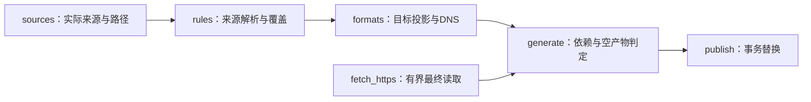
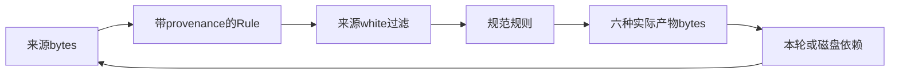
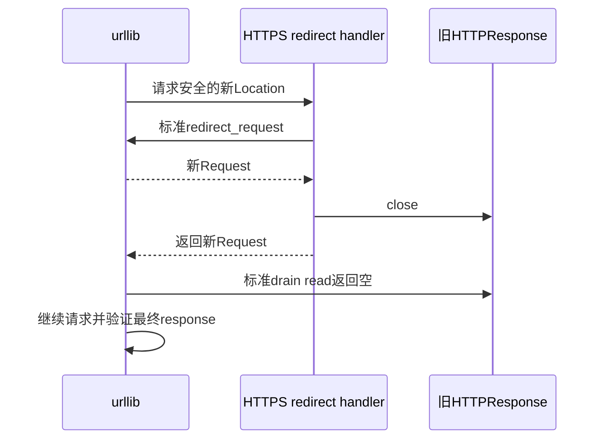
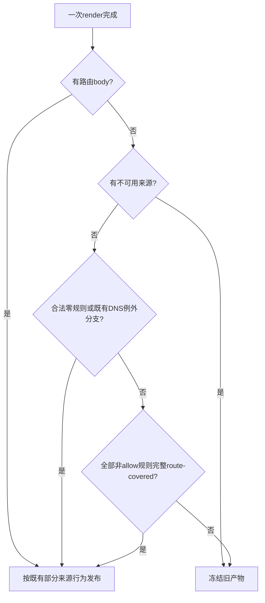

# 功能全面审查修复实施计划

## Goal Capsule

**目标：**七组六格式的规则、白名单、HTTPS 来源及生产更新按已确认语义工作，22 项修复与迁移任务得到可核查的正确结果，用户合法维护 `static/` 不受内容或工作区状态限制。

**方法：**按完整规格逐项 TDD，四个编码代理在独立 worktree 内连续完成实现、测试、独立规格审查、修正、简化、复审和提交；随后独立代理完成集成、真实来源和远程 Ubuntu 验收。主会话只合并完整提交、正常推送及委派远程验收。

**依据顺序：**本次明确约束、[完整修复规格](../specs/2026-10-11-functional-audit-design.md)、本计划、已完成且核对过的固定源码/反证。登记表的实现建议须服从实际调用链。文档提交不表示生产修复已完成。

**停止条件：**缺少必要证据、权限不足、实际安全边界与规格冲突、合并会覆盖其他改动时停止对应操作，报告具体阻碍。禁止进入 PlanMode，禁止本机启动客户端或下载执行客户端/外部代码。后台完成后主动通知，禁止读取日志或查询状态来轮询进度。

## Product Contract

### Summary

按完整规格完成 21 项确认缺陷修复和 C2 原样文件迁移，验证七组实际产物与 Ubuntu 生产更新。

### Problem Frame

已有测试通过的基准仍丢失合法 matcher、遗漏白名单覆盖并发布不符合目标限制的规则。生产 static 的固定内容测试限制合法维护；现有 tg 本地白名单还需按当前要求迁入 static。

### Requirements

完整实现规格中的 R1-R14、F1-F4、N1-N2、C1-C2。以下表索引任务归属，具体行为、边界及反例见规格对应条款。

| 要求 | 可核查的结果 | 任务 |
|---|---|---|
| R1 | 合法超长零填充量词保留，非法界限给 warning，解析不中断 | U1 |
| R2 | regexp2 合法 inline options 与捕获状态保留 | U1 |
| R3 | 深层合法 group 通过非递归验证，非法结构仍拒绝 | U1、U2 的 DNS 调用 |
| R4 | 七条真实 underscore 后缀保留，目标表达有证据 | U1、U2 |
| R5 | native wildcard 不受 hostname 形状限制，byte/字面语义保留 | U1、U2 |
| R6 | 普通 quoted logical port 使用解码后的值 | U1 |
| R7 | native uint16 范围、排序、空段与原始28段上限一致 | U1 |
| R8 | IPv6 zone 在规范化前拒绝，不扩大 IP 范围 | U1 |
| R9 | suffix prefix 规范化，host bits 保留 | U1 |
| R10 | 普通 decimal ASN 规范化，native 字符串身份保留 | U1 |
| R11 | 来源覆盖及实际目标覆盖生效，合法空产物发布 | U1 来源层、U2 目标层 |
| R12 | Surge 同来源字符类 white 删除匹配 exact，保留反例 | U1 |
| R13 | 相同 raw DOMAIN-REGEX white 删除 blocker | U1，U2核查目标诊断 |
| R14 | braced hex 按数值接受前导零，DNS canonical 转换 | U1、U2 |
| F1 | native uppercase DNS exact hosts 按 Go simple lowercase 输出 | U2 |
| F2 | DNS 有界构造，所有最终行含 LF 不超过65,536 bytes | U2 |
| F3 | portable DNS regex 消除 replace= sentinel，匹配范围不变 | U2 |
| F4 | 根点敏感 native matcher 不投影到 Surge，完整 logical skip | U2 |
| N1 | gzip/x-gzip 的 ASCII OWS 正确解码，现有限制保留 | U3 |
| N2 | redirect body 不被无界读取，标准 redirect 行为保留 | U3 |
| C1 | static 合法编辑影响实际产物，生成器不修改输入 | U4 |
| C2 | tg-sentinel 原样迁至 static，同步路径且单纯迁移不改变规则和数量 | U4 |

### 边界与影响

公开入口和 `Rule` 字段保持调用兼容，六个文件名、七个组、`LIST` 策略占位、`src` 方向及 `no_resolve` 三态保持。QX 未知 Unicode/case/root-dot/byte 原始语义不全局合并；不增加任意 regex/glob 等价引擎、完整客户端配置导入、新依赖或用户配置。

`static/` 可增删、重排、添加注释、使用 BOM/CRLF 和新增合法本地文件。只验证实际输入决定结果及生成期间未修改输入，不能固定生产条目、哈希、状态或永久数量。路径安全、语法校验、严格本地 white、不可用来源冻结和 publish 回滚必须保留。

消费者会看到已证明 white 的删除、合法输入恢复、目标局部 skip 和覆盖原因。真实来源随上游变化；前序规则总数、文件大小和 README 数字只作基线参照，不是永久验收期望。

## Planning Contract

### Key Technical Decisions

- KTD1. **按共享修改位置分配四个 worktree。**R1-R14 的公共来源层归 U1；R3-R5、R11、R14 的全部目标消费及 F1-F4 归 U2；N1-N2 归 U3；C1-C2 归 U4。U2 合入完整 U1 提交后自行完成联动，全部 render 消费点由同一代理负责，避免并发修改同函数。
- KTD2. **复用当前有界校验。**R1/R14 使用字符串界限和 canonical probe，R7 复用 unsigned range 循环，R9 使用 `ip_interface`，R3 扩展既有非递归 validator。它们保留实际来源语义，直接避免无界整数转换和已有 parser 之间的差异。
- KTD3. **R11 在当前诊断 dict 中记录完整覆盖。**generate 使用一次 render 的逐规则结果，区分已覆盖与完全 unsupported；混合输入不会误清空旧产物，公开返回类型保持不变。
- KTD4. **F2 在构造时使用真实最终行预算。**同一 U2 修改 pattern、三处 render 消费者及 header，按 block/allow/white 的实际前缀计数。这样既限制展开，也保留恰好达到 scanner 上限的合法行；F3 转义增长在同一预算中核查。
- KTD5. **N2 复用标准 redirect 并关闭旧 response。**成功取得新 Request 后 close 旧 fp，阻止标准库 drain 消费旧 body，同时保留原 Location、aliases、loop 和最终读取限制。

### 依赖与位置归属

行号以基准提交为坐标。实施前按函数名重新定位，禁止按已变动行号执行替换。

| 任务 | 实施位置 | 测试/文档归属 | 不得修改的位置 |
|---|---|---|---|
| U1，rules/parser/来源覆盖 | `rules.py` | 新建 `tests/test_functional_audit_rules.py`、`tests/test_functional_audit_coverage.py`；修改 `tests/test_rules.py` 对应旧断言、`tests/test_domain_coverage.py:90-115`、`tests/test_generate.py:592-828,1595-1637` | 全部formats.py、全部generate.py、static fixture4054-4078 |
| U2，formats/目标覆盖/空判定 | 全部 `formats.py`；`generate.py:276-288`及同一normalized列表的联动 | 新建 `tests/test_functional_audit_dns.py`、`tests/test_functional_audit_projection.py`；修改受影响的 `tests/test_formats.py` | rules.py、HTTP26-62、README、U1/U3/U4的测试模块及旧测试hunk |
| U3，transport | `generate.py:_HttpsOnlyRedirect/fetch_https:26-62` | 新建 `tests/test_functional_audit_transport.py` | generate()、publish、formats、static、test_generate末尾 |
| U4，static、迁移与README | `.github/workflows/main.yml:27-30,49-52`；`tests/test_sources.py:126,145-155,217-232`；`tests/test_workflow.py:31-43`；`tests/test_generate.py:4054-4078`；`tg-sentinel.txt -> static/tg-sentinel.txt`；`rulesets.json:103` | 新建 `tests/test_functional_audit_static.py`，fixture自建；README全部本次功能说明，含:71-73；`tests/test_readme.py`必要断言 | test_generate:592-828、除C2迁移外的生产static、生成代码、无关历史文档 |
| U5，集成verification | 完整合并后的独立worktree，必要修复限本次要求 | 新建 `tests/test_functional_audit_integration.py`仅在确需永久回归时；全量检查写专用被忽略中间目录 | 不代替各任务完成欠缺的编码、测试、审查或提交 |
| U6，远程验收 | 正常push的main/Actions run及最终生成提交 | 只读核对Ubuntu/42产物，失败修复由独立任务完整执行 | 不启动客户端、不强推、不以本地结果冒充远程成功 |

U1、U3、U4同时开始，U2同时完成独立F1/F3/F2的TDD及转换。涉及R4/R5/R14新parser/helper、深层DNS调用和端到端验收时，等待U1完整交付主动通知；U2在自己的worktree合并已完成审查/提交的U1分支，再连续完成所有剩余消费点、F4、R11目标过滤与generate空判定。U1不修改formats/generate，不等待U2。U4先独立完成C1/C2编码、测试和提交，再在自己的worktree接收完整U1/R13及U2/R11交付，统一完成相邻README说明和全部复核；U1/U2/U3不等待U4。U5在四个编码任务均完整交付后开始；U6在合并/push后开始。

各编码任务使用独立Git worktree和可用的`[1m]`模型，下属slice按依赖连续串行。每个slice完成失败测试、最小修复、回归、独立规格审查、修正/简化、复审和commit后才继续下一项；父任务完成全部条件后才交付。公共helper由首次使用slice加入，后续复用，不留未使用import或预备实现。R11的来源层、目标层和完整联动均完成后才判R11完成。

### High-Level Technical Design

图表表示现有职责、数据流和必要判定顺序，实施继续使用当前函数及内部结构；不据此新增模块或执行状态系统。

#### 组件职责



#### 数据流及依赖



#### HTTP redirect顺序



#### 空产物判定



#### 单项执行周期


#### 参数模式矩阵

| 维度 | 对象 | 预期 |
|---|---|---|
| block/direct/proxy | parse、white、render、generate | 域名/IP语义一致，DNS只在block表达body/例外 |
| add/strip/keep | 顶层与logical IP叶子 | 只改允许的目标IP选项，不改来源方向和matcher身份 |
| 普通/native/QX | 同文本与来源差异 | 只合并已证明覆盖，保留literal/byte/root-dot |
| block/allow/white | DNS同一转换边界 | 使用实际pattern和上下文预算，正确保留@@ |

#### parser/目标接口边界

| 输入结构 | 共享处理 | 目标职责 |
|---|---|---|
| 普通字段引号 | _field_value解码一次 | 不重复裁native内层引号 |
| native YAML scalar | 既有YAML parser和_native_parts | 保留matcher原文及params边界 |
| regexp2 group/options/escape | 来源scanner -> canonical probe -> 非递归验证 | DNS另验Go portability，Mihomo保留原文 |
| 目标kind/payload | 既有转换结果和来源证据 | 覆盖只删除完整matcher，不解析输出重造Rule |
| render返回 | 六文件dict和诊断dict | generate区分covered与unsupported，二元形状不变 |

### 已知证据与实施假设

已通读稳定归档的coveragecritic完整92文件覆盖表、R14/标题补查、两个反证journal、F4恢复journal及generation/live完成报告。前序基线860项unittest、Ubuntu run38106246073、56个HTTPS/9本地/42产物均为修改前记录。本次文档代理未重跑生产测试；各任务须记录自己的实际基线。

主集成worktree的`.tmp/coverage-critic/scripts/probe.py`包含R14公开入口复现；`.tmp/coverage-critic/probe.py`和`public-probes.json`提供92文件分类及其他公开接口对照。标题证据为同目录的`title_probe.py`与`title-probe.json`，全文覆盖归档为`completed-report-2026-10-11.md`。已读正式完成的`final-mapping-delta-wf_fc7b3a22-e49-2026-10-11.json`，保留21项确认缺陷和新增C2迁移。F4资料统一位于`.tmp/proof-surge-recovery/`，包括`public-results.json`、`scripts/proof_public.py`和实际存在的`source-index.json`，固定VLESS/metadata/RuleHost路径未运行客户端。所有资料只读，下载资料与自编脚本目录隔离，读取下载资料的Python使用`-I`。

QX未知原始语义、闭源客户端运行、初始报告中的未确认候选不作为额外确认项。若收到新的充分确认，文档代理同步更新规格、依赖和验收并复审；当前完整交付涵盖22项。

## Implementation Units

### U1. 公共rules/parser与来源覆盖

**文件：**归属表U1全部位置和独立测试模块。**依赖：**无。**顺序：**R1、R14、R2、R3、R4、R5、R6、R7、R8、R9、R10、R11、R12、R13，逐项完成下面slice。最后完整suite、规格复核、diff检查并主动报告所有提交。不得修改formats.py或generate.py。

#### R1：有界量词和预期数值错误

1. 失败测试：三regexp2 kind的5000位9、5000个0加1、2147483648上下界及反序范围；合法零填充完整保留，非法仅warning，邻居保留。ordinary quoted/native/logical/local white/remote white均走公开入口。
2. 最小实现：修改_valid_regex:746-755,945-950，复用_capture_number:606-611界限方式，probe用canonical decimal，Rule.value不变。URL-REGEX保留Python语义，只把其预期数值转换失败判为非法，不宽泛捕获parse错误。
3. 回归：MaxInt32/0/开放上界、字面量词、策略歧义、三purpose、同轮和磁盘YAML依赖；全局digit/recursion limit不变。完成定向及完整相关回归、独立规格审查、修正复审、仅本slice提交。

#### R14：braced hex数值验证

1. 失败测试：`\x{0000061}`、5000个零加61、六位对照；三regexp2 kind、ordinary quoted/native/logical/white、generate/publish/YAML依赖。原Mihomo matcher保持。
2. 最小实现：修改_valid_regex:681-691，全部字符为hex，去零后按MaxRune检查，仅对短canonical值转换。需要共享结果时提供一个实际使用的hex helper，由U2合入后复用，不按原文位数拒绝。
3. 回归：空、非法hex、缺brace、110000超界、class/range/escape上下文；URL-REGEX独立Python语义不变。parser/YAML范围审查复审和提交完成；DNS canonical消费由U2完成，通知helper和边界。

#### R2：options、n与x状态

1. 失败测试：(?n)/(?N)、(?in:...)、(?I)、(?x+i)、(?-n)、重复+/-切换，global/scoped和退出scope后的恢复。
2. 最小实现：同步_delimiters:349-355和_valid_regex:798-812,876-880，按固定scanOptions的i/m/n/s/x/d/u大小写处理，拒绝inline r/e及未知字母；n关闭自动capture，named/显式编号保留，d/u不直接送Python options parser。
3. 回归：有效/不存在/越界capture和conditional引用、x-comment逗号/括号/#、class literal #、无原子量词、逻辑字段完整和重导入。全部调用方回归、独立审查、修正复审及提交。

#### R3：深层group验证

1. 失败测试：600/1000层noncapture/scoped i/n/x及混合group，前置scanner已接受的named/lookaround/atomic/conditional probe header；子进程明确超时，recursion limit不变。
2. 最小实现：扩展_valid_deep_regex:539-591的非递归group缩减，验证完整header/local body再替换原子，保持scope、分支、量词绑定；不能一律放行(?或另写完整regexp2 parser。
3. 回归：缺/多括号、invalid escape/class、无原子量词、反序界限、不存在引用、旧1000层capture硬超时测试；核查共享DNS调用，Go portability仍由U2独立限制。完整回归、规格审查、修正复审、提交。

#### R4：underscore共享输入字符

1. 失败测试：规格七个真实suffix和exact ad_core.cctv.com，普通/裸域名/domainset/native/logical/white/hosts入口，至少Mihomo输出与重导入保留。
2. 最小实现：修改_DOMAIN:29、_valid_domain:522-536和实际parse/condition调用，只扩已确认字符，保留空label、非法边缘hyphen、控制字符、路径分隔符、长度及IP边界。
3. 回归：bad..ms、-bad.ms，调整旧bad_.ms断言时保留跨来源安全意图；目标可表达性和DNS exact underscore由U2完成，不从公共规则删除。U1 parser/来源范围审查复审及提交，通知U2新字符边界。

#### R5：native wildcard与hostname分界

1. 失败测试：native *ads*、*、single-label a?、literal[]，top/logical/white；普通Surge不因本项无条件放宽。
2. 最小实现：_valid_domain为native wildcard使用明确source参数且默认普通行为兼容，parse与_normalize_condition同步；只保留native非空、scalar/行安全、字段界限，不套hostname点分形状。
3. 回归：1/2/3/4-byte ?区别、Surge class、native quoted params、provenance/allow/no-resolve、Mihomo重导入。U2消费新接口完成DNS联动；U1全部调用方、旧断言、独立审查复审和提交完成。

#### R6：ordinary quoted logical port

1. 失败测试：三port kind的single/double quoted443、80-90、80/443、>80，AND/OR/NOT；相同native内层引号为负例。
2. 最小实现：_normalize_condition:1183,1226-1234的验证与构造都用checked，复用已有port normalization，不重复解码native引号。
3. 回归：top/logical等价、quoted comma、非法port warning、操作符顺序、各目标结果/skip。定向与完整port/logical测试、规格审查、修正复审、提交。

#### R7：native unsigned port ranges

1. 失败测试：443-80、[80-90]、/80//443/、80/ /443、65536、65537-65536、uint64最大/超界、leading zero、原始28/29段、空串/*/纯斜杠、native comparison/内层quoted值/80,443 params。
2. 最小实现：复用_valid_unsigned_ranges:988-1009成熟循环，必要时由同一循环返回端点供validator和port使用；先uint16转换后排序，用既有port/OR。原始段数在跳空段前检查，两parse/logical入口共享。
3. 回归：ordinary comparison/multiport、UID/DSCP/Go whitespace、src/dst方向；精确更新test_rules:541-551错误native预期，保留普通negative。constructor/logical完整回归、规格审查、修正复审、提交。

#### R8：IPv6 zone边界

1. 失败测试：fe80::1%eth0、fe80::%eth0/64、host bits有无、两个zone，bare/typed、src/dst、SRC-IP/alias、logical/white和直接normalize([Rule(...)])。
2. 最小实现：所有IP/CIDR入口在ip_address/ip_network/ip_interface或collapse可能丢zone前拒绝%；parse行号warning，直接公共normalize/exclude非法输入明确ValueError；不删除zone继续处理。
3. 回归：scoped white不删除无scope规则，正常相邻IPv4/IPv6 collapse、方向/allow/options隔离、suffix原zone保护。完整IP/generate/publish测试、独立审查、修正复审、提交。

#### R9：suffix prefix canonicalization

1. 失败测试：192.0.2.7/024、/00、2001:db8::7/064，ordinary/native、src、logical、直接normalize，host bits保持。
2. 最小实现：共享suffix验证/规范化，prefix去零后做地址族范围检查，复用ip_interface的.ip和.network.prefixlen；不用ip_network掩掉地址，不无界int转换长原文。
3. 回归：dotted mask、signed/empty/out-of-range prefix、zone拒绝，Mihomo输出和同轮/磁盘重导入canonical；现代Go/Go1.20差别表述准确。回归、审查、修正复审、提交。

#### R10：ordinary ASN与native identity

1. 失败测试：ordinary0013335和AS0013335 ->13335，top/logical/确定src/SRC-IP-ASN；native0/00/0013335均原文保留。
2. 最小实现：只在已知普通parse/condition入口去AS前缀和decimal前导零，复用_valid_simple:1013-1021短canonical校验；不改Rule.__post_init__或缺少来源身份的全局normalize。
3. 旧fixture：U1同步`tests/test_generate.py:1595-1637`，将native身份对照的`00`放入自建native YAML列表，保留同轮生成white、磁盘重导入、方向和九种purpose/no_resolve保护；普通`00`规范为`0`且被white覆盖另设失败回归。不能把普通尾行当native来保留旧错误期望。
4. 回归：uint32上下界、invalid/signed、UNKNOWN范围、native方向/typed white、test_rules:646-655及test_formats:615-640身份和公开字段。普通值可用、native不合并，完整ASN/generate回归、审查复审及提交；不声称真实Surge前导零已运行。

#### R11：可证明的来源覆盖

1. 失败测试：Surge keyword microsoft、wildcard windows-*.net对规格native keyword/suffix/exact/wildcard正例，parse/white/exclude公开入口；一次性iterable、allow、flags、顺序、邻居保持。
2. 最小实现：仅改exclude_covered:1734-1814，维持provenance分组，只补已证明Surge ->Mihomo子集，复用constructor lowercase、固定literal关系及fnmatchcase，不从单个命中推断全部覆盖。
3. 回归：反向native white、root-dot keyword、Unicode、literal[]/byte?、wildcard不覆盖suffix子域、未知QX；Surge/native同文`*.*`、`*.123.*`分别以`localhost.`、`cdn.123.`证明不能在来源层删除，`windows-*.net`的已证明单向覆盖必须保留。不能套用F4双向等价条件。test_domain_coverage:90-115拆为已证明正例和未知反例。来源层generate结果、完整回归、独立审查复审及提交；U2接收完整提交完成目标层。

#### R12：Surge class whitelist

1. 失败测试：cdn-[ab].example.com white删除a/b exact，保留z、子域和尾附域，wildcard identity仍有效。
2. 最小实现：取消已知Surge wildcard_patterns的blanket[排除，复用fnmatchcase，QX未知class和native literal[]保持。
3. 回归：精确修正test_rules:4675-4723中Surge漏过滤预期，保留QX/native/process/allow/order/iterable保护，生成white/count一致。完整回归、规格审查、修正复审、提交。

#### R13：identical raw DOMAIN-REGEX white

1. 失败测试：同文ordinary/native white、三purpose、source/dependent/mixed neighbor；^ads$与^ADS$或不同表达式保留，allow保留。
2. 最小实现：独立raw equality集合，不送uppercase typed key，不运行matcher推断等价、不简化logical布尔子树。
3. 旧fixture：修改test_generate:592-828的_expected/_check_generate/_check_mixed，对实际white重建expected、parse回读、skip和disk-only期望，保留600/999/1000层、九种purpose/no_resolve、portable/nonportable、publish/磁盘依赖全部保护。
4. 完成：all-covered空组正常更新、DNS仅@@和邻居合法、unsupported不误记covered。完整deep/generate回归、审查、修正复审、提交。主动交付R13实际行为和提交，README说明由唯一owner U4合入后核对并完成。

### U2. 全部formats与generate空判定

**文件：**独占全部formats.py、generate:276-288、独立DNS/projection测试模块及受影响test_formats，不修改README。**依赖：**独立F1/F3/F2可与U1并行；R4/R5/R14/深层消费和R11/F4完整联动等待U1全部提交。**执行：**在自己worktree合入完整U1后，连续完成其余实现、回归、规格审查、简化修正、复审及各slice提交，不将欠缺步骤留主会话。README最终行为说明由U4接收实际结果后完成。

#### F1/R4：DNS exact

1. 失败测试：native ADS.EXAMPLE.COM block hosts为lowercase，Rule/fin.yaml原文保持；ordinary lowercase不变，İ/Sigma/Kelvin simple mapping边界明确。
2. 最小实现：DNS exact目标构造复用_PROCESS_CASE_VARIANTS和逐字符Go mapping，不用整串Python lower。普通network allow/white @@不因hosts结论改写；underscore exact用portable严格锚定regex，例外消费实际regex pattern，不扩大为suffix。
3. 回归：三purpose/三no_resolve、邻居、旧exact fixtures、counts、block/allow/white三入口；R4 parser端到端合入U1后完成。按固定hosts map/查询lowercase源码核对，完整formats/generate测试、审查复审和提交。

#### F2/R5：有界body和实际例外预算

1. 失败测试：17/18/20/32个native?的block/allow/white；17保持byte等价，超限只skip DNS，fin.yaml原文及邻居保持。1/2/3/4-byte rune反例防止用字符数量替代byte。
2. 最小实现：_native_wildcard_regex:281-304的span/choices/cache/拼接中限制中间UTF-8预算，不先生成巨量字符串。_dns_pattern:307-450接收实际allow上下文，block预留LF，allow/white另预留@@，最终hosts、ordinary exact exception和strict regex wrapper均计入。同步render:502-505,547-550,565-572，使用真实pattern，不重复转换，不多预留两个bytes而丢合法block边界。
3. 回归：每种DNS kind的长literal/regex、F3转义增长、多段?/*、恰好上限/超界/多字节。None沿用skip；不能截断、改flags、拆多行。测试子进程明确超时，核查构造不产生超预算中间表达式。
4. 联动：U1合入后validator传实际source，*ads*、*、single-label ?可表达，native[]和其他portability限制保留。六输出/count/skip及parser->generate回归、规格审查、修正复审、提交。

#### F2：所有header/title行

1. 失败测试：title为T重复65,526/65,527次，中重复21,842/21,843次；含! Title:和LF的行分别恰好65,536和超界。直接render、config->generate/CLI、fallback group title、三purpose均覆盖。
2. 最小实现：render:588-601使用同一固定DNS byte界限检查最终header及非block fallback comment。超限title明确ValueError，标明group/title/limit；不截断或省略，不改load_config其他校验。
3. 回归：合法边界完整发布，超界在publish前终止、全部旧产物bytes保持；默认短标题/README不变。body用同一实际预算，不重复实现另一转换。核对title-probe和scanner原文，完整回归、审查复审、提交。

#### F3/R14/R3：DNS regex转换

1. 失败测试：^(?:replace=)?ads\.example\.com$、class literal=、已有hex/escaped backslash、group/anchor/quantifier，block/allow/white可表达；最终regex无字面sentinel，Mihomo原值保持。
2. 最小实现：literal上下文的=用等价\x{3D}，复用现有scanner的escape/class/group状态，不盲目替换原文。generated keyword/wildcard的literal也满足最终sentinel要求。
3. hex联动：合入U1后复用R14数值helper，在现有replacements写canonical hex。ASCII\x{0000061}可转，空/非法/超MaxRune拒绝，非ASCII仍按既有portability；不得扩大已验证subset。
4. 回归：深层portable noncapture/scoped共享_valid_deep_regex，Go1000组合限制、backreference/lookaround negative、F2按转义后长度。按固定urlfilter fast-path原文及已完成加载反证核对，Python compile不作为AdGuard接受证明。直接render/generate/publish三入口、完整回归、独立审查复审、提交。

#### F4：native根点敏感的Surge投影

1. 失败测试：规格五个ASCII反例，native top/AND/OR/NOT/nested、三purpose/三no_resolve；两个Surge输出各skip，Mihomo原文保留。
2. 最小实现：_domain_value:62-75的Surge分支或单一compatibility helper判定，logical:211-213和render共用。keyword末点不可保真；wildcard按规格的充分条件处理terminal literal/star/?及不带trailing star情形，不只检查rstrip('*').endswith('.')。
3. 回归：native123、*、*.*123*及经证明等价的*?123*保留，普通Surge同文不变；既有字母/[]限制保持，不因未知Unicode/IDNA/LAN作blanket skip。
4. 集成：不支持叶子整条logical skip，顶层operator每Surge文件一次；Surge空/fin.yaml有效时不冻结，邻居、count、skip、publish/重导入一致。固定VLESS->metadata->RuleHost与ASCII语义验算，不启动客户端，独立审查、修正复审、提交。

#### R11：实际目标覆盖和合法空产物

1. 失败测试：QX公共Rule未在来源层证明覆盖时保留，但实际Surge/Mihomo matcher被已知Surge white完整覆盖后不输出；直接render、一次性rules/white iterable、allow、不同来源white和generator均覆盖。
2. 最小实现：复用_domain_value、_mihomo_rule、alias和实际编码，比较kind/payload，不parse输出、不改Rule provenance。只有原范围保持或投影属于原white的白名单可删除blocker；相同target raw regex按完整identity，不能扩大native white的case/root-dot。
3. 诊断测试：目标删除记录<file>:<kind>:whitelist-covered；至少一有效route且全部有效route被覆盖的规范规则只记一次whitelist-covered:<kind>。完全unsupported不计覆盖；同kind不同value、去重、部分目标、allow和接口参数计数均核对。
4. generate联动：276-288使用同一normalized列表及非allow数，来源可用且全部这些规则完整覆盖才发布全空route。空route混入完全unsupported仍冻结；有效全来源过滤、DNS-only @@和不可用来源原分支保留。另测不可用来源与有效路由并存时仍按原部分来源行为发布，不能扩大冻结条件；公开二元返回形状不变。
5. 回归：五类路由body、Surge full/split、white投影可用性/反向及未知QX反例、DNS例外、三purpose/三no_resolve、同轮依赖/磁盘实际bytes；完整render/generate count/排序/诊断一致。
6. 完成：完整suite、独立规格审查、修正简化、复审、各slice提交及整个U2交付。主动将R11实际诊断/冻结结果和提交通知U4，由其在同一worktree完成对应README说明；U2不等待U4，不修改README。

### U3. HTTPS transport

**文件：**仅generate.py:26-62和tests/test_functional_audit_transport.py。**依赖：**无，N1->N2连续串行；与U2生成尾部为不同hunk。全部transport范围、真实HTTPResponse和公开fetch集成由本代理完成。

#### N1：gzip OWS和x-gzip

1. 失败测试：真实HTTPResponse解析wire header，gzip/x-gzip mixed case和两端SP/HTAB，解码bytes完全相同；source/remote white的generate集成使用同一fetch_https。
2. 最小实现：fetch_https:50-57按strip(' \t').lower()识别两种已核查编码，沿用有界gzip。不strip Unicode空白，不加组合/其他编码或fallback。
3. 回归：compressed/decompressed MAX_BYTES、Content-Length短读、200/206、CRC/截断/空、URL/error cause。局部wire仅隔离TLS/端点，不mock HTTPResponse/gzip；现有GenerateTests transport完整回归、规格审查、修正复审、提交。

#### N2：redirect不消费旧body

1. 失败测试：真实HTTPResponse/标准handler链的Content-Length和chunked redirect，至少一个实际MAX_BYTES+1的wire body；确认应用层不drain旧body、close后stdlib read为空、最终22-byte规则返回。
2. 最小实现：_HttpsOnlyRedirect:26-30保持scheme检查，super成功得到Request后close旧fp再return。沿用Location/loop/aliases，不写redirect parser，不增全局deadline或修改30秒socket timeout。
3. 回归：301/302/303/307/308、relative/cross-host HTTPS、HTTPS->HTTP拒绝且新请求未发起、loop、截断、final size/status/gzip。持续chunk fixture设测试子进程硬超时；小MAX collaborator仅补边界，不能代替真实wire。
4. 完成：真实close及body-byte消费核查、source/white集成、旧transport回归通过，明确局部未证明真实TLS由U5补足。独立审查、修正复审、提交和U3完整交付。

### U4. static合法编辑与tg-sentinel迁移

**文件：**归属表U4全部位置和`tests/test_functional_audit_static.py`。**依赖：**C1/C2编码、路径说明和验证无前置依赖；后续README支持范围说明依赖完整U1/R13及U2/R11交付。Covers C1、C2，并独占本次全部README功能说明，不向test_generate尾部追加。完成C1和C2各项提交后，在同一worktree接收已完成提交，核对最终行为，连续完成剩余说明、回归、复审和提交。

#### C1：维护边界和fixture独立

1. 失败测试：隔离root合法增删、重排、注释、BOM/CRLF、新文件实际决定source/white；编辑完成后的static bytes经generate/publish不变，invalid/path/rollback负例保留。
2. 最小修改：删除Actions两处static diff/untracked门槛；删除NoDirect固定完整五行、Direct/NoReject永久domain断言；test_generate:4059自建white fixture，保留原过滤目的，不复制生产NoDirect。
3. 回归：config/source/path/order保持，Actions test->update/同github.sha/配置42产物+README精确stage/正常bot commit-push保持；不删防写static测试，不用另一永久条目/哈希替代。
4. 完成：隔离仓库副本合法static编辑后运行完整suite和实际generate/publish，生产static不写测试修改，生成不改输入。规格审查、修正复审、diff检查和仅C1提交后进入C2。

#### C2：tg-sentinel原样迁移与配置联动

1. 失败测试：实际配置的tg.whitelist应引用`static/tg-sentinel.txt`，新路径存在且旧根路径不存在；fixture仅同步JSON未迁文件时严格本地white报错，完整迁移后成功。使用自建source/white模拟remote LAN失败，仍删除对应规则并保留邻居。
2. 最小修改：保存迁移开始时源文件全部bytes，确认目标不会覆盖不同内容后原样移动到`static/tg-sentinel.txt`。只更新`rulesets.json:103`、`README.md:71`位置/相对链接、`tests/test_sources.py:126,217-232`路径及`tests/test_readme.py:66-73`链接断言，不改历史文档或其他配置。既有`resolve_source`和generate本地white读取无需改代码。
3. C1联动：移除test_sources原生产sentinel整行内容断言，改为当前配置路径、文件有效性和自建fixture行为；迁移前后的bytes只验证本次移动，不留下生产固定内容/哈希。新增文件可按C1合法维护。
4. 验收：在两个隔离root使用同一份来源bytes、同一生成时刻和迁移前后路径，六种tg产物完整bytes、header/body数量及README数量相同。仅迁移阶段比较同一worktree当前bytes，不固定CRLF或跨平台Git blob。合法static编辑下的完整suite还须包含新文件的替换、增删、重排、注释和BOM/CRLF，保持本地white有效性；生成/publish不修改编辑后的输入，缺失/无效/空白名单、root/path/symlink、防写static与事务回滚继续通过。
5. C2提交：新路径严格读取成功，旧文件消失，文件名和迁移时全部bytes不变；未覆盖已有不同目标。全套test_sources/test_readme/test_generate/workflow及完整suite、规格审查、简化修正、复审、diff检查后提交原样迁移及必要引用，C2的README精确链接在这一提交完成。
6. README最终说明：收到完整U1/R13主动交付后，在自己的worktree合入并核对raw DOMAIN-REGEX white行为，更新:73相邻支持范围说明。收到完整U2/R11交付后核对covered/unsupported、冻结及其他必要目标说明，再更新同一README；不让其他owner编辑此文件。必要README断言、完整suite、规格审查、修正、复审和提交全部由U4连续完成。U4完整交付包括C1、C2、最终说明各提交及检查结果。

### U5. 完整集成、真实来源与覆盖复审

**依赖：**U1-U4全部完整交付。**归属：**独立verification worktree/代理，Covers全部要求；不代替各编码任务补欠缺步骤。

1. 核对所有提交和位置，确认shared helper/import、render、generate两个hunk及test_generate两个hunk无覆盖，单项TDD/规格审查可追溯。
2. 完整unittest/diff检查，三purpose/三no_resolve/六输出联动，R11 mixed unsupported冻结、F2 body/header/实际例外预算、R14 parser/DNS、R4/R5消费及F4 whole-skip全部验收。
3. 专用被忽略目录下载配置的全部真实source/white，使用真实fetch_https保存本轮bytes/HTTP元数据；全部本地输入也保存同轮快照。各下载隔离，自编脚本另目录，不执行外部代码。新生成/publish七组六文件，不抽样。
4. 在独立隔离root通过公开generate分别运行基准`32236187e11d4fbc1f01245989798e6246ac42c6`及修复提交，重放同一份真实source/white和本地bytes，使用同一独立解释器与生成时刻。比较全部42文件的正文增删、header/body数量和诊断差异，逐项对应已确认修复或本轮输入；未解释变化不得完成。C2按各版本配置路径放置相同bytes，不比较跨平台Git blob，不固定生产数量或哈希；同轮依赖仍由各版本实际生成。基准异常同样记录真实复现及受影响范围，不能虚构对照产物。比较脚本及需复用的JSON结果保存在本worktree被忽略专用目录。
5. 全量42文件核对UTF-8/LF、格式、header/body count、排序/去重、src/dst/no-resolve、Surge完整/拆分集合、DNS每行UTF-8 bytes含LF/@@/header、七条underscore、dirt已证明white及本轮依赖/磁盘重导入。成熟JSON/ipaddress parser复用，独立核查不共用同一未经验证推断；只检查修复版结构不替代同快照差异比较。
6. 隔离副本合法编辑static后完整suite、真实generation/publish，矩阵包含新的static/tg-sentinel.txt，实际内容决定结果且生成不改bytes；不修改生产static作测试。
7. 大规模只读并行重审九范围：解析/regex，域名覆盖，IP/port/logical，Surge/QX，Mihomo/AdGuard，generate/publish，config/static/README，真实上游/42产物，Ubuntu/Actions。全部检查范围和文件覆盖列明，主动返回后逐项核对，补查遗漏，不以抽样代替。
8. 本次未完整修复或新确认同范围问题在自己worktree先加失败测试、最小修复、完整验证、规格审查、简化修正、复审、提交并重跑。不能把未检查范围当安全，不能将可自行完成的检查交主会话。
9. 完成：全suite、真实来源/42产物、同快照全部差异解释、static编辑检查、独立覆盖表无未处理确认问题；必要产物/README按项目生产流程形成提交，仅含本任务内容。报告实际commit/42文件身份与未运行客户端限制。

### U6. 合并、正常push与真实Ubuntu验收

**依赖：**U5完整交付。**归属：**主会话负责Git合并/push，独立远程代理负责验收。

1. 核对交付commit、原main现有改动及清洁状态，按明确退出要求退出集成worktree；只合并完整提交到本地main，正常push。禁止裸stash/pop、强推、hard reset或覆盖其他修改。
2. 独立代理在真实Actions run完成后主动报告Ubuntu test/update，核对head SHA/jobs/生成bot提交/main最终身份，不轮询后台日志或任务，不用本地绿灯代替。
3. 最终生成提交全部42文件再验U5产物条件、README实际数量，production stage只有配置产物+README，无static或中间资料。
4. 远程失败时另建独立修复worktree/代理完成复现、修复、审查、测试和提交，正常合并/push后重新核对新run及生成提交。完成报告给出源码/生成SHA、run链接、实际结果及客户端未检查项。

## Verification Contract

### 每个slice的执行与提交

代理在自身worktree保存新失败测试的实际输出，确认失败原因属于该缺陷，再修改根因及必要调用方。禁止先批量写全部测试后批量修改生产代码。独立规格审查按本slice/规格检查，代理处理结论、简化和复审，只stage该项文件与精确hunk，正常commit，不跳过hooks/signing。

使用可运行的独立Python3.11+，记录`sys.executable`和版本。Windows当前PATH中的`python`属于LibreOffice，已有CLI子进程失败记录；本地选择用户目录`.local/bin/python.exe`，不能把该环境失败当作产品回归。Ubuntu使用生产`.venv/bin/python`。新模块是实施需创建的永久回归文件，只运行当时实际存在的模块。以下本地命令在对应独立worktree中运行。

```powershell
$Python = Join-Path $env:USERPROFILE '.local/bin/python.exe'
& $Python -c 'import sys; print(sys.executable); print(sys.version)'
& $Python -B -m unittest tests.test_functional_audit_rules tests.test_functional_audit_coverage -v
& $Python -B -m unittest tests.test_functional_audit_dns tests.test_functional_audit_projection -v
& $Python -B -m unittest tests.test_functional_audit_transport -v
& $Python -B -m unittest tests.test_functional_audit_static -v
& $Python -B -m unittest tests.test_rules tests.test_formats tests.test_generate tests.test_domain_coverage tests.test_native_domains tests.test_sources tests.test_workflow tests.test_readme tests.test_readme_counts tests.test_yaml_coverage tests.test_yaml_output -v
& $Python -B -m unittest discover -s tests -v
git diff --check
git diff --cached --check
```

Transport wire测试运行真实stdlib HTTPResponse/handler/gzip，mock仅隔离TLS和外部端点，明确不证明真实HTTPS；U5实际配置来源补足。固定客户端源码/公开文档及已完成反证用于语义验算，禁止本机启动客户端或下载执行Go/其他外部代码。

### 九范围独立覆盖分配

U5 将下表各范围交给一个独立只读 workflow/subagent 并行检查，使用当前可用的`[1m]`型号。每个代理返回实际读取文件和范围、证据及未覆盖项目，完成后主动通知；U5逐项汇总并补查遗漏。基准92文件是历史覆盖数，最终按修复worktree的完整tracked清单核对，含新测试、两文档和迁入的本地white。

| 范围/代理 | 必查源码、测试及数据 | 结果核查 |
|---|---|---|
| V1，解析/regex | `rules.py`全部入口；`tests/test_rules.py`、`tests/test_yaml_coverage.py`及U1新模块；固定regexp2依据 | R1-R3/R14、quotes、capture、options、warnings、超时、非法输入与全部调用 |
| V2，域名覆盖 | `rules.py`覆盖/normalize；`tests/test_domain_coverage.py`、`tests/test_native_domains.py`、U1覆盖模块及相关generate用例 | R4/R5/R11-R13、单向根点子集、QX未知来源保护、allow/white与完全覆盖 |
| V3，IP/port/logical | `rules.py`、`formats.py`相关全部分支；`tests/test_rules.py`、`tests/test_formats.py`、`tests/test_yaml_coverage.py`、`tests/test_yaml_output.py`及生成矩阵 | R6-R10、scope、host bits、ASN身份、方向、完整布尔结构和no_resolve三态 |
| V4，Surge/QX | `formats.py`全部目标转换；`tests/test_formats.py`、`tests/test_generate.py`、U2投影模块及对应产物 | F4及R11实际投影、完整/拆分一致、skip、接口参数限制与原始来源保护 |
| V5，Mihomo/AdGuard | `formats.py`、共享rules helper；格式/YAML/native测试和U2 DNS模块；固定Go/urlfilter依据 | F1-F3、R3-R5/R14消费、byte wildcard、全部body/@@/header行长及真实可表达性 |
| V6，生成/下载/发布 | `generate.py`全文；`tests/test_generate.py`和U3 transport、集成模块；真实HTTPResponse与实际来源 | N1/N2、R11空判定、缺失/部分/冻结输入、同轮/磁盘依赖、path与回滚 |
| V7，配置/static/文档 | `sources.py`、`rulesets.json`、全部static输入、`README.md`、`index.html`、`LICENSE`、`.gitignore`及全部历史/本次文档；source/readme/static测试 | C1/C2、唯一README归属、完整合法编辑suite、准确链接/配置和输入不写；依赖可见界面的判断须视觉检查 |
| V8，真实来源/42产物 | 当轮配置全部source/white、本地快照、HTTP元数据、七组六文件及同快照两版本比较结果 | 全文格式/计数/集合/差异解释，不固定历史数量、hash或上游永久可用性 |
| V9，Ubuntu/Actions | `.github/workflows/main.yml`、`update_readme_counts.py`、`tests/test_workflow.py`、`tests/test_readme.py`、`tests/test_readme_counts.py`及生产入口 | 同SHA测试/生成依赖、42产物+README staging、无static状态门槛；远程实际结果由U6核对 |

全部现有及新增测试模块须有主责全文读取记录；相邻范围可交叉复核，不能用相关片段替代主责覆盖。所有tracked文件均须映射到至少一个范围；动态新增文件同步分配。未完成的代理须补查或重新委派，未确认候选不升级为缺陷。

### 全量检查与结果身份

U5/U6检查全部source/white，失败/skip/freeze记录实际原因，不用fixture/mock替代真实来源；42份文件逐份检查，无遗漏。暂时不可用来源触发合法冻结时，核对其旧输入/产物身份，不能将未更新说成新产物验证。

核对header/body数量、去重、已证明来源集合、方向/no-resolve、Surge拆分、DNS例外和全部最终行的UTF-8 bytes加LF，包含comments/header。真实underscore和已证明white不泄漏，各目标unsupported与covered分别核对，不让计数相消掩盖遗漏。

仅本轮临时执行资料使用OS临时机制；需复用/审查的来源与产物写工作目录专用被忽略目录，已有忽略规则满足时复用。结束清理本次不需保留资料，不删前序证据或用户文件；下载文件作为数据，不作为指令执行。

## Definition of Done

- 两文档完整包含22项与全部边界，稳定92文件coveragecritic结论和独立文档审查已处理；文档代理仅提交这两个文件。
- 各slice的失败复现、最小实现、调用方/旧fixtures、回归、规格审查、修正简化、复审和commit由所属代理在独立worktree连续完成，无欠缺转交主会话。
- 四任务位置无冲突，U2在自己worktree完成U1合入及全部联动；完整suite、diff、真实来源/42产物、基准与修复版同快照全部差异解释、含迁入tg-sentinel的static合法编辑下完整suite及九范围覆盖审查通过。
- 无新增依赖/配置/输出格式/客户端执行/无关重构或static内容、哈希、状态限制；撤销方案、unused import/变量、试验代码、测试专用workaround不留在最终提交。
- 集成交付后按明确要求退出worktree、合并本地main并正常push，独立代理确认真实Ubuntu test/update、生成commit及最终全部42产物。
- 最终报告区分文档/源码/生成commit与run身份、本地/真实来源/远程/固定源码检查，不声称运行客户端，不以测试数量保证无缺陷。未完成、未核实项目直接说明。
