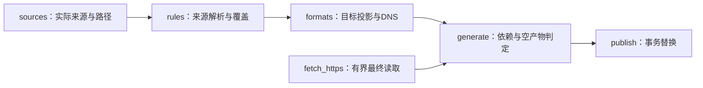
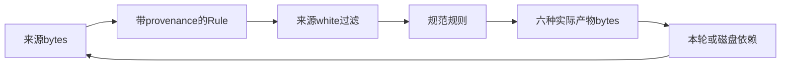
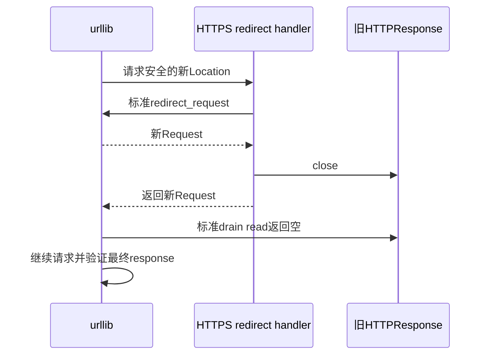
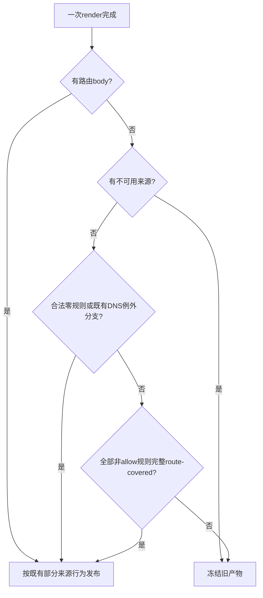

# 功能全面审查修复实施计划

## 当前域名输出要求（2026-10-20）

普通来源和 Surge 的 `DOMAIN`／`DOMAIN-SUFFIX` 在 Mihomo classical 输出中直接使用原生规则，接受 Mihomo 原生 case／root 行为，并按最终标量去重。Rule 来源身份继续用于其他目标及 DNS；真实 raw regex、必要 keyword／wildcard 转换和其余已完成修复保持。

下文 U5D1、KTD6 及 S1 中要求 ordinary paired-class／双 arm suffix 的步骤保留为历史实施记录，当前执行服从本节和规格的同日期要求。真实 raw paired 输入的严格结构证书和有限覆盖判断仍需验证，不从生成文件恢复旧来源。验收使用公开 parse／render 的失败回归、原完整 suite、同一封存输入与固定时间的真实 generate／publish、全部 42 份输出及独立规格／正确性审查；固定快照产物只用于验证。

## Goal Capsule

**目标：**七组六格式、白名单、HTTPS 来源及生产更新按已确认语义工作。原 22 项任务和 V6 static alias、V4 wildcard 根点两个 fix 已完整提交；当前在 fe96/tree `916ce25ddc10fddcc2a7b4acfc5af01263fc032f` 上完成规格 U5D1-U5D4，再完成新候选 U5 和真实 Ubuntu U6。static 的合法内容和状态不受固定断言限制。

**方法：**本轮由独立 worktree 的一个编码 workflow 串行负责重叠的 formats 修改，按下文 S1-S4 连续完成公开 seam red -> minimal green、调用方/旧 fixture、相关回归、独立规格与正确性审查、修正简化、复审和正常英语提交。独立部分的只读审查并行；主会话只合并完整交付，不补未完编码。U1-U4 条款保留为已完成任务的范围和审计记录，不重新执行。

**依据顺序：**本次明确约束、[完整修复规格](../specs/2026-10-11-functional-audit-design.md)、本计划、已完成且核对过的固定源码/反证。登记表的实现建议须服从实际调用链。文档提交不表示生产修复已完成。

**停止条件：**缺少必要证据、权限不足、实际安全边界与规格冲突、合并会覆盖其他改动时停止对应操作，报告具体阻碍。禁止进入 PlanMode，禁止本机启动客户端或下载执行客户端/外部代码。后台完成后主动通知，禁止读取日志或查询状态来轮询进度。

## Product Contract

### Summary

保留已完成的 21 项缺陷修复和 C2 原样迁移，在其完整提交 fe96 上完成 U5D1-U5D4 的有限-profile 投影修复，验证新候选七组实际产物与 Ubuntu 更新。Surge Unicode/IDNA 全域等价、一般 canonical 反向转换和完整 Surge white 等价视图不列为修复承诺；其余明确边界不减少。

### Problem Frame

fe96 已包含原 22 项交付、static 合法维护和 tg-sentinel 原样迁移。后续独立反证确认 native 与 Surge/DNS 在可达 raw Host 的 case/root 上不同，DNS wire presentation 还改变部分 literal/regex 的匹配。当前修改针对这些已确认的目标转换及其 white/bytes/诊断调用方，未证明的闭源 Unicode/IDNA 保持未知。

### Requirements

原 R1-R14、F1-F4、N1-N2、C1-C2 的任务归属及回归条件保留。当前 U5D1-U5D4 细化实际入口的 case/root/wire 行为，F1 的 constructor-only DNS 预期按完整证据更正，F2/F3 的构造与加载正例继续实际验收。下表和规格共同约束新候选，不把旧绿灯用于批准新树。

| 要求 | 可核查的结果 | 任务 |
|---|---|---|
| R1 | 合法超长零填充量词保留，非法界限给 warning，解析不中断 | U1 |
| R2 | regexp2 合法 inline options 与捕获状态保留 | U1 |
| R3 | 深层合法 group 通过非递归验证，非法结构仍拒绝 | U1、U2 的 DNS 调用 |
| R4 | 七条真实 underscore 后缀保留，目标表达有证据 | U1、U2 |
| R5 | native wildcard 不受 hostname 形状限制，byte/字面语义保留 | U1、U2 |
| R6 | 普通 quoted logical port 使用解码后的值 | U1 |
| R7 | native uint16 范围、排序、空段与原始28段上限一致 | U1 |
| R8 | IPv6 zone 在规范化前拒绝，不扩大 IP 范围 | U1 |
| R9 | suffix prefix 规范化，host bits 保留 | U1 |
| R10 | 普通 decimal ASN 规范化，native 字符串身份保留 | U1 |
| R11 | 来源覆盖及实际目标覆盖生效，合法空产物发布 | U1 来源层、U2 目标层 |
| R12 | Surge 同来源字符类 white 删除匹配 exact，保留反例 | U1 |
| R13 | 相同 raw DOMAIN-REGEX white 删除 blocker | U1，U2核查目标诊断 |
| R14 | braced hex 按数值接受前导零，DNS canonical 转换 | U1、U2 |
| F1 | 已完成 constructor lower 修复；本轮 native exact/suffix 按完整 case/root 证据在 DNS unsupported，普通正确 literal 保留 | 原 U2，当前 S2 |
| F2 | DNS 有界构造，所有最终行含 LF 不超过65,536 bytes | U2 |
| F3 | portable DNS regex 消除 replace= sentinel，匹配范围不变 | U2 |
| F4 | 根点敏感 native matcher 不投影到 Surge，完整 logical skip | U2 |
| N1 | gzip/x-gzip 的 ASCII OWS 正确解码，现有限制保留 | U3 |
| N2 | redirect body 不被无界读取，标准 redirect 行为保留 | U3 |
| C1 | static 合法编辑影响实际产物，生成器不修改输入 | U4 |
| C2 | tg-sentinel 已原样迁至 static，保留路径、单纯迁移不改变数量及合法编辑回归 | 原 U4，当前 U5 |
| U5D1 | native exact/suffix 的 Surge 局部 skip，Surge ASCII literal 的 Mihomo paired-class/profile 投影，非 ASCII legacy 不变 | S1 |
| U5D2 | DNS 三消费者统一 case/root 判定，覆盖 exact exception 快路径、无字母 root 及 native * 正例 | S2 |
| U5D3 | DNS 完整 actual raw matcher 的闭合 scanner 证书、rune/byte presentation 有界编码及未知结构局部 unsupported；取消非成员原输出 fallback，保留可证 regex、k/i aliases、A/B/C 和原控制 | S2、S3 |
| U5D4 | actual white 完整包含、分流与原 kind 诊断、一次 global covered、真实 source/white bytes、冻结和 README | S1、S4、U5 |

### 边界与影响

公开入口和 `Rule` 字段保持调用兼容，六个文件名、七个组、`LIST` 策略占位、`src` 方向及 `no_resolve` 三态保持。QX 未知 Unicode/case/root-dot/byte 原始语义不全局合并；不增加任意 regex/glob 等价引擎、完整客户端配置导入、新依赖或用户配置。

`static/` 可增删、重排、添加注释、使用 BOM/CRLF 和新增合法本地文件。只验证实际输入决定结果及生成期间未修改输入，不能固定生产条目、哈希、状态或永久数量。路径安全、语法校验、严格本地 white、不可用来源冻结和 publish 回滚必须保留。

消费者会看到已证明 white 的删除、合法输入恢复、目标局部 skip 和覆盖原因。真实来源随上游变化；前序规则总数、文件大小和 README 数字只作基线参照，不是永久验收期望。

## Planning Contract

### Key Technical Decisions

KTD1-KTD5 记录已完成 U1-U4 的设计和保留边界；KTD6-KTD8 规定本轮规格 U5D1-U5D4 与实施 S1-S4。前序 U2 审计里的 D1-D4 是其已完成 slice 名称，本轮编号不改写或重开这些记录。

- KTD1. **按共享修改位置分配四个 worktree。**R1-R14 的公共来源层归 U1；R3-R5、R11、R14 的全部目标消费及 F1-F4 归 U2；N1-N2 归 U3；C1-C2 归 U4。U2 合入完整 U1 提交后自行完成联动，全部 render 消费点由同一代理负责，避免并发修改同函数。
- KTD2. **复用当前有界校验。**R1/R14 使用字符串界限和 canonical probe，R7 复用 unsigned range 循环，R9 使用 `ip_interface`，R3 扩展既有非递归 validator。它们保留实际来源语义，直接避免无界整数转换和已有 parser 之间的差异。
- KTD3. **R11 在当前诊断 dict 中记录完整覆盖。**generate 使用一次 render 的逐规则结果，区分已覆盖与完全 unsupported；混合输入不会误清空旧产物，公开返回类型保持不变。
- KTD4. **F2 在构造时使用真实最终行预算。**同一 U2 修改 pattern、三处 render 消费者及 header，按 block/allow/white 的实际前缀计数。这样既限制展开，也保留恰好达到 scanner 上限的合法行；F3 转义增长在同一预算中核查。
- KTD5. **N2 复用标准 redirect 并关闭旧 response。**成功取得新 Request 后 close 旧 fp，阻止标准库 drain 消费旧 body，同时保留原 Location、aliases、loop 和最终读取限制。

- KTD6. **U5D1 只增加已证 ASCII profile。**显式 `(?-i:)` 和 ASCII paired classes 关闭 regexp2 的额外 Unicode alias；suffix 的原 case-sensitive arm 完整保留非 ASCII legacy。全 render/white/重导入是否不回归另行验收，不能从单 matcher 直接推得。
- KTD7. **U5D3 为完整 matcher 发放闭合结构证书并编码。**复用 DNS scanner 的既有 group/alt/class/repeat 摘要、固定 lower/range helpers 和预算；byte wildcard 用 T，rawregex 原子用实际来源 rune 集合的 E，case/root 证书与最终目标成本全部通过才输出。中性 group 继承证书，alternation 不漏分支，未获证书统一 DNS unsupported，禁止非成员旧输出 fallback。只做固定深度 UTF-8/decimal 目标编码，不增加一般 regex parser/AST/等价引擎、decoder/client matcher、新 cache/sidecar/公共类型/配置/依赖；被替代的 rune-width 实现删除。
- KTD8. **U5D4 逐目标证明完整包含。**新 paired family 的有限识别只用于 actual-native 语义；不反向恢复 Surge，不建完整 Surge white 视图。white 可用、target blocker 属于 actual target white 两项同时满足才删除。canonical k 与部分 suffix white 的 K.TEST/K.test. 反例永久保留。

### 依赖与位置归属

U1-U4 表及其单元内行号是原基准坐标，属于已完成归属记录；当前 U5D1-U5D4 以 fe96 的函数名重新定位，不按旧行号替换。新修改只由下文 S1-S4 的 owner 写入，原 U1-U4 不重新启动。

| 任务 | 实施位置 | 测试/文档归属 | 不得修改的位置 |
|---|---|---|---|
| U1，rules/parser/来源覆盖 | `rules.py` | 新建 `tests/test_functional_audit_rules.py`、`tests/test_functional_audit_coverage.py`；修改 `tests/test_rules.py` 对应旧断言、`tests/test_domain_coverage.py:90-115`、`tests/test_generate.py:592-828,1595-1637` | 全部formats.py、全部generate.py、static fixture4054-4078 |
| U2，formats/目标覆盖/空判定 | 全部 `formats.py`；`generate.py:276-288`及同一normalized列表的联动 | 新建 `tests/test_functional_audit_dns.py`、`tests/test_functional_audit_projection.py`；修改受影响的 `tests/test_formats.py` | rules.py、HTTP26-62、README、U1/U3/U4的测试模块及旧测试hunk |
| U3，transport | `generate.py:_HttpsOnlyRedirect/fetch_https:26-62` | 新建 `tests/test_functional_audit_transport.py` | generate()、publish、formats、static、test_generate末尾 |
| U4，static、迁移与README | `.github/workflows/main.yml:27-30,49-52`；`tests/test_sources.py:126,145-155,217-232`；`tests/test_workflow.py:31-43`；`tests/test_generate.py:4054-4078`；`tg-sentinel.txt -> static/tg-sentinel.txt`；`rulesets.json:103` | 新建 `tests/test_functional_audit_static.py`，fixture自建；README全部本次功能说明，含:71-73；`tests/test_readme.py`必要断言 | test_generate:592-828、除C2迁移外的生产static、生成代码、无关历史文档 |
| U5，集成verification | 完整合并后的独立worktree，必要修复限本次要求 | 新建 `tests/test_functional_audit_integration.py`仅在确需永久回归时；全量检查写专用被忽略中间目录 | 不代替各任务完成欠缺的编码、测试、审查或提交 |
| U6，远程验收 | 正常push的main/Actions run及最终生成提交 | 只读核对Ubuntu/42产物，失败修复由独立任务完整执行 | 不启动客户端、不强推、不以本地结果冒充远程成功 |

U1、U3、U4同时开始，U2同时完成独立F1/F3/F2的TDD及转换。涉及R4/R5/R14新parser/helper、深层DNS调用和端到端验收时，等待U1完整交付主动通知；U2在自己的worktree合并已完成审查/提交的U1分支，再连续完成所有剩余消费点、F4、R11目标过滤与generate空判定。U1不修改formats/generate，不等待U2。U4先独立完成C1/C2编码、测试和提交，再在自己的worktree接收完整U1/R13及U2/R11交付，统一完成相邻README说明和全部复核；U1/U2/U3不等待U4。U5在四个编码任务均完整交付后开始；U6在合并/push后开始。

各编码任务使用独立Git worktree和可用的`[1m]`模型，下属slice按依赖连续串行。每个slice完成失败测试、最小修复、回归、独立规格审查、修正/简化、复审和commit后才继续下一项；父任务完成全部条件后才交付。公共helper由首次使用slice加入，后续复用，不留未使用import或预备实现。R11的来源层、目标层和完整联动均完成后才判R11完成。

### High-Level Technical Design

图表表示现有职责、数据流和必要判定顺序，实施继续使用当前函数及内部结构；不据此新增模块或执行状态系统。

#### 组件职责



#### 数据流及依赖



#### HTTP redirect顺序



#### 空产物判定



#### 单项执行周期


#### 参数模式矩阵

| 维度 | 对象 | 预期 |
|---|---|---|
| block/direct/proxy | parse、white、render、generate | 域名/IP语义一致，DNS只在block表达body/例外 |
| add/strip/keep | 顶层与logical IP叶子 | 只改允许的目标IP选项，不改来源方向和matcher身份 |
| 普通/native/QX | 同文本与来源差异 | 只合并已证明覆盖，保留literal/byte/root-dot |
| block/allow/white | DNS同一转换边界 | 使用实际pattern和上下文预算，正确保留@@ |

#### parser/目标接口边界

| 输入结构 | 共享处理 | 目标职责 |
|---|---|---|
| 普通字段引号 | _field_value解码一次 | 不重复裁native内层引号 |
| native YAML scalar | 既有YAML parser和_native_parts | 保留matcher原文及params边界 |
| regexp2 group/options/escape | 来源scanner -> canonical probe -> 非递归验证 | DNS另验Go portability，Mihomo保留原文 |
| 目标kind/payload | 既有转换结果和来源证据 | 覆盖只删除完整matcher，不解析输出重造Rule |
| render返回 | 六文件dict和诊断dict | generate区分covered与unsupported，二元形状不变 |

### 已知证据与实施假设

已通读稳定归档的coveragecritic完整92文件覆盖表、R14/标题补查、两个反证journal、F4恢复journal及generation/live完成报告。前序基线860项unittest、Ubuntu run38106246073、56个HTTPS/9本地/42产物均为修改前记录。本次文档代理未重跑生产测试；各任务须记录自己的实际基线。

主集成worktree的`.tmp/coverage-critic/scripts/probe.py`包含R14公开入口复现；`.tmp/coverage-critic/probe.py`和`public-probes.json`提供92文件分类及其他公开接口对照。标题证据为同目录的`title_probe.py`与`title-probe.json`，全文覆盖归档为`completed-report-2026-10-11.md`。已读正式完成的`final-mapping-delta-wf_fc7b3a22-e49-2026-10-11.json`，保留21项确认缺陷和新增C2迁移。F4资料统一位于`.tmp/proof-surge-recovery/`，包括`public-results.json`、`scripts/proof_public.py`和实际存在的`source-index.json`，固定VLESS/metadata/RuleHost路径未运行客户端。所有资料只读，下载资料与自编脚本目录隔离，读取下载资料的Python使用`-I`。

QX 未知原始语义、闭源客户端运行、初始未确认候选不升级为确认项。后续已确认的 ASCII、exact/suffix、无字母 root 和 wire 报告已纳入 U5D1-U5D4。`wf_500ecb6b-882` 草稿未获批准；`wf_b9b9cf48-117` 原 workflow completed/blocked 与后续 canonical DNS 24 文件封存分别记录。最新 semantic-proof SHA `e48dc5ef612f0ab3e319c776bd8f172c0216d1fc021d2ab729b4a100be14742f`、seal SHA `15da095b740f8f731b06adf3b643baeb70da15ab3bfdf932f66551b3c4178ecd`、wire conclusion SHA `87ac9335b03889a01be878cbd419f53bab00fed15cbc3c5fe773069dc45d4f4e` 均为当前依据；不重复其已完成矩阵，不把其 UNPROVEN 全域 Surge 等价写成实施前置条件。旧 bfae 的 1170 tests/TLS 成功仅对应旧候选，原 static 运行只等主动终态，不读 pending、不取消、不改稿、不重复 full/generation。

## Implementation Units

U1-U4 以下原步骤保留为已完成任务的实施与审计记录，不作为本轮重开指令。其中 DNS constructor-only、raw Host regex 及旧 fixture 预期由当前规格 U5D1-U5D4 和 S1-S4 修订；历史通过结果不追认为新语义已验证。新的连续执行从 S1 开始。

### U1. 公共rules/parser与来源覆盖

**文件：**归属表U1全部位置和独立测试模块。**依赖：**无。**顺序：**R1、R14、R2、R3、R4、R5、R6、R7、R8、R9、R10、R11、R12、R13，逐项完成下面slice。最后完整suite、规格复核、diff检查并主动报告所有提交。不得修改formats.py或generate.py。

#### R1：有界量词和预期数值错误

1. 失败测试：三regexp2 kind的5000位9、5000个0加1、2147483648上下界及反序范围；合法零填充完整保留，非法仅warning，邻居保留。ordinary quoted/native/logical/local white/remote white均走公开入口。
2. 最小实现：修改_valid_regex:746-755,945-950，复用_capture_number:606-611界限方式，probe用canonical decimal，Rule.value不变。URL-REGEX保留Python语义，只把其预期数值转换失败判为非法，不宽泛捕获parse错误。
3. 回归：MaxInt32/0/开放上界、字面量词、策略歧义、三purpose、同轮和磁盘YAML依赖；全局digit/recursion limit不变。完成定向及完整相关回归、独立规格审查、修正复审、仅本slice提交。

#### R14：braced hex数值验证

1. 失败测试：`\x{0000061}`、5000个零加61、六位对照；三regexp2 kind、ordinary quoted/native/logical/white、generate/publish/YAML依赖。原Mihomo matcher保持。
2. 最小实现：修改_valid_regex:681-691，全部字符为hex，去零后按MaxRune检查，仅对短canonical值转换。需要共享结果时提供一个实际使用的hex helper，由U2合入后复用，不按原文位数拒绝。
3. 回归：空、非法hex、缺brace、110000超界、class/range/escape上下文；URL-REGEX独立Python语义不变。parser/YAML范围审查复审和提交完成；DNS canonical消费由U2完成，通知helper和边界。

#### R2：options、n与x状态

1. 失败测试：(?n)/(?N)、(?in:...)、(?I)、(?x+i)、(?-n)、重复+/-切换，global/scoped和退出scope后的恢复。
2. 最小实现：同步_delimiters:349-355和_valid_regex:798-812,876-880，按固定scanOptions的i/m/n/s/x/d/u大小写处理，拒绝inline r/e及未知字母；n关闭自动capture，named/显式编号保留，d/u不直接送Python options parser。
3. 回归：有效/不存在/越界capture和conditional引用、x-comment逗号/括号/#、class literal #、无原子量词、逻辑字段完整和重导入。全部调用方回归、独立审查、修正复审及提交。

#### R3：深层group验证

1. 失败测试：600/1000层noncapture/scoped i/n/x及混合group，前置scanner已接受的named/lookaround/atomic/conditional probe header；子进程明确超时，recursion limit不变。
2. 最小实现：扩展_valid_deep_regex:539-591的非递归group缩减，验证完整header/local body再替换原子，保持scope、分支、量词绑定；不能一律放行(?或另写完整regexp2 parser。
3. 回归：缺/多括号、invalid escape/class、无原子量词、反序界限、不存在引用、旧1000层capture硬超时测试；核查共享DNS调用，Go portability仍由U2独立限制。完整回归、规格审查、修正复审、提交。

#### R4：underscore共享输入字符

1. 失败测试：规格七个真实suffix和exact ad_core.cctv.com，普通/裸域名/domainset/native/logical/white/hosts入口，至少Mihomo输出与重导入保留。
2. 最小实现：修改_DOMAIN:29、_valid_domain:522-536和实际parse/condition调用，只扩已确认字符，保留空label、非法边缘hyphen、控制字符、路径分隔符、长度及IP边界。
3. 回归：bad..ms、-bad.ms，调整旧bad_.ms断言时保留跨来源安全意图；目标可表达性和DNS exact underscore由U2完成，不从公共规则删除。U1 parser/来源范围审查复审及提交，通知U2新字符边界。

#### R5：native wildcard与hostname分界

1. 失败测试：native *ads*、*、single-label a?、literal[]，top/logical/white；普通Surge不因本项无条件放宽。
2. 最小实现：_valid_domain为native wildcard使用明确source参数且默认普通行为兼容，parse与_normalize_condition同步；只保留native非空、scalar/行安全、字段界限，不套hostname点分形状。
3. 回归：1/2/3/4-byte ?区别、Surge class、native quoted params、provenance/allow/no-resolve、Mihomo重导入。U2消费新接口完成DNS联动；U1全部调用方、旧断言、独立审查复审和提交完成。

#### R6：ordinary quoted logical port

1. 失败测试：三port kind的single/double quoted443、80-90、80/443、>80，AND/OR/NOT；相同native内层引号为负例。
2. 最小实现：_normalize_condition:1183,1226-1234的验证与构造都用checked，复用已有port normalization，不重复解码native引号。
3. 回归：top/logical等价、quoted comma、非法port warning、操作符顺序、各目标结果/skip。定向与完整port/logical测试、规格审查、修正复审、提交。

#### R7：native unsigned port ranges

1. 失败测试：443-80、[80-90]、/80//443/、80/ /443、65536、65537-65536、uint64最大/超界、leading zero、原始28/29段、空串/*/纯斜杠、native comparison/内层quoted值/80,443 params。
2. 最小实现：复用_valid_unsigned_ranges:988-1009成熟循环，必要时由同一循环返回端点供validator和port使用；先uint16转换后排序，用既有port/OR。原始段数在跳空段前检查，两parse/logical入口共享。
3. 回归：ordinary comparison/multiport、UID/DSCP/Go whitespace、src/dst方向；精确更新test_rules:541-551错误native预期，保留普通negative。constructor/logical完整回归、规格审查、修正复审、提交。

#### R8：IPv6 zone边界

1. 失败测试：fe80::1%eth0、fe80::%eth0/64、host bits有无、两个zone，bare/typed、src/dst、SRC-IP/alias、logical/white和直接normalize([Rule(...)])。
2. 最小实现：所有IP/CIDR入口在ip_address/ip_network/ip_interface或collapse可能丢zone前拒绝%；parse行号warning，直接公共normalize/exclude非法输入明确ValueError；不删除zone继续处理。
3. 回归：scoped white不删除无scope规则，正常相邻IPv4/IPv6 collapse、方向/allow/options隔离、suffix原zone保护。完整IP/generate/publish测试、独立审查、修正复审、提交。

#### R9：suffix prefix canonicalization

1. 失败测试：192.0.2.7/024、/00、2001:db8::7/064，ordinary/native、src、logical、直接normalize，host bits保持。
2. 最小实现：共享suffix验证/规范化，prefix去零后做地址族范围检查，复用ip_interface的.ip和.network.prefixlen；不用ip_network掩掉地址，不无界int转换长原文。
3. 回归：dotted mask、signed/empty/out-of-range prefix、zone拒绝，Mihomo输出和同轮/磁盘重导入canonical；现代Go/Go1.20差别表述准确。回归、审查、修正复审、提交。

#### R10：ordinary ASN与native identity

1. 失败测试：ordinary0013335和AS0013335 ->13335，top/logical/确定src/SRC-IP-ASN；native0/00/0013335均原文保留。
2. 最小实现：只在已知普通parse/condition入口去AS前缀和decimal前导零，复用_valid_simple:1013-1021短canonical校验；不改Rule.__post_init__或缺少来源身份的全局normalize。
3. 旧fixture：U1同步`tests/test_generate.py:1595-1637`，将native身份对照的`00`放入自建native YAML列表，保留同轮生成white、磁盘重导入、方向和九种purpose/no_resolve保护；普通`00`规范为`0`且被white覆盖另设失败回归。不能把普通尾行当native来保留旧错误期望。
4. 回归：uint32上下界、invalid/signed、UNKNOWN范围、native方向/typed white、test_rules:646-655及test_formats:615-640身份和公开字段。普通值可用、native不合并，完整ASN/generate回归、审查复审及提交；不声称真实Surge前导零已运行。

#### R11：可证明的来源覆盖

1. 失败测试：Surge keyword microsoft、wildcard windows-*.net对规格native keyword/suffix/exact/wildcard正例，parse/white/exclude公开入口；一次性iterable、allow、flags、顺序、邻居保持。另加永久回归：Surge white `DOMAIN-WILDCARD,*.*` 与 native exact `DOMAIN,localhost.`，Host `localhost.` 命中 native，Surge 忽略单个尾根点后 `localhost` 不命中 white，blocker 必须保留；当前基准公开 exclude_covered 正确保留，此例约束新扩展分支。
2. 最小实现：仅改exclude_covered:1734-1814，维持provenance分组，只补已证明Surge ->Mihomo子集，复用constructor lowercase、固定literal关系及fnmatchcase，不从单个命中推断全部覆盖。Surge wildcard 覆盖 native exact 时，仅在覆盖证明中对 constructor 规范后的固定 literal hostname 按 Surge 语义忽略单个尾根点，再匹配；公共 native matcher 与 Mihomo 输出保留尾根点。
3. 回归：反向native white、root-dot keyword、Unicode、literal[]/byte?、wildcard不覆盖suffix子域、未知QX；Surge/native同文`*.*`、`*.123.*`分别以`localhost.`、`cdn.123.`证明不能在来源层删除，`windows-*.net`的已证明单向覆盖必须保留。native exact 根点反例同时核查 matcher 原文未被覆盖证明改写。不能套用F4双向等价条件。test_domain_coverage:90-115拆为已证明正例和未知反例。来源层generate结果、完整回归、独立审查复审及提交；U2接收完整提交完成目标层。

#### R12：Surge class whitelist

1. 失败测试：cdn-[ab].example.com white删除a/b exact，保留z、子域和尾附域，wildcard identity仍有效。
2. 最小实现：取消已知Surge wildcard_patterns的blanket[排除，复用fnmatchcase，QX未知class和native literal[]保持。
3. 回归：精确修正test_rules:4675-4723中Surge漏过滤预期，保留QX/native/process/allow/order/iterable保护，生成white/count一致。完整回归、规格审查、修正复审、提交。

#### R13：identical raw DOMAIN-REGEX white

1. 失败测试：同文ordinary/native white、三purpose、source/dependent/mixed neighbor；^ads$与^ADS$或不同表达式保留，allow保留。
2. 最小实现：独立raw equality集合，不送uppercase typed key，不运行matcher推断等价、不简化logical布尔子树。
3. 旧fixture：修改test_generate:592-828的_expected/_check_generate/_check_mixed，对实际white重建expected、parse回读、skip和disk-only期望，保留600/999/1000层、九种purpose/no_resolve、portable/nonportable、publish/磁盘依赖全部保护。
4. 完成：all-covered空组正常更新、DNS仅@@和邻居合法、unsupported不误记covered。完整deep/generate回归、审查、修正复审、提交。主动交付R13实际行为和提交，README说明由唯一owner U4合入后核对并完成。

### U2. 全部formats与generate空判定

**文件：**独占全部formats.py、generate:276-288、独立DNS/projection测试模块及受影响test_formats，不修改README。**依赖：**独立F1/F3/F2可与U1并行；R4/R5/R14/深层消费和R11/F4完整联动等待U1全部提交。**执行：**在自己worktree合入完整U1后，连续完成其余实现、回归、规格审查、简化修正、复审及各slice提交，不将欠缺步骤留主会话。README最终行为说明由U4接收实际结果后完成。

#### F1/R4：DNS exact

1. 失败测试：native ADS.EXAMPLE.COM block hosts为lowercase，Rule/fin.yaml原文保持；ordinary lowercase不变，İ/Sigma/Kelvin simple mapping边界明确。
2. 最小实现：DNS exact目标构造复用_PROCESS_CASE_VARIANTS和逐字符Go mapping，不用整串Python lower。普通network allow/white @@不因hosts结论改写；underscore exact用portable严格锚定regex，例外消费实际regex pattern，不扩大为suffix。
3. 回归：三purpose/三no_resolve、邻居、旧exact fixtures、counts、block/allow/white三入口；R4 parser端到端合入U1后完成。按固定hosts map/查询lowercase源码核对，完整formats/generate测试、审查复审和提交。

#### F2/R5：有界body和实际例外预算

1. 失败测试：17/18/20/32个native?的block/allow/white；17保持byte等价，超限只skip DNS，fin.yaml原文及邻居保持。1/2/3/4-byte rune反例防止用字符数量替代byte。
2. 最小实现：_native_wildcard_regex:281-304的span/choices/cache/拼接中限制中间UTF-8预算，不先生成巨量字符串。_dns_pattern:307-450接收实际allow上下文，block预留LF，allow/white另预留@@，最终hosts、ordinary exact exception和strict regex wrapper均计入。同步render:502-505,547-550,565-572，使用真实pattern，不重复转换，不多预留两个bytes而丢合法block边界。
3. 回归：每种DNS kind的长literal/regex、F3转义增长、多段?/*、恰好上限/超界/多字节。None沿用skip；不能截断、改flags、拆多行。测试子进程明确超时，核查构造不产生超预算中间表达式。
4. 联动：U1合入后validator传实际source，*ads*、*、single-label ?可表达，native[]和其他portability限制保留。六输出/count/skip及parser->generate回归、规格审查、修正复审、提交。

#### F2：所有header/title行

1. 失败测试：title为T重复65,526/65,527次，中重复21,842/21,843次；含! Title:和LF的行分别恰好65,536和超界。直接render、config->generate/CLI、fallback group title、三purpose均覆盖。
2. 最小实现：render:588-601使用同一固定DNS byte界限检查最终header及非block fallback comment。超限title明确ValueError，标明group/title/limit；不截断或省略，不改load_config其他校验。
3. 回归：合法边界完整发布，超界在publish前终止、全部旧产物bytes保持；默认短标题/README不变。body用同一实际预算，不重复实现另一转换。核对title-probe和scanner原文，完整回归、审查复审、提交。

#### F3/R14/R3：DNS regex转换

1. 失败测试：^(?:replace=)?ads\.example\.com$、class literal=、已有hex/escaped backslash、group/anchor/quantifier，block/allow/white可表达；最终regex无字面sentinel，Mihomo原值保持。
2. 最小实现：literal上下文的=用等价\x{3D}，复用现有scanner的escape/class/group状态，不盲目替换原文。generated keyword/wildcard的literal也满足最终sentinel要求。
3. hex联动：合入U1后复用R14数值helper，在现有replacements写canonical hex。ASCII\x{0000061}可转，空/非法/超MaxRune拒绝，非ASCII仍按既有portability；不得扩大已验证subset。
4. 回归：深层portable noncapture/scoped共享_valid_deep_regex，Go1000组合限制、backreference/lookaround negative、F2按转义后长度。按固定urlfilter fast-path原文及已完成加载反证核对，Python compile不作为AdGuard接受证明。直接render/generate/publish三入口、完整回归、独立审查复审、提交。

#### F4：native根点敏感的Surge投影

1. 失败测试：规格五个ASCII反例，native top/AND/OR/NOT/nested、三purpose/三no_resolve；两个Surge输出各skip，Mihomo原文保留。
2. 最小实现：_domain_value:62-75的Surge分支或单一compatibility helper判定，logical:211-213和render共用。keyword末点不可保真；wildcard按规格的充分条件处理terminal literal/star/?及不带trailing star情形，不只检查rstrip('*').endswith('.')。
3. 回归：native123、*、*.*123*及经证明等价的*?123*保留，普通Surge同文不变；既有字母/[]限制保持，不因未知Unicode/IDNA/LAN作blanket skip。
4. 集成：不支持叶子整条logical skip，顶层operator每Surge文件一次；Surge空/fin.yaml有效时不冻结，邻居、count、skip、publish/重导入一致。固定VLESS->metadata->RuleHost与ASCII语义验算，不启动客户端，独立审查、修正复审、提交。

#### R11：实际目标覆盖和合法空产物

1. 失败测试：QX公共Rule未在来源层证明覆盖时保留，但实际Surge/Mihomo matcher被已知Surge white完整覆盖后不输出；直接render、一次性rules/white iterable、allow、不同来源white和generator均覆盖。加入 Surge white `DOMAIN-WILDCARD,*.*` 与 native exact `DOMAIN,localhost.` 永久反例：Host `localhost.` 命中 native，Surge 忽略尾根点后 white 不命中；直接 render 的 Mihomo matcher 必须原文保留，确证覆盖正例仍过滤。
2. 最小实现：复用_domain_value、_mihomo_rule、alias和实际编码，比较kind/payload，不parse输出、不改Rule provenance。只有原范围保持或投影属于原white的白名单可删除blocker；相同target raw regex按完整identity，不能扩大native white的case/root-dot。Surge wildcard 覆盖 native exact 时，复用 U1 的覆盖证明专用 constructor 规范后 literal hostname，仅忽略单个尾根点，不改写公共 native matcher 或 Mihomo 输出；来源单向覆盖与 native -> Surge 完整保真分别验证。
3. 诊断测试：目标删除记录<file>:<kind>:whitelist-covered；至少一有效route且全部有效route被覆盖的规范规则只记一次whitelist-covered:<kind>。完全unsupported不计覆盖；同kind不同value、去重、部分目标、allow和接口参数计数均核对。native `DOMAIN,localhost.` 未被 `DOMAIN-WILDCARD,*.*` 覆盖，不能记 Mihomo 目标或完整 whitelist-covered。
4. generate联动：276-288使用同一normalized列表及非allow数，来源可用且全部这些规则完整覆盖才发布全空route。空route混入完全unsupported仍冻结；有效全来源过滤、DNS-only @@和不可用来源原分支保留。另测不可用来源与有效路由并存时仍按原部分来源行为发布，不能扩大冻结条件；公开二元返回形状不变。
5. 回归：五类路由body、Surge full/split、white投影可用性/反向及未知QX反例、DNS例外、三purpose/三no_resolve、同轮依赖/磁盘实际bytes；完整render/generate count/排序/诊断一致。上述 native exact 根点反例须经 generate/publish、同轮及磁盘 `fin.yaml` 依赖验证 Mihomo `DOMAIN,localhost.` 原文保留，不能记该目标或完整 whitelist-covered；`windows-*.net` 确证正例仍过滤，已有 `*.*`、`*.123.*` wildcard 负例仍保留。
6. 完成：完整suite、独立规格审查、修正简化、复审、各slice提交及整个U2交付。主动将R11实际诊断/冻结结果和提交通知U4，由其在同一worktree完成对应README说明；U2不等待U4，不修改README。

### U3. HTTPS transport

**文件：**仅generate.py:26-62和tests/test_functional_audit_transport.py。**依赖：**无，N1->N2连续串行；与U2生成尾部为不同hunk。全部transport范围、真实HTTPResponse和公开fetch集成由本代理完成。

#### N1：gzip OWS和x-gzip

1. 失败测试：真实HTTPResponse解析wire header，gzip/x-gzip mixed case和两端SP/HTAB，解码bytes完全相同；source/remote white的generate集成使用同一fetch_https。
2. 最小实现：fetch_https:50-57按strip(' \t').lower()识别两种已核查编码，沿用有界gzip。不strip Unicode空白，不加组合/其他编码或fallback。
3. 回归：compressed/decompressed MAX_BYTES、Content-Length短读、200/206、CRC/截断/空、URL/error cause。局部wire仅隔离TLS/端点，不mock HTTPResponse/gzip；现有GenerateTests transport完整回归、规格审查、修正复审、提交。

#### N2：redirect不消费旧body

1. 失败测试：真实HTTPResponse/标准handler链的Content-Length和chunked redirect，至少一个实际MAX_BYTES+1的wire body；确认应用层不drain旧body、close后stdlib read为空、最终22-byte规则返回。
2. 最小实现：_HttpsOnlyRedirect:26-30保持scheme检查，super成功得到Request后close旧fp再return。沿用Location/loop/aliases，不写redirect parser，不增全局deadline或修改30秒socket timeout。
3. 回归：301/302/303/307/308、relative/cross-host HTTPS、HTTPS->HTTP拒绝且新请求未发起、loop、截断、final size/status/gzip。持续chunk fixture设测试子进程硬超时；小MAX collaborator仅补边界，不能代替真实wire。
4. 完成：真实close及body-byte消费核查、source/white集成、旧transport回归通过，明确局部未证明真实TLS由U5补足。独立审查、修正复审、提交和U3完整交付。

### U4. static合法编辑与tg-sentinel迁移

**文件：**归属表U4全部位置和`tests/test_functional_audit_static.py`。**依赖：**C1/C2编码、路径说明和验证无前置依赖；后续README支持范围说明依赖完整U1/R13及U2/R11交付。Covers C1、C2，并独占本次全部README功能说明，不向test_generate尾部追加。完成C1和C2各项提交后，在同一worktree接收已完成提交，核对最终行为，连续完成剩余说明、回归、复审和提交。

#### C1：维护边界和fixture独立

1. 失败测试：隔离root合法增删、重排、注释、BOM/CRLF、新文件实际决定source/white；编辑完成后的static bytes经generate/publish不变，invalid/path/rollback负例保留。
2. 最小修改：删除Actions两处static diff/untracked门槛；删除NoDirect固定完整五行、Direct/NoReject永久domain断言；test_generate:4059自建white fixture，保留原过滤目的，不复制生产NoDirect。
3. 回归：config/source/path/order保持，Actions test->update/同github.sha/配置42产物+README精确stage/正常bot commit-push保持；不删防写static测试，不用另一永久条目/哈希替代。
4. 完成：隔离仓库副本合法static编辑后运行完整suite和实际generate/publish，生产static不写测试修改，生成不改输入。规格审查、修正复审、diff检查和仅C1提交后进入C2。

#### C2：tg-sentinel原样迁移与配置联动

1. 失败测试：实际配置的tg.whitelist应引用`static/tg-sentinel.txt`，新路径存在且旧根路径不存在；fixture仅同步JSON未迁文件时严格本地white报错，完整迁移后成功。使用自建source/white模拟remote LAN失败，仍删除对应规则并保留邻居。
2. 最小修改：保存迁移开始时源文件全部bytes，确认目标不会覆盖不同内容后原样移动到`static/tg-sentinel.txt`。只更新`rulesets.json:103`、`README.md:71`位置/相对链接、`tests/test_sources.py:126,217-232`路径及`tests/test_readme.py:66-73`链接断言，不改历史文档或其他配置。既有`resolve_source`和generate本地white读取无需改代码。
3. C1联动：移除test_sources原生产sentinel整行内容断言，改为当前配置路径、文件有效性和自建fixture行为；迁移前后的bytes只验证本次移动，不留下生产固定内容/哈希。新增文件可按C1合法维护。
4. 验收：在两个隔离root使用同一份来源bytes、同一生成时刻和迁移前后路径，六种tg产物完整bytes、header/body数量及README数量相同。仅迁移阶段比较同一worktree当前bytes，不固定CRLF或跨平台Git blob。合法static编辑下的完整suite还须包含新文件的替换、增删、重排、注释和BOM/CRLF，保持本地white有效性；生成/publish不修改编辑后的输入，缺失/无效/空白名单、root/path/symlink、防写static与事务回滚继续通过。
5. C2提交：新路径严格读取成功，旧文件消失，文件名和迁移时全部bytes不变；未覆盖已有不同目标。全套test_sources/test_readme/test_generate/workflow及完整suite、规格审查、简化修正、复审、diff检查后提交原样迁移及必要引用，C2的README精确链接在这一提交完成。
6. README最终说明：收到完整U1/R13主动交付后，在自己的worktree合入并核对raw DOMAIN-REGEX white行为，更新:73相邻支持范围说明。收到完整U2/R11交付后核对covered/unsupported、冻结及其他必要目标说明，再更新同一README；不让其他owner编辑此文件。必要README断言、完整suite、规格审查、修正、复审和提交全部由U4连续完成。U4完整交付包括C1、C2、最终说明各提交及检查结果。

### 当前 U5D1-U5D4：单一连续 workflow 的 S1-S4

**基准与写入。**fresh worktree 核 branch/HEAD/index/工作区干净，仅正常 ff 到 fe96；发现已有内容即保护其现状。禁止 reset/stash/amend/force 或绕过 hooks/signing/权限。当前新文档 owner 在自身新 branch 用标准 JSON parser 从已核 completed bundle 显式映射两路径，核 CRLF 原 bytes/SHA 后先 spec 后 plan；原 owner 的文档 WIP 只读保留。只改这两正式路径，完整 draft、逐要求/正反例/调用方/safety checklist、diff 与回执另存自有 ignored UUID 目录。stage 两文档后 git write-tree 封存不可变 snapshot_tree，记录 base/两个 blob/实际 bytes/SHA，暂不 commit。两路独立审查在各自 worktree 只读共享 Git 对象的精确 tree/diff，不写 writer 原目录。必要修正后重封存并复审。最终新提交 owner 在自己 fresh worktree 正常 ff 同 base、核无 WIP，仅 `git restore --source=<approved_tree> --staged --worktree -- <两明确路径>` 导入；实际 tree 与批准 tree 一致、其余 99 tracked 不变后正常英语 commit，实际执行 hooks/signing，不跨目录提交或冒充原 owner，再启动编码。

**生产修改范围。**主要文件仅 `formats.py`，复用 `_domain_value(64)`、`_logical_value(177)`、`_native_wildcard_regex(318)`、`_dns_pattern(350)`、`_dns_body(356)`、`_mihomo_rule(906)`、`_route_whitelist(936)`、`render(983)`。`rules.py` 的 parser/normalize/exclude_covered、`generate.py` 的既有 normalized 判空和 transport、`sources.py`、JSON、Actions、static 为验证范围；不预设产品修改。若公开失败证明必要联动，先记录具体输入和调用方，再由同一 owner 精确修复并完整审查，不改已正确的覆盖算法或配置来隐藏丢失。

| 实际调用位置（fe96） | 必须触达的修改或检查 | 旧 fixture 影响 |
|---|---|---|
| `_domain_value` -> `_logical_value:231`、`_mihomo_rule:911`、`_route_whitelist:961,977`、`render:1019` | exact/suffix 来源判断及 U5D1 构造；原 wildcard/keyword 的 Surge 保护独立保留 | native/Surge/QX 同 payload 不能机械视为相同 matcher；logical 编码、顺序、native_fields 及 quotes 保留 |
| `render:1037,1051-1053,1087-1090` | full/split/DOMAIN-SET 按实际投影 kind 分流；诊断记原 kind | native exact/suffix Surge skip，scalar split 豁免及整条 logical skip |
| `_dns_pattern` -> `_dns_body`；`render:1004,1047,1094` | exact exception 快路径前统一 U5D2；U5D3 literal/token 构造、实际 @@ 和 LF 预算 | F1、native raw-host byte/keyword、原 17/18/20/32 支持预期不能继续当完整入口真值 |
| `_route_whitelist`、`render:1058-1098` | actual white 可用性/包含证明、批量 remaining、原 kind/每条完整覆盖 | 新 native family 相互覆盖与 canonical blocker/partial-white 反例分开；不能按 kind 计数相抵 |
| `generate:132-188,239-297` | 实际 bytes source/white、strict generated body、一次 normalized 判空 | 当前 big-data 读 cdn/fin.txt；fin.yaml 新 regex 回读的目标支持须按 actual kind，不能回补来源 |
| `_logical_regex_value/_yaml_value`、最终排序/header | 不新增文件 parser；最终类型/行字符数/字典序、UTF-8/LF、65,536 上限 | 修改后字面预期由最终行计算，不固定旧数量/hash |

**受影响测试与文档。**在现有 `tests/test_functional_audit_projection.py`、`tests/test_functional_audit_dns.py` 增加本次永久回归，更新 `tests/test_formats.py`、`tests/test_generate.py`、`tests/test_native_domains.py`、`tests/test_yaml_coverage.py`、`tests/test_rules.py` 的实际受影响断言，以及 `README.md/tests/test_readme.py` 的必要实际支持说明。`expected_domain` 在 test_formats/test_generate/test_rules 有 28 个调用，含嵌入子进程文本及同一行的多次调用；另核定义和 import 记录。每个调用逐处核原来源，保存位置、真实输入、expected kind/value、修改原因；不全局替换 native 对照，不只修改 helper 迎合结果。保持原输入/邻居、deep/磁盘/三 purpose×三 no_resolve 和原 8 秒/4300/1000 条件，不删测试、不加 skip。其余 domain coverage/YAML/static/transport/path/transaction 模块作为保留回归。

#### S1：U5D1 路由与其不可分割的 U5D4 white

1. **公开 red。**用 `parse/parse_whitelist/Rule/normalize/exclude_covered/render` 复现 native exact/suffix 的 A.test/a.test. Surge 扩大、Surge exact/suffix 的 Mihomo 遗漏，suffix X.a.test 正例；scalar、AND/OR/NOT/nested、ordinary/native quoted 字段和 native_fields=False 标量均覆盖。立即加入会被 kind 改变影响的 actual-white red，不能将 broken public render 留给后续 slice。
2. **最小 green。**在 `_domain_value` 构造规格 U5D1 的显式 -i exact 与双 arm suffix，共用现有 logical/YAML 编码；native->Surge 局部 skip，DOMAIN-SET 只消费经过检查的实际投影。保留其余来源和非 ASCII legacy，不新增一般 canonical->Surge 或完整 white 等价视图。
3. **实际包含。**只为新增 paired family 的顶层 matcher 增加严格形状/literal/回编码识别，不解析输出重造 Rule。same family E->S、S->parent S 分别证明两个 arm；new E 的 ASCII-only keyword/wildcard、new S 的必要 literal keyword 使用本目标实际谓词。复用当前批次、既有 literal/keyword/wildcard helpers 和 `_has_parent`，只加入实际用到的私有 tuple/index；不逐条重建白名单、不增加缓存公共 Rule。
4. **反例与诊断。**原 canonical k.test blocker + U5D1 部分 suffix white test，在 K.TEST/K.test. 上不得删除；actual canonical E_a.test 属于完整 actual canonical S_test 的已证定理单独记录，不将其当本 slice 必须新增的功能。native white 反向、strict-subset white、宽 suffix + 窄 exact、logical 叶子覆盖不提升、localhost./`*.*`、cdn.123./`*.123.*`、windows suffix 保留；已证 windows-*.net 正例继续删除。不同 value/options/interface 同 kind、重复 projection、allow、全 unsupported 分别核 per-file unsupported/covered 和 global once。
5. **调用方回归及提交。**完成 28 处 expected_domain 来源清单，修正由实际类型改变造成的完整六输出、排序、count、YAML 回读和 public generate 旧预期。ordinary U5D1 matcher 在非 ASCII及多根点上的 legacy 保持用字面控制核对，但不替代 white/冻结/依赖验收。运行相关 format/generate/native/YAML/rules/coverage 模块，独立规格和正确性审查，修正/简化/复审后仅提交完整 S1；任何保留公开覆盖回归未通过不得提交。

#### S2：U5D2 与 native wire/byte 构造

1. **公开 red。**DNS block、public allow、真实外部 white 同时覆盖 native exact/suffix 的 ASCII case/root、a.example/ad*.example wildcard、keyword a.test/A.test、无字母 *.*.* 的 x.test/x.test.。保留 native *、非空 FQDN profile 上的 *?* universal 控制、数字 keyword123、Unicode keywordé、keyword195 及 root-stable wildcard；native @@ 输入仍拒绝。真实外部 white 至少经配置、parse_whitelist、generate/publish 到磁盘，不以人工 allow 代替。
2. **最小 green。**`_dns_pattern` 在 exception fast path 前共享来源判定；exact/suffix 及已证 case/root 不保真者仅 DNS unsupported。复用 `_go_lower` 和真正 ASCII 检查，不删除整个 native wildcard 或 Unicode。U5D3 在 `_native_wildcard_regex/_dns_body` 按完整 presentation token 编码 byte/literal，token 前缀从 \A 开始，不能在 decimal escape 内匹配数字。keyword 不依赖末点，wildcard root-stable；ASCII 特殊字节和 separator 按固定源码/profile，不能自行假造 decoder。
3. **独立字面预期。**é.example -> engine `\195\169.example`、É -> `\195\137.example`；native é keyword 区分两者，195 不命中 escape 内数字，raw 195.example 仍命中。原 native * 保留；17/18/20/32 个问号的旧输入因 root 不保真而 skip，同时以 `?` 重复相同次数加 `123*`、ASCII 及封存 Unicode presentation 前缀实际构造 byte 正反例。测试不能实现一个新来源 matcher/decoder 自证，使用成熟 parser/re 的有限字面检查和已核固定源码，标明其验证范围。
4. **F2/F3 不减少。**替代旧 rune-width 展开后删除旧实现，逐段 `_dns_join` 扣真实预算，无超预算 cache/临时串。线性构造低于上限就保留，不维持旧错误 skip 数量。block/allow/white 用 root-stable 数字/Unicode/`=` literal 安全形状分别达到恰好65,536和超一个 byte；block 不扣 @@。原 8 秒、巨量 ?、LF/header/title ValueError/旧产物保护全部保留，不能靠 U5D2 提前 skip 通过构造验收。
5. **回归及提交。**修正 F1 constructor-only、NativeDnsByteFormat/Generate、DnsDomainConsumer/DnsExactConstructor 等旧 raw Host 预期，保留其输入、来源原文、三消费者和其他五目标。普通 exact/suffix、underscore、Surge class、literal[]/byte? 的来源区别保持。运行完整相关 DNS/formats/generate/来源依赖模块；独立规格/正确性审查、修正简化、复审后提交 S2。

#### S3：完整 actual-native rawregex 的闭合 DNS 编码

本 slice 实施 KTD7 和规格 U5D3 的允许语法、原子集合、case/root 证书、最终编码及逐项正例清单。复用原 scanner，不能另建 parser/AST/任意等价引擎，也不能只添加 A/B/C 文本或 wrapper 特判。

1. **公开 red 与既有证据。**在新的失败测试中保留裸195/é/`^a[.]test$`，加 A=`195|zz`、B=`(?:é)`、C=`(?:^a[.]test$)`，a.test/a.test. 控制及有限中性 group/concat/alt/repeat 邻居。source 真值复用已核固定源码与 completed finder1327/verifieraa90，禁止重做原93身份/9source/wire/36+12产物矩阵。实际 parse 的 rawregex 常为 surge/native_fields=False，全部必须触达共享入口。三消费者分别验证；真实 external white 经 parse_whitelist/config/generate/publish，不能用 public allow 代替，native @@ 仍拒绝。A 的 195 不再命中 é 的 escape，B 必须命中 é/É，C 与裸 root-sensitive matcher 仅 DNS unsupported。
2. **完整输入清单。**按规格 U5D3 表及 tests 的实际构造，逐个记输入 bytes、ordinary quoted/native/Rule 来源、是否已有真实语义证明、source/target predicate、保留/新编码/unsupported 及原因。至少包括 `test_formats.py:2021-2295`、`test_functional_audit_dns.py:461-558,966-2842` 的 rawregex 直接断言、其 helper/embedded 子进程/生成依赖，以及 coverage/rules/projection/generate 的 source/white 调用。114 个包含 rawregex 与 DNS 的测试函数上下文是静态索引，不能把每个上下文当一个确定 matcher 或只据旧绿灯认定正确。原输入/邻居/其他五目标保留；缺具体可达见证时写 missing certificate，不虚构已确认语义错误。必要安全同结构正例是新增检查，不能删除原输入或改 fixture 躲过失败。
3. **共享安全入口。**`_dns_pattern` 在 exact exception fast path 之前统一分派整个 actual matcher。所有 raw DOMAIN-REGEX 都走同一个 scanner，任何 token/子分支无证书、case/root 不可恢复、source/target 成本或行预算失败均 None，沿用原 `fin-adb.txt:<原kind>`。不得以 provenance、生成来源、scoped wrapper、scanner compile 成功或原 family 非成员绕过，也不新增诊断键、skip 测试或 fallback。普通 Surge literal/class、native byte/keyword 与 rawregex 的来源处理明确分开；同 bytes 用户输入/生成后 YAML 作同一判定。
4. **最小结构实现。**在既有 lexical/group/alternate/class/repeat 摘要上附带 nullable、末尾含点、case 及有限 anchor 位置；neutral/capture group 继承完整子证书，concat/alt/repeat 按规格的闭合规则合并，unknown 向外失败。只允许规格表所列 literal/ASCII braced hex、class、dot、现有 Unicode atoms、default i/已有 ASCII scoped i、无 anchor 的量词 body、合法边缘 anchor 及严格 canonical/U5D1 exact 模板。最终 raw search 采用 \A T* E(B)，beginning search 不加 T*；显式单可选尾点+End 且 B 的非空末尾非点时，删除可选尾点并编码严格结尾。另一允许尾部是包含点的 rune 集合 S 的无上界 S*，B 的末尾仍须非点，target 保留 E(S)*；`^ads.*$`、`^.*$`、`ads[.]*$` 不丢失，有限上界不套此证明。End 缺 root 证书不得输出。source 可空/universal 只能在完成原 Go 限额检查后作常量归约，不能提前绕过原1000条件。
5. **原子、版本与来源集合。**先完成规格固定 Unicode 数据条款：README/Actions 允许 Python>=3.11，当前3.13.13/UCD15.1.0不能作为 fixed Go15 的 category/lower oracle。复用固定 word boundaries、显式 IsSpace、候选 case 域及 ranges 算法；以已绑定 Go15 tables/同版本 UCD 纯数据给既有 helper 提供最少私有不可变 Nd、nonletter-word intervals 和 simple-lower 映射，替代当前 isalpha/isdecimal/当前 Python lower 的版本依赖，不能并留 fallback。绑定版本/原件SHA/提取方法，完整核所有 intervals、CaseRanges/UpperLower/单点及候选域外identity；不是只核字面样本，也不运行Go或新增运行时配置/来源/依赖。必需数据未能完整核验时记录具体 missing basis，slice blocked，不全禁word/L/Nd或退回Python property。default literal 的完整 Go L preimage 复用 `_PROCESS_CASE_VARIANTS/_go_lower`，i<-İ、k<-K，s 不加 ſ、i 不加 ı。source class 先合并相邻 intervals，再依固定 CharSet singleton/range/category/negate 顺序取得 source-set；C 是 L 的 preimage，不使用目标 Go SimpleFold helpers 代替 source。只接受规格可精确证明的 ASCII interval、singleton、完整前缀 range 与现有固定 properties；其他 Unicode range 不复制旧 lcTable 冒充完整 L 像。Unicode literal、singleton/negated class、L/Nd/word/space 和既有 root-stable class/alt 正例都保留在闭合结构中，不整类禁用。
6. **固定深度 encoder。**C 用现有 range 合并/补集，E(C) 按 UTF-8 宽度和 surrogate 边界分段，标准 encode 取得端点，有限 byte-prefix 区间分解的深度最多4，三位 decimal 区间最多3。合并完全相同尾区间，不逐 scalar 枚举到 high rune、不构造任意 regex 自动机或新 cache；每次消费一整个 rune，量词绑定完整 E，native byte `?` 仍只消费一个 T。prefix 从 \A 的 T 边界开始；合法 UTF-8 首 byte 排除 continuation 开始。D(h)=A(P(N(h)))，不能错写成 P(L(h))。目标统一 -i，literal `=` 共用 F3 编码；只用成熟 Python parser/re 的有限目标字面检查，source 真值仍明确来自固定代码，不执行 decoder 或 client matcher。
7. **具体保留/拒绝。**canonical k/i exact/suffix 四例及 s/ſ、i/ı 对照实际编码，U5D1 paired exact ASCII-only 不加 alias；U5D1 suffix 的 non-ASCII legacy root 区分使其完整回读 DNS unsupported。裸 `replace=` 与原 F3 去除严格结尾的同结构安全值实际经过 builder；原 F3 的 root-sensitive 输入仍保留 native。root-stable `[K]x/[K]y`、σ/Σ、Unicode property、否定/constructed class、空分支、named/capture、lazy/数值量词、literal brace、长零 hex、high rune singleton/同端点/完整前缀 range 分别验目标，不从内层 atom 的安全性推出整个 anchored matcher 安全。一般 m/n/s/x/d/u/global/-i、非 ASCII braced hex、subtraction/POSIX、lookaround/ref/conditional 等原 DNS 拒绝保持。
8. **成本与调用方回归。**复用原非递归 scanner、factoring/marker、实际 FoldCase 和 Go repeat/height/compiled-size 计算，同时核来源与最终目标。新增 E/T/外层包装、concat/alt/repeat 的所有目标节点均计入，1000/4300、8秒、65,536全部不提高。边界原值可能因正确编码改变长度或真实成本，按实际目标重算，不能固定旧 skip/count。原高层/大 class 输入保留，另以同层数/相同 operator 的安全结构真实触达 builder；F2/F3 的安全构造不得全部提前 skip。三消费者均核 LF、@@、block 不多扣两 bytes、header/title ValueError 保旧产物。
9. **独立审查、修正及提交。**相关 DNS/formats/coverage/rules/generate/projection/依赖完整回归；同文 raw identity white、actual-white 包含、全部 purpose/no_resolve、完全 unsupported 不计 global covered、合法空/混 unsupported 冻结保持。规格审查逐 token/operator、source CharSet、case preimage、neutral/alt 传播、root 证书、未知入口、成本/字节以及全部正例清单；正确性审查用固定 source 的有限反例和独立目标字面值，不接受 Python re.I 或自写来源 matcher 自证。精确修正、删除重复实现、必要简化、复审后仅正常英语提交完整 S3。

#### S4：完整公开生成依赖、说明与最终 suite

1. **真实 fixture bytes。**分别对 fin.yaml、fin.txt、DOMAIN-SET 的 source/white 执行同轮与 disk-only 的 `load_config/resolve_source/generate/publish`。每次先在自建 static/本地 fixture 写输入，再记录 bytes，发布后核未改。U5D1 新 regex 的 Surge/QX unsupported 按实际类型报告，不恢复上游类型；同一 bytes 的六目标支持子集一致。
2. **生产依赖和冻结。**真实 JSON big-data 读 cdn/fin.txt 的原定义不改。父组 native exact/suffix 导致 fin.yaml 有效而 Surge fin.txt 合法为空，下游只读实际 fin.txt；合法 all-route-covered 空发布、mixed wholly unsupported 冻结、零规则合法清空、DNS-only @@、partial404+有效route、strict generated source/white、冻结链旧产物与标题超界 publish 前终止均核。不得用 Rule 缓存或计数相消通过。
3. **最终说明。**核 README:52、58、77-81、98-100 及 tests/test_readme.py，只改实际新增支持、目标局部 skip、有限 profile 和重导入边界；保留全部六种用法、排序、static 维护和数量更新入口。未证明闭源行为直接保留未知，不写完整等价承诺。
4. **最终完成。**固定 Python 3.13.13 执行下面完整命令，不加 `-t`、不改 skip/8秒/4300/1000。一次最终完整 suite 在所有源码/fixture/说明修改后运行；审查修正改变行为时重跑受影响测试及必要完整 suite，不无依据倍增。双路独立终审核完整 spec/plan、全部实际 diff、逐要求/调用方/正反例和简化，修正、复审、正常英语提交全部由同一 workflow 连续完成。此交付只完成源码候选，不批准旧 bfae 或宣布 U5/U6 通过。

### U5. 完整集成、真实来源与覆盖复审

**依赖：**原 U1-U4/两个 fix 的完整提交及当前 S1-S4 全部完整交付。**归属：**独立 verification worktree/workflow；覆盖原22项+U5D1-U5D4、全部42/V8及所有必要边界，不代替编码任务补欠缺步骤。旧 bfae 候选不得发布；原 static bbr 运行只等待主动终态，不读 pending、不取消、不修改或重复其 full/generation。

1. 核提交、tree、解释器/实际加载模块和所有 changed hunks，保存完整路径定义及逐要求覆盖表。新代码的 caller、旧 fixture、TDD、独立规格/正确性审查、修正复审及英语提交均可追溯。主会话4582干净不代表可将未完候选合入。
2. 新树完成最终完整 unittest/diff 检查，继承的结果明确绑定原 tree，必要 full/TLS/static9 按新树和实际变化实际执行或重新绑定。原 wf375-6 inheritance 目录不可访问的覆盖范围须重做并保留可访问资料，不为此重复无关旧 full。任何新行为修正都按影响重验，不将旧1170 tests或TLS直接称为新树通过。
3. 复用已真实下载封存的56个唯一HTTPS/8个非生成local source/white快照，逐份核路径/SHA/HTTP元数据、配置覆盖和字节身份；生成依赖不充当local快照。下载数据与自编脚本分开，读取外部资料用固定Python `-I`，不执行下载代码。后续确需新的真实下载时另立新快照身份，不与固定T比较混用。
4. 用同一固定解释器 `C:/Users/user/.local/bin/python.exe` 3.13.13、上述实际bytes、T=`2026-10-15T12:34:56+08:00` 通过公开 generate 重生成新候选全部42，与322/aa/旧bfae逐文件完整正文增删、header/body数量和diagnostics归因。各版本同轮依赖由其真实输出生成，C2按其各自配置路径放相同bytes；旧基准异常保留，不虚构对照、不为追齐SHA重做已结束矩阵。随后以实际时钟生成42并调用实际update_readme_counts；43个允许路径和实际changed清单分别按Git记录。
5. **新表示规模及全部42。**fixed T、actual clock 两轮分别逐文件记录最终 UTF-8/LF bytes、对应 Git blob ID/bytes/SHA、42 总量和各文件最终 kind 数量，绑定各自 snapshot_tree；磁盘 CRLF 与输出 LF、旧树与新树不能混报。实际完成受影响 a3/a4 全量生成，核其适用的真实同轮与磁盘 source/white 回读，不以小 fixture 或抽样代替。fe96 的 Git blobs 总77,011,711、CRLF 工作区79,511,363、旧 snapshot 生成78,071,439仅为不同基准对象，不继承为新结果。全部42逐份检查格式、header/body count、最终类型/行字符数/字典序、去重、src/dst/no_resolve、Surge full/split/DSET 集合、DNS每条物理行含 LF/@@/hosts/regex/header/title 的65,536预算、underscore、dirt已证white及依赖。U5D1-U5D4 actual谓词/profile、A/B正确编码及C/未知结构统一拒绝、k/i aliases与partial-white、native*、R11永久正反例逐项核对，结构检查不代替差异归因。固定 Mihomo classical 已核逐条 regexp2.Compile 和顺序 Match，实际客户端加载/内存/匹配性能未测，不新增 benchmark 或将估算当缺陷。成熟JSON/AST/ipaddress/re只按真实能力复用。
6. 新候选隔离副本执行必要static9合法编辑后的完整suite及真实generate/publish，含static/tg-sentinel替换、增删、重排、注释、BOM/CRLF和新增合法文件。实际编辑后bytes决定产物且全过程不改输入；不固定生产内容/hash/状态，不降低原完整suite/真实生成条件。沿用原已经核准运行的身份和终态，但它不代替新树必要验收。
7. 以九范围表并行分配新树受影响的独立只读审查，保留旧全面审计和已完成fix的覆盖记录。每个tracked文件映射到已有可访问证据或本轮主责，动态新增同步分配；22+U5D1-U5D4/全部边界/42V8没有未检查项。需要重审的完整范围须全部检查，不以抽样代替；不重复已结束且仍有效的语义矩阵，也不重开已完成U1-U4。
8. 确认且可安全修复的新问题由本workflow在自己独立worktree按公开red、最小修复、相关及必要完整suite、独立规格/正确性审查、简化修正、复审、正常提交连续完成。不能把未知闭源语义称确认问题，不能以未知全域转换阻塞已确认有限修复；有真实要求冲突则给具体输入/证据并返回blocked，不降规格或将可完成检查交主会话。
9. **提交前发布边界和双终审。**按 GitHub 官方[单文件界限](https://docs.github.com/en/repositories/working-with-files/managing-large-files/about-large-files-on-github)，逐个核拟提交 Git blob：超过50 MiB仅warning，大于100 MiB不通过，记录具体文件、实际bytes、阈值。不能删正确规则、降低case/root语义、提高限额、改配置、amend/force或重写历史来通过。未压缩总量不冒充push pack大小；单次2 GiB限制由U6正常push如实验证。双独立终审确认源码、全部实际变化、同快照完整归因、新42规模/a3-a4回读、发布界限、full/static9/TLS/路径/22+D/42及可访问证据满足后，正常提交本候选产物/README，仅43允许路径按实际变化stage。之后才交U6正常合main/push。回执分清源码/产物/文档commit、tree、实际/继承检查和客户端性能未测；此项关闭 U5-NEW-REPRESENTATION-SCALE，不能引用旧28fe ready追认。

### U6. 合并、正常push与真实Ubuntu验收

**依赖：**U5完整交付。**归属：**主会话负责Git合并/push，独立远程代理负责验收。

1. 核对交付commit、原main现有改动及清洁状态，按明确退出要求退出集成worktree；只合并完整提交到本地main，正常push。如实核[2 GiB 单次 push 限制](https://docs.github.com/en/get-started/using-git/troubleshooting-the-2-gb-push-limit)的实际结果，文件未压缩总量不等于实际 pack；受限时记录真实 Git 错误、候选 commit/tree，不虚构成功。禁止裸stash/pop、强推、hard reset、amend/重写历史或覆盖其他修改。
2. 独立代理在真实Actions run完成后主动报告Ubuntu test/update，核对head SHA/jobs/生成bot提交/main最终身份，不轮询后台日志或任务，不用本地绿灯代替。
3. 最终生成提交全部42文件再验U5产物条件、README实际数量，production stage只有配置产物+README，无static或中间资料。
4. 远程失败时另建独立修复worktree/代理完成复现、修复、审查、测试和提交，正常合并/push后重新核对新run及生成提交。完成报告给出源码/生成SHA、run链接、实际结果及客户端未检查项。

## Verification Contract

### 每个slice的执行与提交

代理在自身worktree保存新失败测试的实际输出，确认失败原因属于该缺陷，再修改根因及必要调用方。禁止先批量写全部测试后批量修改生产代码。独立规格审查按本slice/规格检查，代理处理结论、简化和复审，只stage该项文件与精确hunk，正常commit，不跳过hooks/signing。

产品仍支持Python3.11+；本轮固定解释器 `C:/Users/user/.local/bin/python.exe` 3.13.13，记录 `sys.executable`、版本和实际加载模块，不通过修改PATH或调查本机解决无关环境问题。Ubuntu使用生产`.venv/bin/python`。当前原U1-U4测试模块已经存在，新回归优先加入现有模块；以下命令在所属独立worktree运行，最终完整命令必须为 `-B -m unittest discover -s tests -v`，不加 `-t`，不新增skip或提高8秒/4300/1000。

```powershell
$Python = 'C:/Users/user/.local/bin/python.exe'
& $Python -c 'import sys; print(sys.executable); print(sys.version)'
& $Python -B -m unittest tests.test_functional_audit_rules tests.test_functional_audit_coverage -v
& $Python -B -m unittest tests.test_functional_audit_dns tests.test_functional_audit_projection -v
& $Python -B -m unittest tests.test_functional_audit_transport -v
& $Python -B -m unittest tests.test_functional_audit_static -v
& $Python -B -m unittest tests.test_rules tests.test_formats tests.test_generate tests.test_domain_coverage tests.test_native_domains tests.test_sources tests.test_workflow tests.test_readme tests.test_readme_counts tests.test_yaml_coverage tests.test_yaml_output -v
& $Python -B -m unittest discover -s tests -v
git diff --check
git diff --cached --check
```

Transport wire测试运行真实stdlib HTTPResponse/handler/gzip，mock仅隔离TLS和外部端点，明确不证明真实HTTPS；U5实际配置来源补足。固定客户端源码/公开文档及已完成反证用于语义验算，禁止本机启动客户端或下载执行Go/其他外部代码。

### 九范围独立覆盖分配

U5 将下表各范围交给一个独立只读 workflow/subagent 并行检查，使用当前可用的`[1m]`型号。每个代理返回实际读取文件和范围、证据及未覆盖项目，完成后主动通知；U5逐项汇总并补查遗漏。基准92文件是历史覆盖数，最终按修复worktree的完整tracked清单核对，含新测试、两文档和迁入的本地white。

| 范围/代理 | 必查源码、测试及数据 | 结果核查 |
|---|---|---|
| V1，解析/regex | `rules.py`全部入口；`tests/test_rules.py`、`tests/test_yaml_coverage.py`及U1新模块；固定regexp2依据 | R1-R3/R14、quotes、capture、options、warnings、超时、非法输入与全部调用 |
| V2，域名覆盖 | `rules.py`覆盖/normalize；`tests/test_domain_coverage.py`、`tests/test_native_domains.py`、U1覆盖模块及相关generate用例 | R4/R5/R11-R13、单向根点子集、QX未知来源保护、allow/white与完全覆盖 |
| V3，IP/port/logical | `rules.py`、`formats.py`相关全部分支；`tests/test_rules.py`、`tests/test_formats.py`、`tests/test_yaml_coverage.py`、`tests/test_yaml_output.py`及生成矩阵 | R6-R10、scope、host bits、ASN身份、方向、完整布尔结构和no_resolve三态 |
| V4，Surge/QX | `formats.py`全部目标转换；`tests/test_formats.py`、`tests/test_generate.py`、U2投影模块及对应产物 | F4/R11、U5D1/U5D4 actual投影和white完整包含、partial/complete canonical区别、完整/拆分/DOMAIN-SET、原kind诊断、接口参数和来源保护 |
| V5，Mihomo/AdGuard | `formats.py`、共享rules helper；格式/YAML/native测试和U2 DNS模块；固定Go/regexp2 class/urlfilter/miekg及Go15数据 | F1-F3、R3-R5/R14、U5D2/U5D3全部raw matcher共用证书、neutral/alt未知传播、fixed word/L/Nd/simple-lower与Python3.11+边界、rune/byte编码、A/B/C/alias/root、native*和真实安全builder、全部行限；客户端性能明确未测 |
| V6，生成/下载/发布 | `generate.py`全文；`tests/test_generate.py`和U3 transport、集成模块；真实HTTPResponse与实际来源 | N1/N2、R11空判定、缺失/部分/冻结输入、同轮/磁盘依赖、path与回滚 |
| V7，配置/static/文档 | `sources.py`、`rulesets.json`、全部static输入、`README.md`、`index.html`、`LICENSE`、`.gitignore`及全部历史/本次文档；source/readme/static测试 | C1/C2、唯一README归属、完整合法编辑suite、准确链接/配置和输入不写；依赖可见界面的判断须视觉检查 |
| V8，真实来源/42产物 | 当轮配置全部source/white、本地快照、HTTP元数据、七组六文件及同快照两版本比较结果 | 全文格式/计数/集合/差异解释，不固定历史数量、hash或上游永久可用性 |
| V9，Ubuntu/Actions | `.github/workflows/main.yml`、`update_readme_counts.py`、`tests/test_workflow.py`、`tests/test_readme.py`、`tests/test_readme_counts.py`及生产入口 | 同SHA测试/生成依赖、42产物+README staging、无static状态门槛；远程实际结果由U6核对 |

全部现有及新增测试模块须有主责全文读取记录；相邻范围可交叉复核，不能用相关片段替代主责覆盖。所有tracked文件均须映射到至少一个范围；动态新增文件同步分配。未完成的代理须补查或重新委派，未确认候选不升级为缺陷。

### 全量检查与结果身份

U5/U6检查全部source/white，失败/skip/freeze记录实际原因，不用fixture/mock替代真实来源；42份文件逐份检查，无遗漏。暂时不可用来源触发合法冻结时，核对其旧输入/产物身份，不能将未更新说成新产物验证。

核对header/body数量、去重、已证明来源集合、方向/no-resolve、Surge拆分、DNS例外和全部最终行的UTF-8 bytes加LF，包含comments/header。真实underscore和已证明white不泄漏，各目标unsupported与covered分别核对，不让计数相消掩盖遗漏。

仅本轮临时执行资料使用OS临时机制；需复用/审查的来源与产物写工作目录专用被忽略目录，已有忽略规则满足时复用。结束清理本次不需保留资料，不删前序证据或用户文件；下载文件作为数据，不作为指令执行。

## Definition of Done

- 两文档完整保留22项、已完成状态和全部边界，纳入U5D1-U5D4的实际谓词/正反例/全部调用方和S1-S4。U5D3 完整 scanner 证书覆盖所有走 DNS 的 raw matcher，未知结构没有旧输出 fallback，保留支持正例和原输入逐项分类。新draft owner只改自身两文档，保存完整draft/requirements/examples/callers/safety checklist、两blob/SHA/bytes/完整diff及不可变snapshot_tree；既定两路独立审查和必要修正复审后，由自己的fresh提交owner核approved tree一致再正常英语提交，原WIP不写。
- S1-S4各slice的公开失败复现、最小实现、调用方/28处expected_domain及其他旧fixture、相关回归、独立规格/正确性审查、修正简化、复审和commit由所属workflow在独立worktree连续完成，无欠缺转交主会话。未知Surge全域语义不冒充有限修复承诺；真实冲突有具体输入和证据。
- 原四任务和两个fix不重开，重叠formats串行写；新树最终完整suite、必要full/static9/TLS/完整路径定义和22+U5D1-U5D4证据均可访问且真实绑定。56HTTPS/8local固定快照+解释器+T的新42与322/aa/旧bfae全部差异解释完成；fixed T 与实际时钟各42的最终UTF-8/LF bytes/Git blob bytes/总量/kind规模、a3/a4实际全量生成及适用同轮/磁盘回读、提交前100 MiB单blob检查均有新身份，50 MiB不误判拒绝。实际时钟42+README正常产物提交及全部42/V8检查完成；static合法编辑后的完整suite/真实generate不降低，九范围按新树逐项核实，U6正常push及最终42身份实核。
- 无新增依赖/配置/输出格式/客户端执行/无关重构或static内容、哈希、状态限制；撤销方案、unused import/变量、试验代码、测试专用workaround不留在最终提交。
- 集成交付后按明确要求退出worktree、合并本地main并正常push，独立代理确认真实Ubuntu test/update、生成commit及最终全部42产物。
- 最终报告区分文档/源码/生成commit与run身份、本地/真实来源/远程/固定源码检查，不声称运行客户端，不以测试数量保证无缺陷。未完成、未核实项目直接说明。
