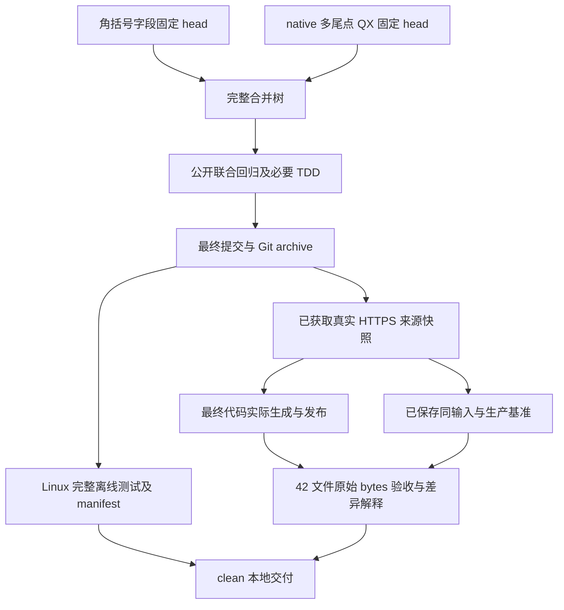

# 最终功能集成与本地验收 - Plan

## Goal Capsule

- **目标：**在同一最终已提交树验证全部十二根因、numeric-angle 与 native 多尾点 QX 修正及 QX 内存预算，重放已真实获取的全部上游 bytes，生成并验收 42 个产物。
- **依据：**[最终集成规格](../specs/2026-10-22-functional-integration-design.md) R1-R12，以及两个固定输入中的组件规格和公开实现。
- **执行：**唯一写入者在独立 worktree 连续完成合并、必要 TDD 修正、完整 Linux 测试、真实构建、产物验收、复审及英文提交；无待做本地步骤转交。
- **边界：**不修改 main、不 push、不触发 Actions；不运行客户端、不开展网络安全工作、不改 timeout／skip、不调查本机系统。

## Product Contract

正常 merge `a00ad3b53a66b18a93a1de3550d871d045b80f55`（tree `5a3ead353e56e6d71d858c2b3f84228a1b1522cb`）与 `685399b4a485fbab9f0475cc401cb92d9a5fd542`（tree `66a8a81d2421f9874d7df80a185ce97eebbb3568`）。共同祖先 `8e4aa6e108cb41248bc46ad6e6b86ecf982edf38`、十二根因组件和 QX policy-tail 内存修复历史全部保留。fetch 后固定远端为 `d9d2a0bab2fe7e2d2938967c28607f7caebb0564`，已在两个输入历史中；各格式说明、42 个生产文件和 README 数量保持。新产物仅写隔离副本，正式生产生成留给后续远程 update。

| 要求 | 单元 | 核查依据 |
| --- | --- | --- |
| R1-R3 | U1、U5 | 固定 SHA 祖先、merge parents、hunk 及生产 mode／blob、README 计数、范围差异 |
| R4-R6 | U2 | 十二根因公开回归、实际 bytes 联合检查与已有 helper |
| R7-R8 | U3 | 最终 commit／tree／archive、逐文件 manifest、完整 Linux suite 终态 |
| R9-R10 | U4 | 全部真实 URL／角色／bytes／hash／parser warnings、真实 generate／publish、static hash |
| R11 | U4 | 42 文件验收 JSON、固定生产 baseline、同输入生成差异 |
| R12 | U5 | 规格／功能／简化复审、最终 clean、证据和清理记录 |

## Planning Contract

### Key Technical Decisions

- KTD1. 正常 merge 两个固定后继 head，逐 hunk 保留兼容内容；相对 `8e4aa6e` 的生产差异仅 ordinary guard 一行及 QX wildcard validator 两行。rules 的 pattern validator、字段能力／normalize、QX lexer 内存修复，以及 formats 的 ordinary DNS 与 raw／markup／QX／logical helper 均保留。
- KTD2. 先运行已有公开回归，仅为未覆盖的联合行为增加必要小型测试；真实问题先 red，再最小修复，不引入新 parser、缓存、sidecar 或重复能力框架。
- KTD3. 最终测试从完整 Git archive 在 Linux `/tmp` 执行，Python `-I -B` 显式导入可信 root。manifest 证明测试前后受控内容一致；证据独立保存，不在下载目录运行解释器。
- KTD4. 复用已完成 `8e4aa6e` 验收的真实来源批次，核对最终配置、全部响应和角色 hash；核对真实抓取时 `068e527` 的 `fetch_https` 与最终实现相同。本轮只重放，不声称重新联网。
- KTD5. 复用已有真实构建执行器和同一产物验收脚本，不复制 HTTP 或格式解析。最终代码实际 generate／publish／README update，原始 LF 目录以已保存 `8e4aa6e` 和 d9d baseline JSON 验收，逐组／六格式比较正文、count、bytes，并独立记录 ADB Version。

### High-Level Technical Design

### Assumptions

固定输入已分别完成 TDD 和完整 Linux suite，仍须共同验证。Debian WSL、Linux Python 和本地 Git 对象可用。真实批次固定为 `C:/Users/user/Downloads/rconvert/.claude/worktrees/wf_c9c6f81b-00e-1/.tmp/final-verification` 的 `real-sources.json`、`remote-bytes` 和 `parsed-roles`，共 56 个唯一 URL、72 次角色引用、18,071,088 bytes；最终配置与该批次必须一致。本轮不重新抓取，不执行下载内容，不以模拟输入替代原始响应。

## Implementation Units

### U1. Fixed-history integration

1. 记录本 worktree／branch／base／status 和 main 初始 SHA；读取两个固定输入 spec／plan／实际 diff。核查没有既有 dirty 文件碰撞。
2. 正常 merge 两个 head，逐 hunk 处理必要冲突；fetch origin main 后固定 SHA，读取实际差异并正常合并，保留远端正确内容。核查全部组件、共同祖先及 bot 祖先，生产 hunk 为固定并集，42 生产文件 mode／blob 和 README 计数区与 d9d 一致，所有格式说明并存。
3. 更新本规格及计划覆盖最终全部验收，先英文提交，再固定 exact commit。唯一写入面为本 worktree；其他 worktree 和旧证据只读。

完成条件：R1-R3 的历史和范围成立，无未解决冲突，无生产重新生成。

### U2. Public joint regression

依赖 U1。运行 alias／wildcard／DNS／HTTP／CI／keyword／routing／target-field 及相关公开测试；核查实际调用路径。

- 十二根因各有最终树的实际测试，不仅依赖祖先存在。
- numeric-angle `*<123>*`／`*<123`／`*123>*` 经 ordinary／QX／native scalar 和 Surge logical 实际 bytes 保留；真正 markup、process 拒绝、URL-REGEX literal-field 例外不变。marker、奇数尾 slash、引号、括号、非 ASCII、class／native 区别和 DNS 局部预算保持。
- native `*..`／`..`／`*123..`／`a...` 的 QX 局部 unsupported、YAML 原值、ordinary 拒绝，以及 `*`／`*123*`／`1..2*` 正例保持。source／white 的同轮及非空 disk-only、跨来源白名单实际覆盖删除、scalar／logical、三个 purpose／no_resolve、目的／来源 IP、static／旧产物保护。
- keyword 短项 unsupported 与长项能力联动，Unicode 原值、ignored-tail、root-dot、allow／options／来源身份和逆序保持；安全包含仍归约。

先读取现有测试，联合缺口才补最小回归；两个后继的既有测试和 helper 完整复用。任何新确认问题必须具体 red -> 最小修复 -> green，相关规格和所有调用方同步，禁止放宽原断言或 strict readback。已有 `test_oversized_dns_does_not_allocate_the_expanded_regex` 同时检查 QX allow／white 的超长 pattern；保留 `8e4aa6e` lexer 去除 `,LIST` 的一行修复，原 2 MiB 阈值及括号／引号判定不变。

完成条件：联合场景真实通过，无新失败，必要修正及回归英文提交。

### U3. Exact final Linux snapshot

依赖 U2。对提交完整 archive，标准库 tarfile 提取到 Linux `/tmp` 新空目录，记录每个受控路径、mode、blob、bytes 和 SHA-256。使用 `python3 -I -B`，显式加入可信 root 后完整 unittest discovery。调用给足前台 timeout，后台仅等待通知，不主动轮询。

核查唯一测试身份、无 overlay、完整终态、failure／error／skip 原因及前后 manifest 相同；十个 Windows-only skips、8 秒 timeout 和原 2 MiB 阈值保持。所有受控变更先提交，代码、测试或文档变更后重新固定 exact commit 并重跑最终树。日志、manifest、命令及解释器保留在 `.tmp/final-complete-verification/`。

完成条件：R7-R8，最终提交完整 Linux suite 无失败／错误，测试内容与最终 Git 身份关系准确。

### U4. Real source build and artifact acceptance

依赖 U2，使用已固定提交的可信代码，可与 U3 独立运行。

1. 枚举最终配置全部远程角色，与已完成真实批次逐项核对；核对 56 URL／72 角色及全部响应、解析结果和 warnings 的 hash。以真实 fetch 时 `068e527`、`8e4aa6e` 和最终 `fetch_https` 实现 hash 相同证明可复用，如实记录原抓取身份，不重新联网。下载目录与可信脚本／代码隔离，使用 Python `-I`。
2. 读取旧证据 `scripts/build_fixed_sources.py` 等执行器的准确参数后复用。从最终 archive 建立 Linux `/tmp` 可信代码副本，实际 `generate`／`publish` 使用本批固定 bytes，更新独立 artifact root 的 README counts。记录全部 diagnostics、42 文件原始 LF bytes 和 20 个 static 前后 hash；不改受控生产产物。
3. 实际执行同一 `C:/Users/user/Downloads/rconvert/.tmp/functional-audit-2026-10-21/acceptance/accept_artifacts.py`，最终可信 `--root` 与独立原始 LF `--artifact-root` 分离，输出新 JSON；分别使用已保存 `acceptance-final.json` 和 `acceptance-baseline-d9d.json` 的 `--baseline-json`，不对无 Git 元数据的 snapshot 使用 `--baseline-commit`。复用全部 parser、排序、Surge split、README、no_resolve、UTF-8 LF、DNS 65,536 bytes 和单文件 100 MiB 检查。
4. 与 `8e4aa6e` 同输入 42 文件／78,223,345 bytes／2,503,812 正文／35 路由 2,048,959 实际比较逐组／六格式 count、bytes 和正文，独立记录 ADB Version。原 d9d 生产 78,125,149 bytes／2,500,723 正文，已有同输入生成对照说明 a3 各五格式 +309、a4 各五格式 +308、dirt 四格式 +1 源自上游变化；本轮代码差异须按实际规则解释。不能用任意比例判断正常，不转换 CRLF。

完成条件：全部真实来源成功，角色／warnings 完整；42 文件验收 passed，baseline 及同输入差异有依据，static bytes 保持。

### U5. Review, final state, and return

依赖 U1-U4。规格 R1-R12 逐项核对，功能／回归、范围和简化复审限两个已确认修复的组合及实际 range，不重新开启无边界审计，不添加无关优化。确认合并树等于固定 hunk 并集，全部正反例、严格依赖和输入历史保留。所有受控变更先英文提交，再对最终 exact commit 验收；验收后不改文档。任何受控变更均重新固定提交并重做最终完整 suite 及产物验收。

核查 `git diff --check`、clean、所有 merge parents、生产文件和 main 初始 SHA。保存本轮必要证据，清理无需保留的 OS 临时副本，保留所有其他任务内容和本分支供外层合并。返回全部修改文件、commit／tree、各项结果与证据路径、真实 fetch／warnings、42 计数大小和 delta、static hash、TDD 和复审结果及限制。

完成条件：本地验收无待做步骤；不进行 main merge、push 或远程 Actions。

## Verification Contract

| 检查 | 方法 | 必需结果 |
| --- | --- | --- |
| 历史／生产 | ancestry、merge parents、mode／blob／README 计数比较 | 固定输入可达，42 受控文件保持 d9d |
| 联合行为 | 已有公开测试及必要小型回归 | 十二根因和 wildcard／字段／keyword 组合通过 |
| 完整离线测试 | 最终提交 Linux archive、Python `-I -B` | 无 failure／error，仅十个既有 Windows-only skips |
| 测试树身份 | 所有受控文件的 Git blob／mode／SHA-256 | 前后相同，源码与最终提交关系准确 |
| 真实来源 | 原抓取身份、最终 fetch_https hash、全部响应与角色 hash | 同批 56 URL／72 角色完整，不声称重新联网 |
| 真实生成 | generate／publish／README update、static hash | 42 原始 LF 产物，static 不变 |
| 产物验收 | 现有 acceptance 脚本、d9d baseline／同输入生成 | 全项 passed，逐组／格式差异可解释 |
| 本地交付 | 规格／功能／简化复审、diff check／clean／main SHA | 修改全部提交，证据保留，main 未变 |

## Definition of Done

两个固定后继 head、共同祖先和全部组件历史完整；numeric-angle、native 多尾点 QX、原 2 MiB 内存阈值和十二根因在最终 exact commit 的公开回归及完整 Linux suite 实际通过，无 overlay，全部受控 path／mode／blob／SHA-256 前后相同。同批已真实获取的 56 URL／72 角色由最终可信代码实际生成、发布并通过 42 文件验收，逐组／六格式 count、bytes、正文及 ADB Version 的比较有证据。42 受控生产文件及 README 数量保持 d9d，20 个 static 输入保持。完整脚本、日志、manifest、产物 JSON 和原始来源路径保存在 `.tmp/final-complete-verification/`，本轮 OS 临时 snapshot 清理。最终 clean 分支供外层执行 main 合并、普通 push 及远程 Actions 验收，不将这些后续远程操作记为本阶段完成。
