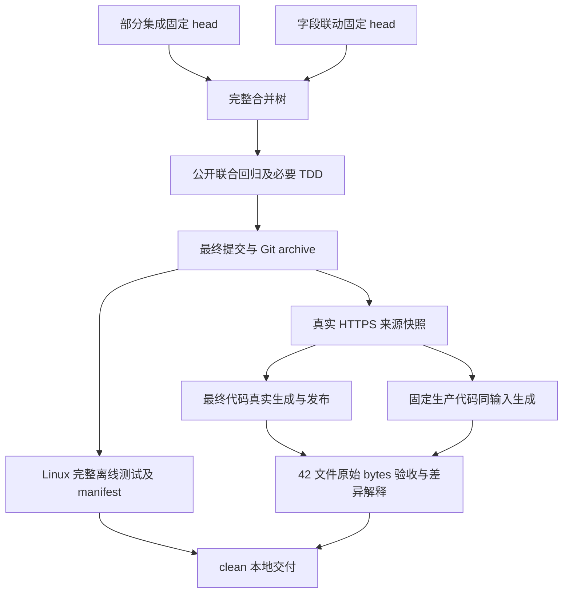

# 最终功能集成与本地验收 - Plan

## Goal Capsule

- **目标：**在同一已提交树验证全部十二根因修正、字段能力与扩大 wildcard 的联合行为，真实读取全部上游，生成并验收 42 个产物。
- **依据：**[最终集成规格](../specs/2026-10-22-functional-integration-design.md) R1-R12，以及两个固定输入中的组件规格和公开实现。
- **执行：**唯一写入者在独立 worktree 连续完成合并、必要 TDD 修正、完整 Linux 测试、真实构建、产物验收、复审及英文提交；无待做本地步骤转交。
- **边界：**不修改 main、不 push、不触发 Actions；不运行客户端、不开展网络安全工作、不改 timeout／skip、不调查本机系统。

## Product Contract

整合 `a66e7814caacbfb87f63979d497ff1e094c13c6d` 与 `badfbfb60b7b55e95ab6f72a260088695f3c6afc`，保留全部历史、各格式说明及 `d9d2a0b` 生产文件和 README 数量。新产物仅写隔离副本，正式生产生成留给后续远程 update。

| 要求 | 单元 | 核查依据 |
| --- | --- | --- |
| R1-R3 | U1、U5 | 固定 SHA 祖先、merge parents、hunk 及生产 mode／blob、README 计数、范围差异 |
| R4-R6 | U2 | 十二根因公开回归、实际 bytes 联合检查与已有 helper |
| R7-R8 | U3 | 最终 commit／tree／archive、逐文件 manifest、完整 Linux suite 终态 |
| R9-R10 | U4 | 全部真实 URL／角色／bytes／hash／parser warnings、真实 generate／publish、static hash |
| R11 | U4 | 42 文件验收 JSON、固定生产 baseline、同输入生成差异 |
| R12 | U5 | 规格／功能／简化复审、最终 clean、证据和清理记录 |

## Planning Contract

### Key Technical Decisions

- KTD1. 正常 merge 两个固定 head，逐 hunk 保留兼容内容。rules 的 pattern validator 与字段能力／normalize，以及 formats 的 ordinary DNS 与 raw／markup／QX／logical helper 均保留。
- KTD2. 先运行已有公开回归，仅为未覆盖的联合行为增加必要小型测试；真实问题先 red，再最小修复，不引入新 parser、缓存、sidecar 或重复能力框架。
- KTD3. 最终测试从完整 Git archive 在 Linux `/tmp` 执行，Python `-I -B` 显式导入可信 root。manifest 证明测试前后受控内容一致；证据独立保存，不在下载目录运行解释器。
- KTD4. 真实 fetch 每个唯一 URL，按角色用公共 parser 记录全部 warnings。固定本轮 bytes 后复用给最终代码及生产基准，不重新抓取造成输入差异。
- KTD5. 复用现有产物验收脚本，不复制格式解析。最终与生产代码都实际 generate／publish，更新各自 README；以原始 LF 文件验收并解释所有组／格式的明显 delta。

### High-Level Technical Design

### Assumptions

固定输入已分别完成 TDD，仍须共同验证。Debian WSL、Linux Python 和本地 Git 对象可用。生产 sources 以最终配置为准，预期 56 个唯一 URL、72 次角色引用，实际不符时记录实际数量。网络读取失败保留真实结果，不用旧缓存、mock 或 partial 结果代替。

## Implementation Units

### U1. Fixed-history integration

1. 记录本 worktree／branch／base／status 和 main 初始 SHA；读取两个固定输入 spec／plan／实际 diff。核查没有既有 dirty 文件碰撞。
2. 正常 merge 两个 head，逐 hunk 处理必要冲突。核查全部组件及 bot 祖先，42 生产文件 mode／blob 和 README 计数区与 d9d 一致，所有格式说明并存。
3. 更新本规格及计划覆盖最终全部验收，英文提交。唯一写入面为本 worktree；其他 worktree 仅按固定提交读取。

完成条件：R1-R3 的历史和范围成立，无未解决冲突，无生产重新生成。

### U2. Public joint regression

依赖 U1。运行 alias／wildcard／DNS／HTTP／CI／keyword／routing／target-field 及相关公开测试；核查实际调用路径。

- 十二根因各有最终树的实际测试，不仅依赖祖先存在。
- 扩大 wildcard 的 marker、奇数尾 slash、引号、括号、非 ASCII、markup、class／native 区别和 DNS 局部预算，经 ordinary／Surge／QX／YAML bytes 读取。
- scalar／logical、source／white、同轮／disk-only，三个 purpose／no_resolve、source-IP 方向、static／旧产物保护。
- keyword 短项 unsupported 与长项能力联动，Unicode 原值、ignored-tail、root-dot、allow／options／来源身份和逆序保持；安全包含仍归约。

先读取现有测试，联合缺口才补最小回归。任何新确认问题必须具体 red -> 最小修复 -> green，相关规格和所有调用方同步，禁止放宽原断言或 strict readback。已有 `test_oversized_dns_does_not_allocate_the_expanded_regex` 同时检查 QX allow／white 的超长 pattern；联合字段 lexer 必须在保持括号／引号判定的同时通过该内存预算断言。

完成条件：联合场景真实通过，无新失败，必要修正及回归英文提交。

### U3. Exact final Linux snapshot

依赖 U2。对提交完整 archive，标准库 tarfile 提取到 Linux `/tmp` 新空目录，记录每个受控路径、mode、blob、bytes 和 SHA-256。使用 `python3 -I -B`，显式加入可信 root 后完整 unittest discovery。调用给足前台 timeout，后台仅等待通知，不主动轮询。

核查完整终态、failure／error／skip 原因及前后 manifest 相同；十个 Windows-only skips 保持，8 秒 timeout 不变。代码或测试改动后重新构造 archive 并重跑最终树。日志、manifest、命令及解释器保留在 `.tmp/final-verification/`。

完成条件：R7-R8，最终提交完整 Linux suite 无失败／错误，测试内容与最终 Git 身份关系准确。

### U4. Real source build and artifact acceptance

依赖 U2，使用已固定提交的可信代码，可与 U3 独立运行。

1. 枚举最终配置全部远程角色，最终 `fetch_https` 真实读取每个 URL。每个原始响应创建独立新空目录，记录 URL、bytes、SHA-256、角色、解析规则和 warnings；下载目录与可信脚本／代码隔离，使用 Python `-I`。
2. 从 archive 建立隔离可信代码副本，真实 `generate`／`publish` 使用本批固定 bytes，更新该副本 README counts。记录全部 diagnostics，42 文件原始 LF bytes 和 static 前后 manifest；不改工作分支生产产物。
3. 从 d9d 原始 blobs 建立 baseline artifact root，实际执行现有 `accept_artifacts.py` 得到 baseline JSON。对新产物以最终可信 root 和独立 artifact root 执行验收，检查所有既有要求。
4. 在固定 d9d 生产代码用同批 bytes 真实生成 42 文件并验收，逐组／格式比较 count、bytes 和行集合，区分上游变化与本次修正。不能用任意比例判断正常，不转换 CRLF。

完成条件：全部真实来源成功，角色／warnings 完整；42 文件验收 passed，baseline 及同输入差异有依据，static bytes 保持。

### U5. Review, final state, and return

依赖 U1-U4。规格 R1-R12 逐项核对，功能／回归、范围和简化复审，修正所有本轮确认问题；不添加无关优化。若实现或测试改变，重做最终提交完整 suite 及产物验收。若仅文档改变，准确列明受测提交、最终提交及未变源码／测试／产物 blob 关系。

核查 `git diff --check`、clean、所有 merge parents、生产文件和 main 初始 SHA。保存本轮必要证据，清理无需保留的 OS 临时副本，保留所有其他任务内容和本分支供外层合并。返回全部修改文件、commit／tree、各项结果与证据路径、真实 fetch／warnings、42 计数大小和 delta、static hash、TDD 和复审结果及限制。

完成条件：本地验收无待做步骤；不进行 main merge、push 或远程 Actions。

## Verification Contract

| 检查 | 方法 | 必需结果 |
| --- | --- | --- |
| 历史／生产 | ancestry、merge parents、mode／blob／README 计数比较 | 固定输入可达，42 受控文件保持 d9d |
| 联合行为 | 已有公开测试及必要小型回归 | 十二根因和 wildcard／字段／keyword 组合通过 |
| 完整离线测试 | 最终提交 Linux archive、Python `-I -B` | 无 failure／error，仅十个既有 Windows-only skips |
| 测试树身份 | 所有受控文件的 Git blob／mode／SHA-256 | 前后相同，源码与最终提交关系准确 |
| 真实来源 | 最终 fetch_https、独立空目录、公共 parse／white | 全 URL 成功，bytes／角色／warnings 可复用 |
| 真实生成 | generate／publish／README update、static hash | 42 原始 LF 产物，static 不变 |
| 产物验收 | 现有 acceptance 脚本、d9d baseline／同输入生成 | 全项 passed，逐组／格式差异可解释 |
| 本地交付 | 规格／功能／简化复审、diff check／clean／main SHA | 修改全部提交，证据保留，main 未变 |

## Definition of Done

两个固定 head 的历史完整、十二根因公开回归和实际 bytes 联动通过；最终完整 Linux suite、全部真实上游构建及 42 文件验收均有终态证据。42 受控生产文件及 README 数量保持 d9d，static 输入保持。最终 clean 分支和证据可供外层执行 main 合并、普通 push 及远程 Actions 验收，不将这些后续远程操作记为本阶段完成。
