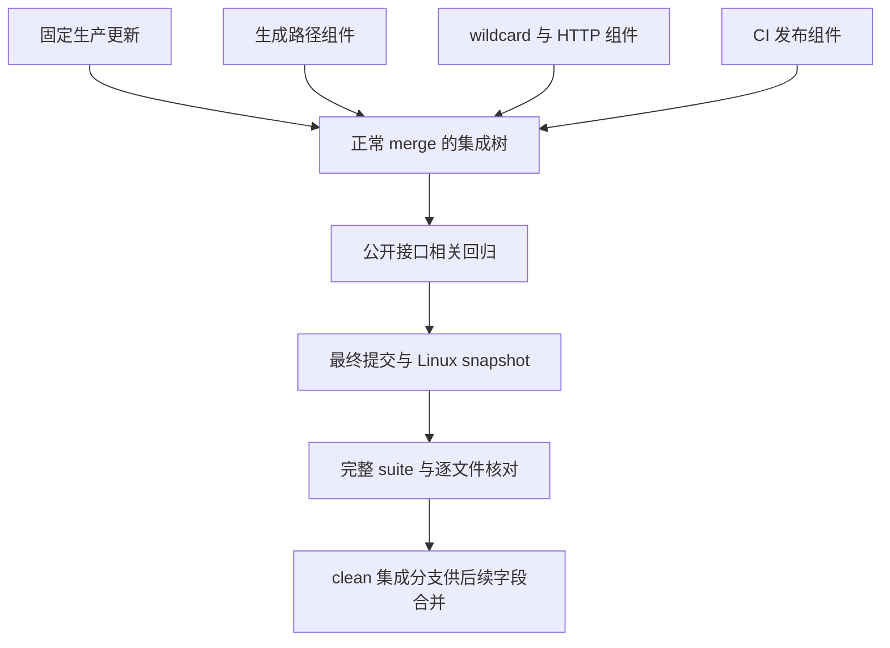

# 已完成功能组件集成 - Plan

## Goal Capsule

- **目标：**生成、转换及本地发布在共同使用时保持各组件已完成的公开行为，并保留最新生产规则供后续字段联动任务接入。
- **方法：**固定输入、正常 merge、复用已有公开回归和完整 Linux snapshot 验证，采用 KTD1-KTD3。
- **依据：**[集成规格](../specs/2026-10-22-functional-integration-design.md)、各固定组件规格及实际代码。
- **执行：**当前独立 worktree 连续完成文档、合并、必要修正、回归、复审及英文提交；不向真实远端发布。
- **停止条件：**存在必须改变授权范围或需要用户决定的冲突时报告具体事实；可在本轮解决的集成问题自行完成。

---

## Product Contract

### Summary

整合规格中的四个固定输入，保持生产文件与固定 bot 更新一致，完成跨组件公开接口及完整 Linux 回归。

### Problem Frame

三个功能组件共享生成、读取和文件发布接口。它们分别验证通过仍需在同一提交树上确认组合行为；同时，初始基准之后已有两次生产规则更新。

### Requirements

规格 R1-R10 为产品要求，本计划不改变其含义。

| 要求 | 实施归属 | 验收依据 |
| --- | --- | --- |
| R1 | U1 | 固定 SHA、正常 merge、祖先可达性及 merge parents |
| R2 | U1、U3 | 42 个产物 mode／blob、README 计数及功能段 |
| R3 | U1、U2、U3 | 组件并集与最终 diff、必要修正的失败回归 |
| R4 | U2 | alias、static 及生成依赖公开测试 |
| R5 | U2 | wildcard 回读、DNS 局部 skip 和预算测试 |
| R6 | U2 | OWS source／white 及截断保护测试 |
| R7 | U2 | 真实临时 Git 发布及已有文件保留测试 |
| R8-R9 | U2、U3 | 最终提交 snapshot、manifest、完整 Linux 测试终态 |
| R10 | U3 | 规格／简化复审、clean 分支及临时内容清理 |

### Scope Boundaries

本轮直接新增两份集成文档，合并固定组件所有已提交文件。只有复现的集成缺陷才允许在对应生产文件和测试中追加最小修正。不重写正常组件，不增加重复测试矩阵或抽象。

字段联动分支以及最终完整树的真实上游生成、42 产物验收属于后续依赖。本轮不执行规格末节列出的远程操作、客户端、系统适配或网络安全工作。

---

## Planning Contract

### Key Technical Decisions

- KTD1. **以固定提交合并。**先提交本规格和计划，再合并固定生产更新及三个组件，保留所有历史；冲突逐 hunk 读取双方意图并保留兼容内容。对应 R1-R3。
- KTD2. **优先复用已有公开回归。**新模块已包含所需接口与真实文件／Git helper，运行同一合并树即可验证组合；只有缺陷需要新增测试。对应 R4-R7。
- KTD3. **从最终提交验证 Linux snapshot。**以 git archive 和标准库解包，结合 Git 对象及逐文件 hash 证明测试树身份；日志保留在已忽略目录。对应 R8-R10。

### High-Level Technical Design

### Assumptions

固定组件提交已经完成各自 TDD，当前 worktree 初始干净。已有 Debian WSL 和 Linux Python 可运行测试；实际版本和命令记录到验证日志。组件仍需在共同提交树上执行本计划的验收。

---

## Implementation Units

### U1. Fixed-history integration

**目标：**满足 R1-R3。**依赖：**集成规格和本计划已复审并英文提交。

**文件：**`generate.py`、`rules.py`、`formats.py`、`update.py`、`.github/workflows/main.yml`、`README.md`、各固定输入中的测试、文档和生产产物。

**步骤与核查：**

1. 固定 `origin/main` 的完整 SHA，确认初始身份、clean index／工作区及四个输入对象。核查生产更新仅含产物和 README 数量，组件改动与其规格一致。
2. 依次正常合并生产更新、生成路径、wildcard／HTTP、CI 固定 head，使用英语 merge 消息。出现冲突时逐 hunk 核查 source commit，不整文件选边。
3. 核查所有固定 head 及两个 bot 提交成为祖先；最终 42 个产物与固定生产更新的 mode／blob 一致，README 数量和组件说明均保留。

**测试场景：**合并不重新生成生产目录，`generate.py` 的 fetch 与 alias 部分并存，README 计数／DNS／Actions 独立变更均保留。

**完成条件：**无未解决冲突，无额外生产修改，所有输入历史及产物身份符合要求。

### U2. Public cross-component regression

**目标：**满足 R3-R7、R9。**依赖：**U1。

**文件：**运行 `tests/test_generator_alias_regressions.py`、`tests/test_wildcard_dependency_regressions.py`、`tests/test_ordinary_wildcard_dns.py`、`tests/test_chunked_ows_regressions.py`、`tests/test_ci_publication.py`、`tests/test_workflow.py`，以及相关生成／transport／static／来源／README suite。

**步骤与核查：**

1. 在 Linux `/tmp` 的当前提交 snapshot 执行上述模块及相关 suite，保留命令、解释器、实际测试结果和日志。核查现有 helper 使用真实路径、bytes、HTTPResponse 及临时 Git，不 mock 内部成功。
2. 逐项核查下列公开场景已有测试实际执行；只在存在缺口或复现缺陷时补最小测试。新缺陷先取得失败证据，再修复根因并重跑相关模块。
3. 对必要修正逐条规格审查及简化，确认无额外功能、配置、依赖、parser、Rule 缓存或重复实现，英文提交。

**测试场景：**

- 单标签 DOMAIN-SET alias 同轮及 disk source／white，显式 entry 与实际生成格式优先，static symlink 输入 bytes 保持。
- native wildcard 通过 Surge／QX bytes 回读，safe pattern 与 DNS 未证明 literal 局部 skip、65,536 bytes 行预算保持。
- ASCII OWS chunked source／white 正常输出与 canonical 相同；截断保留所有旧文件及 static bytes。
- CI 正常发布、unchanged、superseded，已有 tracked／untracked／ignored 允许目标拒绝覆盖，无关文件保持。

**完成条件：**要求场景全部在合并树运行且无新增失败，不修改 timeout／skip 或吞掉错误。

### U3. Final commit verification and handoff

**目标：**满足 R1-R3、R8-R10。**依赖：**U2。

**文件：**最终受控树及已忽略的 `.tmp/integration-verification`；仅必要修正可形成新提交。

**步骤与核查：**

1. 核最终 diff 属于固定组件、生产更新、两份集成文档和已复现修正，复审规格 R1-R10。确认提交身份与 clean 工作区。
2. 对最终提交重新构造完整 git archive，标准库解包到独立 Linux `/tmp`。manifest 记录每个受控路径、mode、Git blob、SHA-256；核 archive、snapshot 与最终 commit 一致。
3. 在同一 snapshot 前台等待完整 unittest discovery 退出。保存完整日志、退出码、测试数及每个 skip 原因；失败时修正授权范围原因并重跑最终树，不用部分通过代替终态。
4. 测试后重核全部受控 hash、42 个生产 blob 和 README 数量，清理本轮 snapshot 及 OS 临时 fixtures，保留证据目录。保持 clean 集成分支，返回原目录，不删除本分支或其他任务内容。

**完成条件：**最终提交完整 Linux suite 无失败或错误，仅保留既有十个 Windows-only skip；manifest 身份准确，所有临时清理及未覆盖项如实返回。

---

## Verification Contract

| 检查 | 方法 | 必需结果 |
| --- | --- | --- |
| 身份与范围 | branch／HEAD／status、固定对象及差异 | 只写当前独立 worktree |
| 历史 | 固定 head、bot SHA 的祖先检查与 merge parents | 全部历史可达，无替换历史 |
| 生产文件 | 配置组 × `formats.FILES` 的 Git mode／blob 比较 | 42 个文件与固定生产更新一致 |
| README | 计数区 bytes 与 wildcard／DNS／Actions 段比较 | 数量及说明各自保留 |
| 相关回归 | 六个新模块与生成、transport、static、来源、README suite | 所需公开场景通过 |
| 完整回归 | Linux `python3 -B -m unittest discover -s tests -v` | 真实终态无失败／错误，skip 原因明确 |
| snapshot 身份 | git archive、标准库 tarfile、Git blob／SHA-256 manifest | 测试前后受控内容等于最终提交 |
| 交付 | `git diff --check`、规格／简化复审、status、临时清理 | clean 分支、日志和 manifest 可复核 |

---

## Definition of Done

四个固定 head 和两个 bot 提交在最终历史中，生产 42 文件及 README 计数保持；公开接口与最终完整 Linux suite 有实际通过终态。没有字段联动未完成内容、无关重构或试验代码进入本分支。

最终交付列明 worktree／branch／base／head、文档和 merge／修正提交、冲突依据、测试终态及 manifest 位置。真实全上游生成、GitHub 发布与字段联动验收明确留待最终完整树，不冒称本轮已完成。
