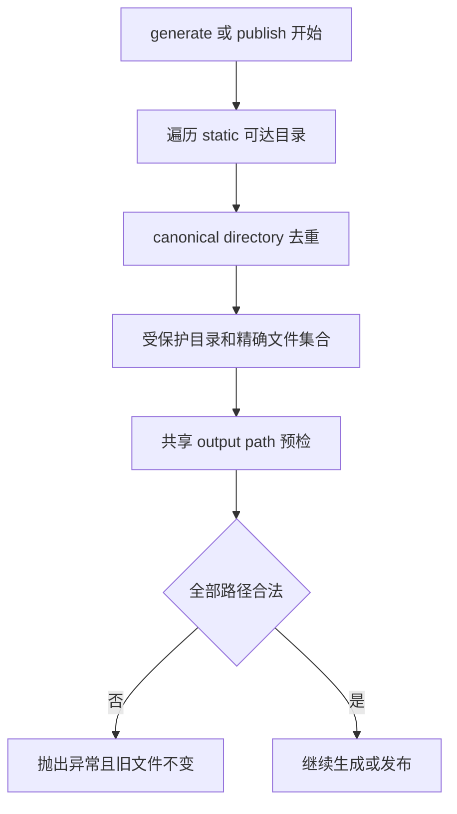
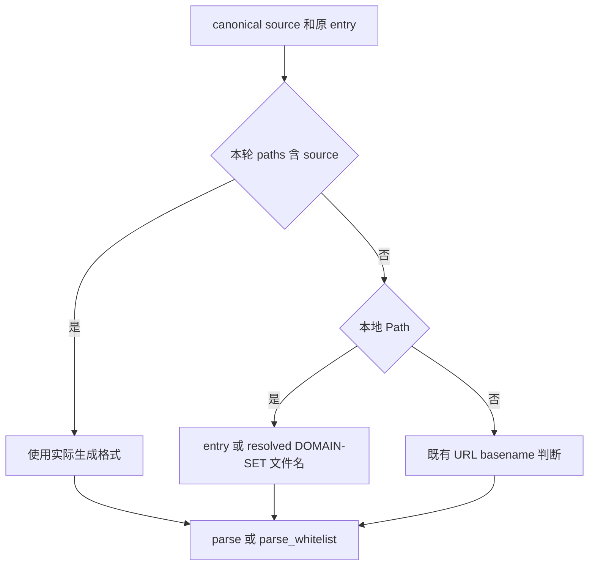

# 生成器路径别名修复 - Plan

## Goal Capsule

- **目标：**使用合法 Linux symlink 的项目可正常读取 DOMAIN-SET 依赖，static 可见内容在生成及发布期间保持不变。
- **方法：**扩展共享路径预检，保留来源格式上下文，采用 KTD1-KTD3。
- **依据：**本次限定范围、[生成器路径别名规格](../specs/2026-10-22-generator-alias-design.md)、本计划、当前代码及公开行为测试。
- **执行：**同一个独立 worktree 连续完成两项修复；先提交规格，再提交本计划，U1 完整提交后开始 U2。仅本地英文提交，主会话只合并完整交付。
- **停止条件：**需要扩大文件范围、用户决策或操作权限时报告具体依据。其他可自行解决的问题在本任务内处理。

---

## Product Contract

### Summary

补全 static 后代链接目标的写入保护，修复改名 DOMAIN-SET 文件在同轮及非空 disk-only source／whitelist 中的读取。六格式接口、配置、产物及现有错误处理保持。

### Problem Frame

当前路径预检无法发现从 static 后代链接反向引用的物理输出目标。来源解析又会丢失改名文件的 DOMAIN-SET 格式上下文，两者分别可能改写输入或中止合法构建。

### Requirements

产品要求以规格 R1-R12 为准，本计划不改变其含义。

| 规格要求 | 实施归属 | 验收依据 |
|---|---|---|
| R1-R2 | U1 | 目录子树、文件精确目标、多层链接及 canonical 去重 |
| R3-R4 | U1 | generate／独立 publish／staging 预检、旧 bytes／链接、合法别名和调用间变化 |
| R5-R6 | U2 | 生成格式优先、显式 entry、resolved 文件名及 disk-only |
| R7-R9 | U2 | URL 不变、普通单标签拒绝、实际 bytes、上下文隔离 |
| R10 | U1、U2 | 既有六格式 alias、冻结、前向依赖、空输入、碰撞、回滚 |
| R11-R12 | U1、U2 | 限定 diff、逐项 TDD、相关及完整 suite、审查简化和提交 |

### Scope Boundaries

仅 `generate.py`、新增 `tests/test_generator_alias_regressions.py` 和本次两份文档可修改。验证会读取 `sources.py`、`rules.py`、`formats.py`、相关既有测试、README 和 Actions。无需修改调用方公开签名、配置、fixtures 原件、导出或产物。

不增加 TOCTOU／并发控制、跨调用缓存、Rule 恢复机制、外部客户端、依赖或可配置选项。这些机制不属于本次两项已确认行为修复。

---

## Planning Contract

### Key Technical Decisions

- KTD1. **每次调用收集一次保护范围。**`generate` 和 `publish` 都将当次 static 可达目录／文件集合交给既有 `_output_path`，保留其祖先和链接链检查；目录遍历按 canonical directory 去重。对应 R1-R4，避免每个产物重复扫描或后续调用使用旧结果。
- KTD2. **来源格式判断复用 `paths`。**生成路径映射优先，非生成本地路径结合 resolved 名称和 entry，URL 分支保持。五处 parser 调用统一使用该私有判断，对应 R5-R8；只查询 `paths.get` 无法满足 R6。
- KTD3. **本地 whitelist 缓存区分格式上下文。**同一物理文件经不同 entry 的读取不得混用解析结果，对应 R9；保留现有提前验证本地 whitelist 的顺序。
- KTD4. **只在公开接口验证行为。**新测试调用 `generate`／`publish`，读取实际文件及链接；字面预期不从 parser／renderer 计算。现有 helper 仅用于构造旧文件或已适用的 fixture。

### High-Level Technical Design

### Assumptions

验证使用已有 Debian WSL 的 Linux Python 3.13.5，新增 fixture 写系统临时目录。远程 Ubuntu Actions 和真实客户端未在本地测试范围内，不用本地结果代替远程验收。

---

## Implementation Units

### U1. Static descendant target protection

**目标：**满足 R1-R4，保留 R10-R12。**依赖：**规格和本计划已提交。**文件：**`generate.py`、`tests/test_generator_alias_regressions.py`。

**步骤与检查：**

1. 新增 `static/main -> ../sample` 的公开 generate 失败回归，保留 sample／healthy 六个旧文件和所有链接；先观察预期异常未抛出的 red，再实现最小目录保护。检查预检发生在 fetch 前，未创建 `.tmp`。
2. 增加独立 publish 的物理目录目标、多层目录目标及无关 alias 入口，检查新目录输出和健康输出在前时仍无修改。发现新的失败分支时逐个先 red 再修复。
3. 为 static 文件链接的精确物理目标建立 red，再补最小文件保护。检查同父目录普通产物可发布，不能禁止整个父目录。
4. 覆盖 static 指向 `.tmp`、`.tmp` 别名指向受保护目标，以及深层文件链接。检查暂存前拒绝，旧 staging 内容、健康组和链接均不变。
5. 覆盖重复 canonical directory、指回祖先的可解析目录循环和多层链接，在有明确超时的子进程检查终止及实际保护。新增／移除链接后再调用，检查没有陈旧缓存。
6. 运行本模块、既有 `StaticAliasPublishTests`、static maintenance／migration、alias、碰撞、路径边界、冻结和发布事务测试。逐项核 R1-R4 和 R10，检查唯一共享实现、无冗余配置或未使用内容。
7. 运行完整 unittest discovery，定位所有失败，修正本次引入的问题后重跑。规格审查、简化和复审后检查 diff 仅含本项两文件并英文提交，不能把测试或提交步骤留给主会话。

**测试场景：**

- 目录后代 symlink 的精确根和更深子目录，直接物理写入与其他非 static alias 写入均拒绝。
- 文件后代 symlink 的精确目标拒绝，相邻文件和其他目录成功。
- 健康组六文件全部不变，新输出目录与 `.tmp` 均未创建，输入 bytes 和 readlink 值不变。
- static 输入合法编辑、BOM／CRLF、root／目录／文件／staging 非 static aliases、`static/../products`、无 static 继续通过。
- 多层、重复链接、祖先循环可终止，后续调用按新的文件系统状态保护。

**完成条件：**新测试的 red／green 可追溯，相关和完整 suite 有终态，R1-R4／R10 的规格复审无遗漏，最小修复已本地提交。

### U2. DOMAIN-SET alias context

**目标：**满足 R5-R9，保留 R10-R12。**依赖：**U1 已完整提交。**文件：**`generate.py`、`tests/test_generator_alias_regressions.py`。

**步骤与检查：**

1. 为 `parent/fin-surge-ds.txt -> ../storage/saved-output.list` 添加同轮 source 的 localhost 失败回归，再以 `paths` 的实际格式作最小修复。检查读取新生成正文、完整六产物和链接保留。
2. 添加发布后删除 parent 配置和原输入的 disk-only source red，再让 helper 接收 entry，保留显式本地文件名。检查不从上游 Rule 或其他格式补回内容。
3. 增加同轮和 disk-only whitelist，含显式 entry 的反斜杠和大小写形式。对五处 parser 调用逐处检查格式参数，不遗漏生成 whitelist 正文校验及逐行诊断。
4. 加入相同物理 whitelist 被不同上下文 entry 引用的 red，按 KTD3 分离缓存。检查普通 entry 的单标签仍拒绝，两种 entry 顺序均符合 R9。
5. 将单标签扩至 localhost／x／123，交叉 block／direct／proxy、add／strip／keep、source／whitelist、saved-output.list／fin.yaml。检查六产物的字面正文及完整发布，disk-only 与同轮一致。
6. 加入多标签、suffix、IPv4 样式实际 bytes 对照，核 DOMAIN-SET 的裸 IP 重新解析结果。验证实际生成 YAML／ADB 等格式优先于物理 fin-surge-ds.txt 名称；保留 resolved 文件名识别、URL basename 边界及无上下文裸单标签拒绝。
7. 运行六格式 alias、前向依赖、冻结、空 disk-only、生成正文严格校验、碰撞、路径边界、回滚和 bytes integration。规格复审逐处追踪调用方，再检查重复代码／缓存键／未使用内容。
8. 最终完整 suite、必要修正与复审、diff 检查后英文提交 U2。核工作区干净，返回全部提交及实际测试终态，不 push／merge 或清理其他 worktree。

**测试场景：**

- 同轮逻辑与物理 entry 按实际生成格式读取；disk-only 显式 DOMAIN-SET entry 保持上下文。
- 精确白名单 localhost 删除 localhost，保留 child.localhost 和合法 suffix；source 生成 DOMAIN,localhost。
- 物理目标 fin.yaml 不覆盖实际 DOMAIN-SET；实际 YAML 目标名为 fin-surge-ds.txt 不扩大 native 单标签解释。
- 同文件普通 whitelist 不能继承显式 DOMAIN-SET entry 的接受权限。
- 空磁盘文件、普通单标签及前向引用仍在发布前拒绝，所有旧 bytes 保持。

**完成条件：**R5-R10 的新旧行为测试全部符合，完整 suite 通过，五处调用方和缓存上下文均复审，U2 已提交且无无关改动。

---

## Verification Contract

验证在所属 worktree 对应的 WSL 路径运行。新 fixture 使用 Linux `/tmp` 和真实相对 symlink；时钟 mock 只稳定 ADB 文件头，不替代文件系统、依赖读取或发布。

| 检查 | 方法 | 必需结果 |
|---|---|---|
| 初始身份 | Git worktree、branch、HEAD、status | 独立 worktree，基准匹配，无覆盖已有改动 |
| 基线 | 既有 static 和 DOMAIN-SET 公开测试 | 保存实际终态，区分原有问题 |
| 每个行为变化 | 单个新测试先失败，再最小实现 | red 对应真实缺陷，green 保留字面预期 |
| 相关回归 | 新模块及 test_generate 的 static／six alias／冻结／前向依赖／回滚，sources／static／integration | 无新增失败或 symlink skip |
| 完整 suite | `python3 -B -m unittest discover -s tests -v`，隔离模式可用等价 loader 设置明确源码路径 | 每项修复后均有完整终态，保留既有平台专用 skip 原因 |
| 规格与简化 | 对照 R1-R12、五处格式调用、输出／staging 预检及完整 diff | 无遗漏、重复实现、额外配置、吞异常或 parser 变更 |
| 提交 | `git diff --check`、staged diff、最终 Git status | 每项只提交所属文件，英文消息，无未提交任务内容 |

---

## Definition of Done

- 规格、本计划、U1、U2 按顺序完成并分别提交，Git 身份和测试结果可追溯。
- 两项新行为及所有保留条件均经公开接口核查，完整 suite 未被删减或弱化。
- 仅四个约定文件变化，不修改生产 static／配置／产物、parser 或其他测试文件。
- 无试验代码、陈旧缓存、重复格式判断、未使用 import、额外依赖或 module docstring。
- 最终回执列明 worktree／branch／base／head／commits、red／green／完整 suite 终态、审查简化结论和未核验项。未运行远程 Actions 或客户端须明确说明。
