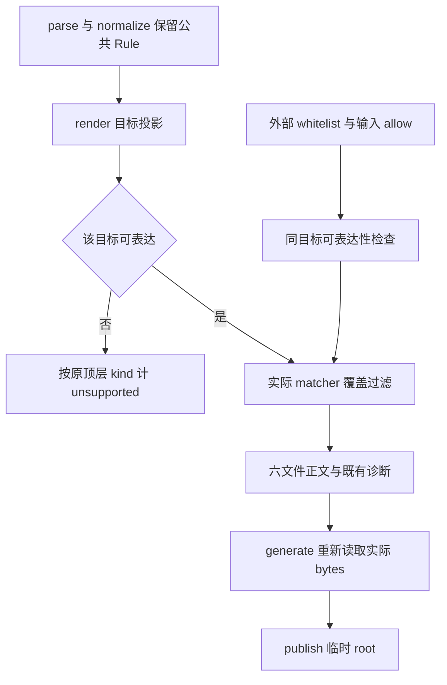

# Routing fields - Plan

## Goal Capsule

- 目标：合法输入不会因四项路由字段转换及 DNS escaped-hyphen 投影改变 matcher、扩大生成白名单或使后续生成依赖失败。
- 方法：复用目标转换及 unsupported 分支，具体规则以规格 R1-R5 为准。
- 执行范围：单个独立 worktree 连续实施和提交；不 push，不合并主分支，不运行客户端。
- 完成条件：五项各自经失败测试、最小修复、相关回归和审查后提交，最终完整 Linux suite 通过。

---

## Product Contract

### Summary

修复 Mihomo process ASCII-space、非重连 payload comma、QX 字段回读和 Mihomo logical literal 括号。保持公共 matcher，无法保真表达时按目标跳过。

### Problem Frame

当前 renderer 可输出被 Mihomo 裁剪或截断的 matcher，普通 quoted logical 叶子还可变成不同的条件结构。QX 特殊字段可在生成依赖中产生 warning，或被回读为更宽的 whitelist。

### Requirements

- R1. 遵守规格 R1 的 nonregex process ASCII-space 边界和普通 PROCESS-NAME hex regex 正例。
- R2. 遵守规格 R2 的最终有效 payload comma 检查，以及相同的 Mihomo white 可用性判断。
- R3. 遵守规格 R3 的 QX 文本／white 共享检查，保留已有 HOST-KEYWORD 字面 backslash／marker 能力。
- R4. 遵守规格 R4 的逐叶 native 括号检查，包含跨叶子抵消和非法前缀。
- R5. 遵守规格 R5 的来源 escaped-hyphen 身份及 DNS 目标局部 unsupported，保留安全 class 控制与 encoded Go 语义。
- R6. 保持规格的公开接口、六目标、诊断、真实 bytes 依赖和发布边界。

### Scope Boundaries

生产修改仅 `formats.py` 的路由字段函数和既有 DNS class 扫描／范围归约。新增测试仅 `tests/test_routing_field_regressions.py`、`tests/test_dns_hyphen_regressions.py`。既有 `tests/test_generate.py` 只改已确认的 USER-AGENT QX 预期；其余测试不改。文档仅本规格、本计划和 README 相关支持说明，规则数量区保留。

不新增依赖、配置或公共类型，不改 rules／generate 算法、static、生产产物。待独立确认的名称空白不进入当前实施。native wildcard 的输入闭合归另一任务，本任务保留既有 native `*` 输出。

---

## Planning Contract

### Key Technical Decisions

- KTD1. 使用 `_process_value` 的共享 Mihomo 分支实现 R1，普通 PROCESS-NAME hex 转换之后检查，避免顶层和 logical 产生不同结果。
- KTD2. 在 `_mihomo_rule` 及 `_logical_value` 的最终有效 payload 处实现 R2，并让 `_route_whitelist` 在使用原白名单之前确认投影成功。
- KTD3. 把现有 QX 字段限制与 R3 新边界合并为同一个小型目标判定，由输出及 white 复用，不重新 parse 输出构造 matcher。
- KTD4. 在 logical nonregex 叶子恢复 native ignored-tail 后复用 `_delimiters(native_fields=True)` 实现 R4，检查每个 payload 的所有前缀及最终平衡。
- KTD5. 在现有 DNS class scanner 记录 encoded=False 的 escaped-hyphen 原子位置，只在 reducer 将其当 range 端点时返回 None；不改 encoded=True 的 Go 目标语义。

### High-Level Technical Design

### Sequencing

保留现有文档提交，先提交本次 R5 规格与计划增补。U1-U5 修改同一文件，按此顺序连续执行；不并行编辑。每个单位在本项测试失败后才实现，完成相关回归、规格审查、简化和复审后单独英文提交。全部完成后执行 U6。

恢复入口已有 U1 的两行实现、README 说明及新测试，保持原样。停止线程没有提供可核查 red 输出时，以 Git 基线文件和同一测试在操作系统临时目录构造隔离 snapshot，真实运行得到 red；当前 worktree 不回退、不覆盖现有实现，再在当前实现运行同一测试得到 green。其余新增行为仍逐个 red -> green，不先批量写测试。EnterWorktree 若受工具会话限制不能切换，所有读写和 Git 命令显式指定本 worktree 的绝对路径，禁止编辑主仓库。

### Assumptions

固定客户端源码仅用于判定已明确字段语义；没有客户端执行或 QX 特殊字段编码依据。Linux WSL 测试验证 Python 逻辑，不代替尚未运行的远程 GitHub Actions。

---

## Implementation Units

### U1. Mihomo process ASCII-space

- **Goal：**完成 R1，使用 KTD1。
- **Files：**`formats.py`、`tests/test_routing_field_regressions.py`、`README.md`。
- **Approach：**用公开 parse／normalize／render 加最小尾空格失败例；实现共享目标检查；再补各边缘和集成控制组。
- **Test scenarios：**
  1. 三类普通 quoted process 及公共 literal PROCESS-NAME，首／尾／两端／纯 ASCII space，仅 Mihomo unsupported。
  2. 顶层、AND／OR／NOT、嵌套、多错误叶子按顶层计一次，保持其他目标。
  3. 普通 PROCESS-NAME 的字面 space 编码为既有 hex regex；tab、Unicode whitespace、内部 space、native trim 保持。
  4. 三种 purpose／no_resolve 下，真实同轮／磁盘 YAML 依赖保留健康邻居；全目标 unsupported 继续冻结旧六文件。
- **Verification：**新测试及已有 process／字段／YAML 回归通过；确认 diff 未修改公共 value 或来源层。

### U2. Mihomo literal comma

- **Goal：**完成 R2，使用 KTD2；依赖 U1。
- **Files：**`formats.py`、`tests/test_routing_field_regressions.py`、`README.md`。
- **Approach：**先用 inbound quoted comma 确认失败，再扩展现有最终 payload guard；用公开 white 覆盖反例确认投影检查有效。
- **Test scenarios：**
  1. 三个 inbound 名称类，comma 在首／中／尾，单双引号及直接 Rule，顶层与 logical 整条跳过。
  2. QX HOST-KEYWORD literal comma、公共 native keyword／wildcard comma，不能截断 matcher。
  3. 原生 ignored params、slash 名称列表、UID／DSCP comma-to-slash、三种 regex 重连和普通 PROCESS-NAME hex 正例保持。
  4. 不可表达 white 不删除健康 blocker；同轮／磁盘 YAML 依赖无 matcher 改变；全 unsupported 组冻结。
- **Verification：**精确 unsupported／covered 诊断及 header；运行既有 native ignored-tail 与 constructor 测试。

### U3. QX 字段与生成白名单

- **Goal：**完成 R3，使用 KTD3；依赖 U2。
- **Files：**`formats.py`、`tests/test_routing_field_regressions.py`、`tests/test_generate.py` 的指定 USER-AGENT 方法、`README.md`。
- **Approach：**依次为起始引号、边缘空白、USER-AGENT odd trailing slash 和 whitespace-marker 增加失败例并最小修复；每个行为单独确认 red 后再实现。
- **Test scenarios：**
  1. keyword、native wildcard、USER-AGENT 的未闭合／成对起始引号与边缘空白，QX 跳过，其余目标保持。
  2. USER-AGENT 一／三个尾 slash 与 whitespace 后三种 marker 跳过；内部引号／空白、偶数尾 slash、无空白 marker 保留。
  3. HOST-KEYWORD 内部 marker、字面一至三个尾 slash 继续保留；三字段 LIST 不变。
  4. 公共 whitelist／allow 及真实同轮／磁盘 source／white 不扩大裸 keyword blocker 的删除范围；健康邻居、诊断、输入与旧文件 bytes 保持。
  5. unsupported 不计 interface-option，正常输出仍计；logical 继续整条跳过且计一次。
- **Verification：**新失败回归及 QX／字段相关测试通过；精确更新指定旧方法的 QX body、count、skip 预期，保留全部其他检查。

### U4. Mihomo logical 逐叶括号

- **Goal：**完成 R4，使用 KTD4；依赖 U3。
- **Files：**`formats.py`、`tests/test_routing_field_regressions.py`、`README.md`。
- **Approach：**先用 quoted inbound 单边括号及跨叶子抵消确认失败，再使用现有 native scanner 检查最终 nonregex 叶子。
- **Test scenarios：**
  1. 六种名称／process 类，左右单边括号、`12)3(`、多个错误叶子、AND／OR／NOT／嵌套，Mihomo 整条 unsupported。
  2. `AND,((IN-NAME,"12(3"),(IN-USER,"45)6")),PROXY` 不得静默丢掉第二条件；不能用整体括号数量作为判断。
  3. balanced `12(3)`、顶层 `foo(`、普通 PROCESS-NAME hex、regex 编码和 native ignored-tail 正例保持。
  4. 真实 parent／child fin.yaml 同轮及 disk-only 依赖无失败，IP 方向与 no-resolve 不变，按顶层 operator 计一次。
- **Verification：**逐叶字面预期和完整结构回读均通过；既有 ignored-tail 两组正例及深层 logical 测试保持。

### U5. DNS escaped-hyphen

- **Goal：**完成 R5，使用 KTD5；依赖 U4。
- **Files：**`formats.py`、`tests/test_dns_hyphen_regressions.py`、`README.md`。
- **Approach：**先以 `[!-\-9]x` 的 DNS 目标错误输出确认 red，保留 escaped-hyphen 身份后对参与 range 的原子局部返回 None；再为 escaped 起点及否定／property 组合执行逐项回归。
- **Test scenarios：**
  1. `[!-\-9]x`、`[^!-\-9]x`、`[\--9]x`、`[^\--9]x`，普通 quoted／native 两来源均保留公共值和 fin.yaml，只跳过 DNS。
  2. block、公共 allow、真实 parse_whitelist 三个消费者精确一次 unsupported；scoped／中性组、重复 escaped hyphen 及 property 包装不产生错误正文。
  3. `[-a]`、`[a-]`、`[\-a]`、`[a\-]`、`[\-a-c]`、`[--0]`、hex hyphen 两组及 property 控制继续有正确 DNS 匹配；encoded Go 目标扫描不受来源标记影响。
  4. 三种用途／no_resolve、真实 generate／publish、同轮和 disk fin.yaml source／white 使用真实非空 bytes，输入和旧文件保护保持。
- **Verification：**新测试、既有 class/property／DNS／来源 hyphen 测试通过；不改来源 validator、预算或其他五目标。

### U6. 完整复审与交付

- **Goal：**验证 R1-R6 的联合行为；依赖 U1-U5。
- **Files：**只检查上述变更范围，必要修正限于所属任务。
- **Approach：**执行完整 Linux unittest；按规格逐项核对文本、white、依赖、计数、冻结、排序、输入和发布边界；审查共享判定没有重复实现或多余抽象。
- **Verification：**完整 suite 终态成功、diff 检查通过、仅授权文件改变，所有提交均在当前 worktree。最终返回真实 red／green、suite 命令和结果、commit、路径及未检查范围，不写额外报告文件。

---

## Verification Contract

测试通过公开接口观察行为，expected 使用规格中已知正确的字面文本或 Rule，不复制内部转换生成 expected，不调用私有函数作为测试入口。

Linux 执行器使用已有 Debian WSL 的 `python3 -I -B`，显式加入当前 worktree 后由 unittest discovery 执行；临时 fixture 使用 Linux `/tmp`。单项先运行所属新测试类，相关回归运行 formats、rules、generate、YAML／projection 测试，最终执行 `unittest discover -s tests -v` 的等价公开 discover。Windows Python 仅用于必要的辅助检查，不把 Windows skip 计作验收。

每次 red 保留真实失败输出；green 必须包括同一测试和相邻受影响回归。每项提交前检查规格、diff 范围、whitespace、未使用内容及公共接口兼容。

---

## Definition of Done

- 五项规格的正反例均有公开接口测试，且逐行为 red -> green 证据可回查。
- 全部新测试、相关测试与完整 Linux suite 通过，未降低严格生成校验或新增 skip。
- README 描述最终支持边界，规则数量区及非任务文件保持。
- 无未使用实现、撤销方案、额外依赖或未清理的本次实验代码；临时 fixture 自动清理。
- 规格先提交，五项修复分别英文提交；工作区干净，返回 base／head／branch 及全部提交。
