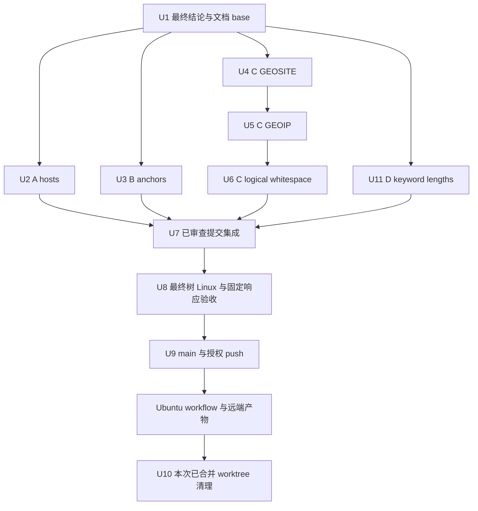

# 六项功能回归修复与发布 - Plan

## Goal Capsule

- **目标：**合法 hosts、regexp2、logical 空白、geodata 和长 keyword 经公开转换及文件回读后保留可表达的 matcher，长 keyword 在既有有界检查内完成归约，不能表达的目标只跳过完整规则。
- **依据：**`docs/superpowers/specs/2026-10-23-functional-regressions-design.md` R1-R10。该规格规定行为；本计划规定所有权、测试、合并与发布顺序。
- **方法：**同一文档提交为 base，A／B／C／D 四个独立 worktree 并行实现，C 内部三项顺序完成，主会话只合并已完成、审查、提交及完整精确树 suite 的分支。
- **开始条件：**六项独立最终结论已收齐，R5 native-only、GEOIP 身份保护和 R6 长度索引范围已明确；文档提交本身不启动实施。
- **停止条件：**实际证据与规格冲突、需要修改他人拥有的位置、无法证明目标 matcher 保真，或缺少真实用户的 push 授权时，报告具体事实，不自行扩大范围。
- **交付责任：**实现者连续完成自己的编码、测试、规格／功能／简化审查、修正、复审及英文提交；主会话负责最终合并、精确树验收、获授权后的 push、Ubuntu 与远端产物核查及本次 worktree 清理。

---

## Product Contract

### Summary

实施规格 R1-R6 的六项修复与优化，并按 R7-R10 完成联合回归、固定 bytes 生成与耗时对照、每个 owner 和最终集成提交的完整 Linux 测试，以及远程发布验收。全部采用现有 Rule、parser、格式投影和生成／发布入口。

### Problem Frame

初始提交对部分合法 hosts 注释、regexp2 anchor 量词、quoted whitespace-only logical 叶子和 geodata 参数处理不完整；合法长 keyword 的全部 proper substring 枚举还会使公开 normalize／generate 超时。修复后，目标投影、白名单与生成依赖须保持原能力和覆盖语义，不能把新接受的来源值直接写入不支持的目标。

### Requirements

| 规格要求 | 执行单元 | 核查依据 |
| --- | --- | --- |
| R1 hosts 注释 | U2 | 普通 hosts raw 内容、HTML 预扫描、四地址、邻行／行号、typed literal `#` |
| R2 anchor 量词 | U3 | 三个 regexp2 kind、原 matcher／捕获、deep、URL-REGEX 和 DNS 独立边界 |
| R3 logical 空白 | U6 | 13 kind、解码后空值、scalar 对照、name-list／UID／DSCP、完整逻辑 |
| R4 GEOSITE | U4 | 全部属性段、首个 `!` 的消费顺序、有效 listName、literal key、实际 YAML bytes |
| R5 native GEOIP | U5 | 类别／取反／方向、全部目标投影分支、white、Unicode 身份和 no_resolve |
| R6 长 keyword 归约 | U11 | 同 identity 真实比较 key 长度、合法长值有界完成、短项场景和原 guards |
| R7 联合行为 | U2-U7、U11 | 公开 API、同轮和非空磁盘依赖、三 purpose／三 mode、冻结／旧产物 |
| R8 精确树 Linux 测试 | U2、U3、U6、U11、U8 | 每个 owner 最终 head 及集成的 archive、完整 suite、mode／blob／SHA-256 |
| R9 固定 bytes 与产物 | U8 | 响应 hash、两轮 42 产物、static、README 与优化前后耗时 |
| R10 合并／远程／清理 | U7、U9、U10 | 正常合并、真实 push 授权、Ubuntu SHA／job／bot／远端 bytes、Git 清理 |

Product Contract 由独立规格完整承载，不在本计划重定义属性语法或新增目标支持。

### Scope Boundaries

生产修改仅涉及既定 parser／投影／GEOIP 身份及 keyword 归约位置、五份新增回归文件，以及 C 或集成 owner 在 README 现有语言中补充必要的 native geodata-mode 说明。当前文档任务不修改 README。公开签名、Rule 字段、模块导出、`formats.FILES`、类型集合、配置、依赖和 static 保持。禁止事项按规格范围限制执行。

---

## Planning Contract

### Key Technical Decisions

- KTD1. **按函数位置分配唯一写入者。**A 只改 `_source_records`；B 只改 `_valid_regex` 及确需的 deep probe；C 修改 `_valid_simple` 的 GEOIP／GEOSITE 分支、必要的 `_qx_field_supported` 和 `exclude_covered` GEOIP 身份位置，以及 `formats.py` 相关位置；D 只改 `normalize`。四个分支修改 `rules.py` 的不同位置，主会话按实际 hunk 核查后正常合并，不能整文件取一侧。
- KTD2. **每个行为使用公开入口的 vertical TDD。**先加入最小可观察失败，运行得到真实 red，再修共享根因并取得 green，随后补相邻边界与实际 bytes 回归。每个 slice 完成审查和提交后才进入同一 owner 的下一项。
- KTD3. **复用已有校验和目标能力处理。**R1 在既有记录生成位置处理 hosts 有效内容；R2 只改变 validation probe；R3 只调整解码后通用空值判定；R4／R5 不查询数据库。R5 的目标限制必须覆盖现有普通／选项／logical／white 四条路径。
- KTD4. **通过新证据目录复用固定响应和验收算法。**基线目录只读；新目录中的可信执行器只适配最终 commit、证据路径、实际受控文件和测试数，不放宽产品断言，不重写 HTTP 或规则 parser。
- KTD5. **在最终受控提交之后验证身份。**组件完成后合并并提交必要 README／文档修正，再用完整 archive 在 Linux `/tmp` 运行最终 suite 和固定响应生成。测试后的任何受控变更都会使该精确树验收失效，须重新提交并验证。
- KTD6. **把本地固定输入验证与远程实时发布分开。**本地复用 56 URL 的旧响应；Ubuntu `update.py` 使用当次真实上游。远端数量差异须对应实际来源和生成提交，不能要求其等于旧响应基线。
- KTD7. **每个 owner 在最终提交 head 完成完整精确树 suite。**A、B、C、D 各自英文提交后，按规格 R8 从该 exact head 的完整 Git archive 在 Linux 原生 `/tmp` 执行全部 unittest，保存前后 path／mode／blob／SHA-256、测试终态及原十个 skips。失败由原 owner 连续修正、审查、提交并重验，完成后才交付；C 在三个 slice 都提交后的最终 head 执行此门槛。最终集成 U8 再独立完成一次全套。
- KTD8. **R6 只减少不存在的候选长度。**D 基于同 identity 组实际比较 key 的较短非空长度搜索，保留原能力与末尾点 guards；不转成全组两两扫描。源码证据为 `normalize` 的 keyword 字典和 proper substring 循环，完成依据为公开有界回归、短项场景和固定生产输入的实测耗时。

### Ownership and Impact

| owner／worktree | 允许生产位置 | 新增测试文件 | 调用方／fixture／配置／导出核查 |
| --- | --- | --- | --- |
| A | `rules._source_records` | `tests/test_hosts_comment_regressions.py` | `parse` HTML 与 hosts、`parse_whitelist`、临时 hosts source／white、`generate`／`publish`；配置和导出不改 |
| B | `rules._valid_regex`，确需的 `_valid_deep_regex` | `tests/test_regexp2_anchor_regressions.py` | `parse`／logical 重新校验、`_apply_no_resolve`、DNS caller、DOMAIN-REGEX white、临时 YAML source／white；`formats.py` 不改 |
| C | `rules._valid_simple` 的 GEOIP／GEOSITE、必要的 `_qx_field_supported` 与 `exclude_covered` GEOIP 身份位置；`formats.py` 相关投影 | `tests/test_geodata_regressions.py`、`tests/test_logical_whitespace_regressions.py` | scalar／logical／options／white、Unicode 类别身份、临时 parent／source／white、country／LAN／UNKNOWN；可精确补充必要 geodata-mode README 说明 |
| D | `rules.normalize` | `tests/test_keyword_normalization_performance.py` | parse／normalize／render、真实 generate／publish、长值与大量短项、identity／目标能力／尾点 guard；不修改 C 的 helper |
| 主会话集成 | 已完成分支合并、必要 README 与本规格／计划修正 | 优先复用上述测试；联合缺口由原 owner 在其任务 worktree 补齐 | 保留生成／发布／README／workflow 入口，最终 archive、固定响应及耗时、main 与远端 |

A／B／D 不得改 C 的 `formats.py`、`_valid_simple`、`_qx_field_supported`、`exclude_covered` GEOIP 身份位置或测试文件；A／B／C 不得改 D 的 `normalize` 或 performance 测试。C／D 不得改 `_source_records`、regex validator 或 A／B 的测试文件。确需跨所有权位置时，先报告具体 failing caller 并由主会话调整分工，禁止并发修改同一位置。所有测试 helper 留在各自小型回归文件，复用标准库及现有公共 API，不复制整个矩阵框架。

### Dependencies and Verification Flow

### Assumptions and Execution-Time Facts

Linux 原生 Python、Git 对象和既有证据可用。实施时仍须核对路径、hash、配置角色和最终远端 SHA；这些执行结果不能由计划预先宣布。现有脚本的固定 SHA／目录名／132 文件／1363 tests 断言只属于基线，最终树清单与测试数须从实际收集结果取得。

---

## Implementation Units

| 单元 | 结果 | 主要位置 | 依赖 |
| --- | --- | --- | --- |
| U1 | 固定规格与共同 base | 两份功能回归文档 | 六项最终核实 |
| U2 | hosts 注释完整处理 | `_source_records`、独立 hosts 测试 | U1 |
| U3 | regexp2 anchor 验证 | `_valid_regex`／必要 deep、独立 anchor 测试 | U1 |
| U4 | GEOSITE 参数 | `_valid_simple`、geodata 测试 | U1 |
| U5 | GEOIP 校验与目标投影 | `_valid_simple`、`formats.py`、geodata 测试 | U4 |
| U6 | logical 合法空白 | `_logical_value`、独立 whitespace 测试 | U5 |
| U11 | 长 keyword 归约 | `normalize`、独立 performance 测试 | U1 |
| U7 | 合并并形成最终受控提交 | 四个已完成分支、必要 README | U2、U3、U6、U11 |
| U8 | 精确树与固定输入验收 | Linux archive、新证据目录 | U7 |
| U9 | main、Ubuntu 与远端验收 | 既有 workflow／update 入口 | U8、真实 push 授权 |
| U10 | 保存证据并清理本次分支 | 本次创建的 worktree／branch | U9 |

### U1. 固定规格、门槛和共同 base

**要求：**R1-R10。

1. 记录主仓库／当前文档 worktree 的 branch、HEAD、tree、status、main／origin main 和既有 worktree 清单。初始 `.claude/` 及所有历史 worktree 保留，不 stash、不 reset、不强制清理。
2. 六项独立最终结论已确认，核对固定源码、R4 `!`／trim 顺序、R5 native-only／GEOIP Unicode 身份与目标边界，以及 R6 的公开性能证据和长度索引范围。存在新的实质规格冲突就停止对应实施，直接报告依据。
3. 先完成规格，再完成本计划，逐条检查公开测试入口、保持条件、A/B/C/D 所有权和验收门槛。`git diff --check` 后只提交这两份文档，commit 消息使用英语。
4. 核查文档 commit clean，记录 commit／tree；从该 exact commit 建立四个独立实现 worktree。通过 workflow 并行运行 A／B／C／D，使用可用的长上下文型号。要求完成后主动返回，不由主会话轮询进度。

**完成标准：**六项最终结论与规格一致，四个实现任务从同一已提交文档 base 开始。当前文档任务只完成步骤 1-3，不创建实现任务或执行后续操作。

### U2. A：普通 hosts 行尾注释

**文件：**`rules.py` 的 `_source_records`、`tests/test_hosts_comment_regressions.py`。依赖 U1，可与 B、C 并行。

1. 读取 `_source_records`、`_source_parts`、`parse` 的 HTML／hosts 消费和 `parse_whitelist`，搜索实际 callers。新增最小公开 `parse` 回归：紧贴 hostname 的 `#` 后有看似合法 alias，期望只保留 `#` 前 hostname；记录真实 red。
2. 在 `_source_records` 实施最小普通 hosts 范围处理，使 HTML 预扫描与逐行 parser 消费相同有效内容；运行该例得到 green。不改 hostname validator 或其他来源 lexer。
3. 逐个加入注释内 HTML／doctype、未闭引号、逗号、括号及四地址用例，按 R1 核对正反例。尚未满足的行为先观察 red 再修，已有 green 的保护例记录为回归。
4. 用临时 source／white 调用真实 `generate`／`publish`，验证 block 输出、direct／proxy block-only、后续邻行物理行号、static 和旧文件保留。复用现有 hosts／HTML／literal-field／generated dependency 测试。
5. 逐项规格审查、功能审查和简化，修正后复跑受影响测试及本任务相关完整回归，再 `git diff --check` 并英文提交。

**测试情景：**BOM／CRLF、空行、多个合法 alias、现有无效 alias、单标签、四地址；typed/native/regex/QX keyword 的 literal `#`；真实 HTML 仍拒绝；不在 `#` 前修复非法 hostname。

**完成标准：**公开 Rule 和 warning 准确，HTML 预扫描不受 hosts 注释污染，差异仅为允许位置与独立测试；完成 KTD7 的 owner 最终 head 全套后，clean commit 可合并。

### U3. B：regexp2 anchor 的 validation probe

**文件：**`rules.py` 的 `_valid_regex` 及确需的 `_valid_deep_regex`、`tests/test_regexp2_anchor_regressions.py`。依赖 U1，可与 A、C 并行。

1. 读取 scanner、捕获／引用校验、末端 Python probe、deep helper 及 `formats._dns_regex` caller。以公开 `parse` 对 `DOMAIN-REGEX,^+ads` 建立最小 red，固定输入 Rule.value 和后续合法邻行的预期。
2. 只调整 validation probe 使最小例 green；不改 matcher、不分配捕获槽，不把 Python 编译成功当作 regexp2 真值。
3. 逐步加入两个进程 regex kind、八种 anchor、普通／lazy／计数量词和代表性的转义／class 反例。根据固定 regexp2 证据逐例验证，不一次重写整个 regex parser。
4. 添加 scalar、AND／OR／NOT、深层表达式和 `add/strip/keep` 重新验证例；检查捕获编号、named／numeric backreference、flags／comment／x-mode 边界。运行既有 deep 8 秒测试，不提高 timeout 或 recursionlimit。
5. 从 `render` 读取真实 YAML bytes，再用 `parse` 和 `generate` 的同轮／非空 disk-only 路径回读。DOMAIN-REGEX white 走公开白名单流程；进程 regex 不增加外部 white 支持。检查 quantified anchor 的 DNS 局部 unsupported，URL-REGEX 原验证保持。
6. 完成功能／规格／简化审查、必要修正与复审，相关 regex／DNS／YAML／generated dependency 回归通过后英文提交。

**测试情景：**`^+ads`、`\A?ads`、`\b+ads`、`a$*`；其他 anchor 与 lazy／bounded 形式；`^++`、孤立／非法相邻量词、无效 escape/class/backreference、超界计数；类内 literal、escaped anchor；deep 路径和不改变原捕获的往返。

**完成标准：**R2 所有公开入口保留原 matcher，原非法输入仍拒绝，DNS／URL 边界不扩大；不修改 C／D 位置，完成 KTD7 的 owner 最终 head 全套后，clean commit 可合并。

### U4. C 的第一个 slice：GEOSITE

**文件：**`rules.py` 中 `_valid_simple` 的 GEOSITE 分支、`tests/test_geodata_regressions.py`。依赖 U1，与 A、B 并行。

1. 读取 GEOSITE scalar／logical caller、普通字段解码、native ASCII trim、Go whitespace 常量和 Mihomo 投影。用 `google@cn@cn` 的公开 `parse`／`render` 建立最小 red。
2. 按 R4 实施最小语法校验并取得 green。只校验有效 listName 和既有字符范围，属性按来源规则允许承载，不加载数据库或重写原文。
3. 增加 `google@`、`google@@cn`、Go whitespace／literal key 正例，以及 `!`、`!@cn`、ordinary quoted `' ! '`／`' !@cn '`、HTAB／NBSP 顺序反例。验证 scalar、AND／OR／NOT、深层条件、标准 YAML bytes 回读和合法邻行。
4. 保留 comma／HTML／YAML／logical 边界及 GEOSITE 的原目标 unsupported。生成 fixture 仅作 source，不把 GEOSITE 加入白名单。
5. 规格／功能／简化审查，修正复审和相关回归通过后单独英文提交；该提交完成后才开始 U5。

**完成标准：**所有属性形式保留原 payload，有效 listName 为空时拒绝，无额外数据库语义或新目标支持。

### U5. C 的第二个 slice：GEOIP 与目标能力

**文件：**`rules.py` 中 `_valid_simple` 的 GEOIP／SRC-GEOIP 分支、必要的 `_qx_field_supported` 和 `exclude_covered` GEOIP 身份位置，`formats.py` 相关 scalar／options／logical／white 位置，`tests/test_geodata_regressions.py`。可在 `README.md` 精确补充必要 native geodata-mode 说明。依赖 U4。

1. 仅放宽 native scalar／logical，ordinary 显式 GEOIP 语法保持。以 native `GEOIP,telegram` 的公开解析和六格式投影建立 red：Mihomo 保留，Surge／QX 不输出该值；不能只为 parser green 而结束。
2. 同一 vertical slice 完成来源校验与所有目标入口的最小能力限制，使端到端 green。复用一个清楚的共享判定或现有分支模式，不能留下普通、`no-resolve`、logical 或 white 某一路径未处理。
3. 逐步加入 `private`／`cloudflare`／`!CN`／`!telegram`、SRC-GEOIP、`GEOIP,src`、来源／目的 options、AND／OR／NOT、深层 no_resolve 三态。原 country／LAN／UNKNOWN 和固定 SRC 尾字段测试作为保持条件。
4. 单独加入 native `ß`／`SS` 类别与反向、`!`、SRC-GEOIP、allow／options 的公开 white 回归，先观察 `exclude_covered` 的 Python upper 身份碰撞 red，再采用保守字面身份或已证明 Go 语义最小修正并 green。验证 raw white、目标投影与实际生成 white；目标 unsupported 的 white 不能制造覆盖删除／计数，相同类别的原覆盖继续工作，不新增类别与 CIDR 的数据库推断。
5. 用临时 parent／source／white 配置验证同轮和非空磁盘 YAML source／white，`publish` 后读取实际 bytes；只输出 native GEOIP 的组不能被错误冻结。验证完全 unsupported／合法全覆盖等原冻结与清空差别。
6. 完成规格／功能／简化审查，修正、复审并通过 geodata、routing／white／generate 回归，单独英文提交后才开始 U6。

**完成标准：**R5 parser、方向、选项、每个目标输出／white 分支同时成立，取反说明限定 dat 模式，无数据库依赖或默认 mmdb 承诺。

### U6. C 的第三个 slice：logical 合法空白

**文件：**`formats.py` 的 `_logical_value` 空值判定、`tests/test_logical_whitespace_regressions.py`。依赖 U5。

1. 读取 `_fields`／`_field_value`、scalar 字段投影、`_logical_value` 及 name-list／UID／DSCP 判定。以 `PROCESS-NAME,' '` 的合法 logical 公开 parse -> render 建立 red，同时记录对应 scalar 已有输出。
2. 仅修正解码后的通用空值判定，使 Surge 引用与 Mihomo exact hex regex green。专门类型判定不改。
3. 逐步补齐 R3 的 13 kind、单／双引用、SP／HTAB／NBSP、AND／OR／NOT 和嵌套条件。按已有 scalar 目标能力写明确预期；不能统一要求所有目标都支持所有空白。
4. 增加真正空引号、未引用空白、native 实际 ASCII trim、name-list 空段／Go whitespace、UID／DSCP、进程 ASCII 边缘空白、QX 边缘空白、目标 unsupported 叶子、Surge depth 和完整邻行反例。
5. 使用可表达的 Surge／YAML 实际 bytes 构造同轮与非空磁盘 source；非 white kind 仍按原规则处理，不新增白名单支持。检查三种 purpose／mode、IP 叶子标志和完整逻辑诊断。
6. 复跑 whitespace、routing field、target field、native arity、deep、URL／regex 及相关 generate 回归，完成规格／功能／简化审查、修正和复审后单独英文提交。C 最终汇总三个 slice 的 commit 和完整相关验证。

**完成标准：**合法空白不再由通用 strip 丢弃，其他目标限制和真正空值拒绝保持，全部 logical 输出完整；C 三个 slice 提交后的最终 head 完成 KTD7 全套。

### U11. D：按实际比较 key 长度搜索 keyword

**文件：**`rules.py` 的 `normalize`、`tests/test_keyword_normalization_performance.py`。要求 R6、R7、R8，依赖 U1，与 A／B／C 并行。

1. 读取 `normalize` 的 identity、比较 key、keyword 字典、proper substring 循环及普通／QX／Mihomo 能力 guards，核对现有 keyword projection／target field 测试。以公开 parse 后单条 65,450 字符 numeric keyword 的 normalize 和真实 generate 建立既有 8 秒有界 subprocess red；直接 render 的完整值及 DNS 每行 65,536 bytes 为合法性对照，不执行客户端。
2. 按 KTD8 只建立同 identity 组实际存在的较短非空比较 key 长度索引，减少不存在的候选，不改 matcher、Rule、排序、归约条件或 helper。先让最小 normalize／generate 用例 green，再补后续情景，不替换成全组两两扫描。
3. 逐例补齐单条／双条长值、无较短 key、存在真正较短 key、大量短 keyword、短长混合和不同 identity。明确检查原 Rule.value 与 comparison key 长度不同的 Unicode 情形、目标局部 unsupported、options／allow、重复／逆序及一次性 iterable。复用 `docs/superpowers/specs/2026-10-22-keyword-projection-design.md` 的 native `123.`／`123.45` 保留正例和存在安全 `123` 时的正常归约；普通安全包含仍归约，空 key 不删除非空规则。
4. 用公开 render／parse_whitelist／exclude_covered 和真实 generate／publish 检查 source／white、同轮与非空 disk-only bytes，以及三 purpose／三 no_resolve。完整长值和 DNS 恰好边界保持，其他目标能力不扩大；不放大 timeout、不添加输入限制、不关闭包含去重。
5. 在同一可信 Linux 环境记录长值、小值和大量短项的实际耗时，运行既有 keyword projection、target field、rules／formats、generated dependency 与 DNS 边界回归。完成规格／功能／简化审查，修正复审后英文提交，按 KTD7 对 D 最终 head 完整 archive suite。

**完成标准：**合法长值在原有有界检查内完成，原归约结果和 guards 保持，大量短项未被改为全组两两扫描，D 的最终 head 全套通过；最终固定生产耗时由 U8 同输入实测，不预先宣称加速倍数。

### U7. 集成、联合回归与最终受控提交

**文件：**四个实现分支的已审查提交，必要的 `README.md`、本规格和计划。依赖 U2、U3、U6、U11。

1. 收到各 owner 主动返回后核对 base／commit／tree／clean、KTD7 最终 head 的完整 Linux archive suite、相关测试和 review 结果、精确修改位置。未完成的实现、修正、提交或全套验证由原 owner 连续完成，不由主会话接手残余步骤。
2. 在独立集成 worktree 正常合并 A、B、C、D 全部提交，核对 `rules.py` 各自拥有的 hunk、C 的 formats 和必要 README 改动均存在。冲突逐 hunk 解决；需要新功能修正时发回对应 owner 先 red -> green -> review -> commit -> 最终 head 全套，再合并。
3. 同一树运行五个新增回归及已有 `test_rules`、`test_formats`、routing／target field、DNS／YAML、generated dependency、functional integration、README／workflow／publication 回归。重点检查 R1 HTML 与 R2 literal-field、R2 probe 与 DNS caller、R3 空白与 R5 logical target guard，以及 D 原样调用 C 共享能力 helper 后的 keyword 归约。
4. README 只在既有语言和对应段落中精确补充必要的 native geodata-mode 与目标限制说明；C 已完成的说明不重复添加，不增加无关说明。计数区此时保持生产基准，副本计数在 U8 由真实生成计算。
5. 逐 R1-R10 规格审查、功能审查、差异范围检查和简化复审；移除本次冗余 helper、重复 guard、未使用 import 和未采用实现。仅修本次问题，修正后重新检查。`git diff --check` 后英文提交所有受控变更，记录最终 exact commit／tree。

**完成标准：**合并包含全部分支历史与预期 hunk，无未提交受控修改；联合检查通过，所有文档和 README 反映最终实现，具备 U8 的唯一测试身份。

### U8. 最终 exact commit 的 Linux 与固定 bytes 验收

依赖 U7。完整 suite 与固定响应生成可在相同 commit 的两个独立快照并行，均由负责验收的 workflow 结束后主动返回。

1. 对最终提交执行完整 Git archive，标准库 `tarfile` 解包到 Linux `/tmp` 新空目录。记录实际 commit、tree、路径、mode、Git blob、bytes／SHA-256 和解释器；证明无 overlay、测试前后全部受控内容相同。
2. 从可信 snapshot cwd 用 `python3 -I -B` 显式加入可信 root，执行 `unittest discover -s tests -v`。保存完整日志、实际收集数、exit、failures／errors／skips、耗时。十个既有 skips 及原 timeout／内存阈值保持，新增 skip 不得用来规避失败。
3. 新建随机唯一的 `.tmp/` 证据目录，读取规格 R9 的只读 manifest／脚本／基线 JSON。逐条核对最终配置的 56 URL／72 角色、18,081,490 响应 bytes 及 hash；沿 manifest 已核路径读取 body，不复制或执行下载目录中的程序，不重新抓取。
4. 将可信脚本与下载数据分开。若复用 `owned_audit.py`／`production.py`，先复制到新证据目录，只适配 commit／evidence root／实际文件及测试数等运行身份断言；保留既有产品检查，不覆盖旧目录。旧 manifest 的抓取 commit／hash 保持，archive／测试／生成分别绑定实际运行 code commit／tree，不把旧抓取身份改成最终代码 SHA。Python 使用 `-I`，cwd 为可信代码／脚本目录。
5. 在独立 artifact root 用真实 `generate`／`publish` 和 `update_readme_counts.update` 重放两次。固定 ADB header 时钟，核对两轮全部 42 文件 bytes 及 diagnostics 完全一致，无冻结；保存全部 parser warnings 和每目标 skipped 统计。
6. 按规格 R9 的逐文件条件检查 UTF-8 LF、计数、排序、重复、原生回读、方向／no-resolve、Surge full/split、DNS 行上限、单文件大小、20 static hash 和 README 数量。与旧基线逐组／六格式比较正文、bytes、count，单独记录 ADB Version。解释每条增删及 warning 变化，不用固定总量或比例阈值代替判断。记录两轮真实耗时，并在可比的 Linux、解释器、固定输入、时钟和执行条件下重放初始提交作优化前对照；基线旧记录 81.852／83.021 秒仅供参照，不冒充本次对照。R6 应保持归约结果，不能用变少的输出作为加速。
7. 验收前后原 worktree 的生产产物、配置、static 和 README 计数不变；新输出只留独立证据。任何失败均定位到具体行为，原 owner 修正并提交后重新合并，重新固定整个受控提交，再执行本单元完整验证。

**完成标准：**最终精确树完整 suite 无 failure／error，唯一身份和前后 manifest 一致；同批响应两次稳定生成 42 文件，全部验收通过且差异有规则级依据。日志、脚本、manifest、产物、JSON 和原始响应引用保存可复查。

### U9. main、授权 push、Ubuntu 和远端产物

依赖 U8。此单元由主会话执行；文档任务不执行。

1. fetch 并核对当前 main／远端 tip，保护初始用户内容。若远端前进，读取具体差异并正常合并；只要形成新受控 tree，就先完成必要审查、提交和 U8 精确树验收。
2. 返回主工作目录，核查没有与本次路径冲突的用户改动，正常合并已验收集成分支到 main。若只增加 merge commit 且 tree 与已验收 tree 完全相同，记录 SHA 及 tree 映射；内容不同则重新验收实际最终树。
3. 确认真实用户已授权本次 push；没有授权时停在本地已验收状态并报告。获授权后只普通 push，不 force、不跳过 hooks／signing。若 hook 导致受控树变化，重新审查、提交并完成 U8。
4. 确认 `.github/workflows/main.yml` 的 Ubuntu `test` job checkout 并测试本次事件 SHA，记录 run／attempt／job／head SHA、解释器和 Git 版本、完整测试终态。`update` 依赖同次 test，仅 main／非 PR 发布。
5. 等待 `update` 终态，读取实际 `published`／`unchanged`／`superseded` 及 bot 提交关系。过期运行必须继续追踪替代 SHA，不能把 `superseded` 当发布成功。远端失败按实际日志复现，交由原 owner 最小修正、测试、审查、提交后重新走验收和普通 push。
6. fetch 最终远端 main，按配置枚举 42 个文件和 README，直接检查实际远端提交 bytes 的结构、计数、排序、Surge split、no-resolve、DNS 上限、static 保留及限定发布路径。保存 bot 父提交、产物 tree、README 数量和基于当次来源的差异说明；实时上游变化不归为固定输入代码差异。

**完成标准：**实际替代或原事件 SHA 经 Ubuntu 测试并成功发布／确认无变化，远端最终产物通过核查；没有真实授权时明确交付本地完成状态，不声称远程已完成。

### U10. 交付证据与本次 worktree 清理

依赖 U9，或已明确停在缺少 push 授权的本地完成状态。

1. 保存本次所有 commit／tree、TDD red／green、规格／功能／简化审查、Linux 终态、固定输入／42 产物验收，以及已执行时的 Ubuntu 和远端结果。清理前把需要复查的证据保留在不会随 worktree 删除的本次专用目录。
2. 用实际祖先关系、status 和 worktree 清单证明本次待清理分支已合并且没有未提交／未合并内容。退出任务 worktree 回原目录，再用 Git worktree／branch 管理命令清理本次创建且已无用途的 worktree 和本地分支。
3. 保留历史 worktree、其他任务分支、用户 `.claude/` 和仍需 review 的未合并文档分支。不强制删除；本机已知问题造成的非阻塞清理失败只记录未清理路径，不调查系统。
4. 返回实际修改、main／远端 SHA、各 commit／tree、证据路径和明确的未执行项。临时 Linux snapshot 仅删除本次创建的目录。

**完成标准：**可复查证据完整，本次已合并且无用途的 worktree／branch 按权限清理，原有内容保持；任何未清理／未授权操作如实报告。

---

## Verification Contract

公开入口和具体行为由规格的公开测试入口表定义，以下为执行入口和质量门槛。

| 检查 | 具体入口 | 通过条件 |
| --- | --- | --- |
| A 最小与完整回归 | `python3 -B -m unittest discover -s tests -p 'test_hosts_comment_regressions.py' -v`，既有 hosts／HTML 测试 | 真实 red -> green；R1 正反例及公共构建行为满足 |
| B 最小与完整回归 | `python3 -B -m unittest discover -s tests -p 'test_regexp2_anchor_regressions.py' -v`，既有 regex／DNS／YAML 测试 | 原 matcher／捕获、deep、URL 与 DNS 边界满足 |
| C geodata 回归 | `python3 -B -m unittest discover -s tests -p 'test_geodata_regressions.py' -v` | U4 和 U5 分别 red -> green、审查、英文提交 |
| C 空白回归 | `python3 -B -m unittest discover -s tests -p 'test_logical_whitespace_regressions.py' -v` | 13 kind 与专门空值限制满足，无残缺 logical |
| D 性能回归 | `python3 -B -m unittest discover -s tests -p 'test_keyword_normalization_performance.py' -v` | 合法长值原 8 秒有界 red -> green，实际长度索引和原 guards 保持，短项场景不退化为两两扫描 |
| 联合公共行为 | 五新增模块及 `test_rules`／`test_formats`／routing／target／generate／YAML／DNS／README／workflow／publication | R7 完整，既有严格行为无回归 |
| owner 最终 Linux suite | A／B／C／D 每个最终 head 的完整 archive，按 KTD7／规格 R8 | 全部真实 discovery 无 failure／error，失败由原 owner 修正重验后交付 |
| 集成最终 Linux suite | 最终 archive 上 `python3 -I -B`，显式可信 root 后完整 `unittest discover -s tests -v` | 无 failure／error，原十个 skip，实际测试树与 Git 身份一致 |
| 固定响应构建 | 只读 manifest、新目录可信脚本、真实 `generate`／`publish`／README update | 全部 hash／角色匹配，两次 42 文件与 diagnostics 稳定，优化前后实际耗时有同条件记录 |
| 产物验收 | 规格 R9 原始 bytes 检查与基线比较 | 全部格式约束通过，static 不变，逐规则解释差异 |
| 范围与提交 | `git diff --check`、精确路径／hunk、status／ancestry | 只改任务相关位置，英文提交，clean，不丢历史 |
| 远程 | 获授权的普通 push、Ubuntu test／update、远端提交 bytes | 事件／替代 SHA 与实际发布关系明确，42 文件／README／static 验收通过 |

命令中的普通 Python 写法用于任务回归入口；完整重型测试必须遵守 U8 的 Linux `/tmp`、隔离解释器和完整 archive 要求。现有脚本只提供可复用执行方法，本计划未执行实现、suite、生成或远程发布。

---

## Definition of Done

R1-R6 各自有真实 red／green 和保持边界的公共测试，A、B、C、D 从共同文档 base 完成独立编码、审查、修正、复审和英文提交，每个 owner 的最终 head 均完成 KTD7 全套。C 的 GEOSITE、GEOIP（含 Unicode 身份保护）、logical 空白三项分别提交；D 只优化实际候选长度。集成树保留全部预期 hunk，无未完成编码或验证转交。

最终集成受控提交另在 Linux 原生 `/tmp` 完整 archive 上通过全部离线测试，逐路径 mode／blob／SHA-256 前后相同。同批固定 56 URL／72 角色响应由最终代码稳定生成两次 42 文件，static、README、诊断、格式、差异和优化前后真实耗时核查满足规格 R9。正常合并 main，按真实授权执行普通 push，确认 Ubuntu 实际测试及远端产物；授权缺失时明确交付本地已完成范围。必要证据保留后，仅清理本次已合并且无未保存内容的 worktree／branch，记录全部未执行或未清理事项。
