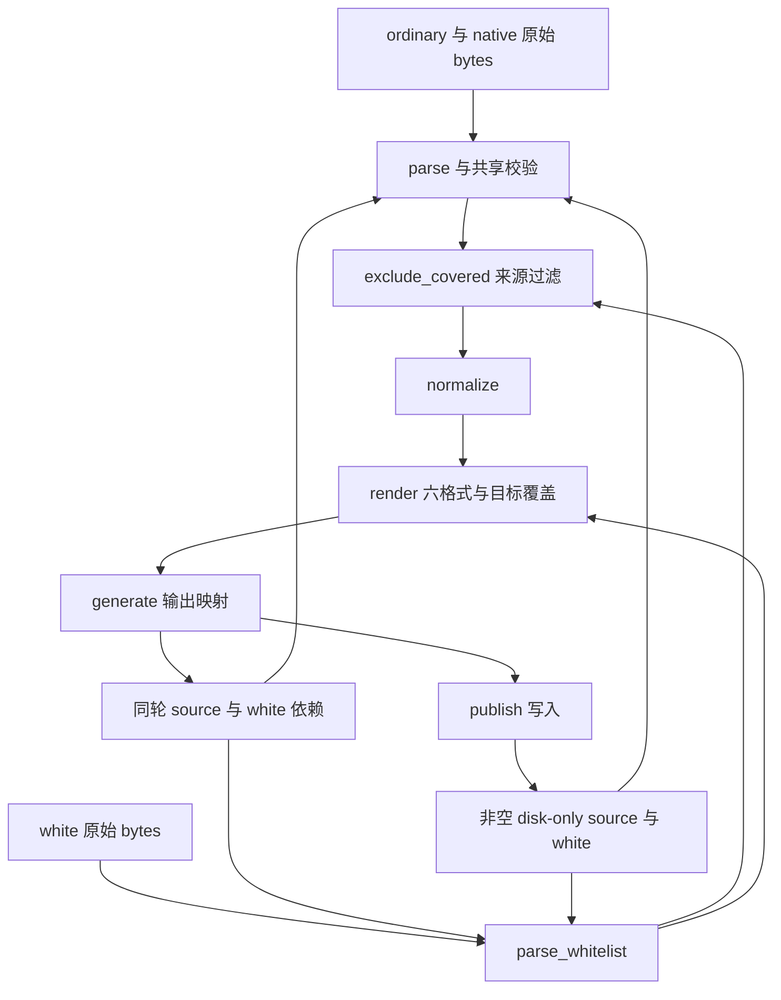
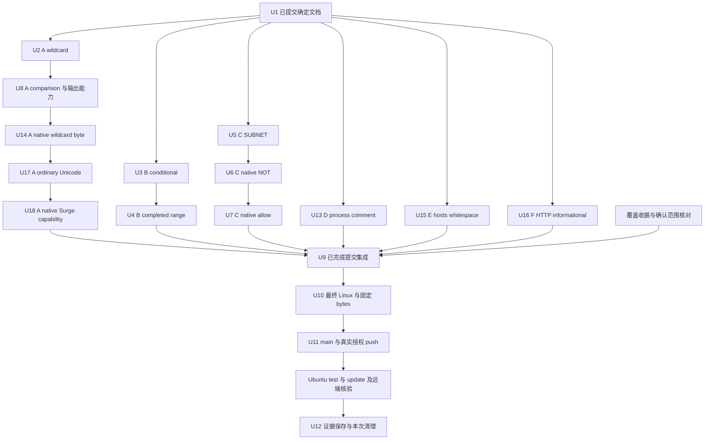

# 功能审查修正与发布 - Plan

## Goal Capsule

- **目标：**合法规则经公开转换及真实文件回读后保留可表达 matcher，非法 regexp2 与 native `@@` 不进入生成链，GitHub Actions Ubuntu 更新的七组产物满足现有格式和发布要求。
- **依据：**`docs/superpowers/specs/2026-10-24-functional-audit-design.md` R1-R18 规定行为和完成条件；本计划分配实现所有权及验证顺序，不重定义 matcher 语义。
- **方法：**A comparison／dedup、B regex、C SUBNET／native、D quoted process、E hosts、F HTTP informational response 六个独立 worktree 并行，组内连续完成 vertical TDD、审查、修正、英文提交及最终 head 完整 Linux suite（KTD1-KTD3）。
- **开始条件：**R1-R8、R13-R18 已确认，独立单元按已提交范围实施。阅读覆盖和基线测试已闭合，最终集成前核对收据及独立结论；修复后组件／集成、固定生成及远端验收另行执行，不阻塞独立实施。
- **停止条件：**实际证据与规格冲突、需要写入其他 owner 位置或无法保持目标能力时，报告具体缺口并停止对应操作。原始用户请求已明确要求 main 合并、GitHub push 及远程更新核验，发布按该授权范围执行。
- **交付责任：**各 owner 完成其全部实现与验证，主会话只合并已完成且无所有权冲突的提交，并负责最终精确树、固定输入、main、获授权发布和清理。

---

## Product Contract

### Summary

实施规格 R1-R8、R13-R18 的十四项已确认修正，涵盖规则比较／校验／输入、ordinary／native Unicode 投影能力及合法 informational HTTP 响应，完成公开接口回归、精确树 Linux 测试和固定 bytes 生成发布验收。

### Problem Frame

基线的共享归约与校验会删除普通 wildcard 仍需的 Mihomo 投影，误判部分 regexp2 conditional／class、legacy SUBNET 和 native NOT，将 native quoted ABP 例外误读为 allow，因 QX 非 ASCII 比较误删不同 matcher，并丢失合法长 keyword 的 DNS 输出。普通 quoted process 的尾注释会进入 matcher，native wildcard 在 lowercase 改变字节宽度时被 white 误删，hosts 非标准空白又会生成额外域名／white。普通 Unicode 被 Python full lowercase 改变 regex 字面内容，native Unicode 的 Surge 能力 guard 又遗漏固定 case 变体。这些结果经生成依赖传递，可能丢失可表达规则或发布错误 matcher；合法 103 后的最终响应还会被当成错误，中止更新。新增测试须证明具体行为，DNS 长值结论限定输出完整性，不声称生产上游实际发送 103。

### Requirements

| 规格要求 | 执行单元 | 可核查结果 |
| --- | --- | --- |
| R1 wildcard／suffix | U2 | 全小写根点见证所需 regex 保留，suffix 原生输出及安全归约保持 |
| R2 expression options | U3 | 按 `ntTestgroup`／`ntTestref` 与真实嵌套层级校验，完整 capture 集合保持 |
| R3 condition header | U3 | noncapture／atomic 合法，原 matcher 与外层分支计数正确 |
| R4 completed range | U4 | 合法单 hyphen 保留、非法双 hyphen 拒绝，escape endpoint 与 probe 一致 |
| R5 legacy SUBNET | U5 | bare BSSID 可回读，prefixed 与未知 colon 边界保持 |
| R6 native NOT | U6 | ASCII space 包装按结构接受，native 单 child 及 ordinary 行为保持 |
| R7 native `@@` | U7 | 解码后拒绝，无 allow／DNS 例外泄漏，其他 mixed-format 兼容保持 |
| R8 Unicode comparison／keyword 输出能力 | U8 | QX 跨值限制、keyword 原文代表及双重 contains 证明同时生效，合法 DNS 行和安全归约保持 |
| R9 公开入口与 bytes | U2-U8、U13-U18 | 六格式、source＋white 同轮及非空 disk-only、三 purpose × 三 no_resolve |
| R10 精确树 suite | U2-U10、U13-U18 | 各 owner 最终 head 和最终集成树独立完整 Linux 验证 |
| R11 固定生产输入 | U10 | 同输入 baseline 对比、两轮 42 文件稳定、static／README／格式核查 |
| R12 集成与远程 | U9、U11、U12 | clean 提交正常合并、真实授权、Ubuntu 与远端实际结果、限定清理 |
| R13 quoted process 尾注释 | U13 | 四 process 字段在已闭 quote 外识别尾注释，裸 marker／policy／logical／native 保持 |
| R14 native wildcard byte 覆盖 | U14 | white／candidate 先完整 Go15 lowercase 再比较 bytes，正确数量对照及原归约保持 |
| R15 hosts ASCII 空白 | U15 | 仅 SP／HTAB 分隔／trim，不误增域名或 white，native 前导空白和逐 alias 恢复保持 |
| R16 HTTP informational response | U16 | 同连接消费合法 1xx 后处理最终响应，不重发 GET，101及全部最终校验保持 |
| R17 ordinary Unicode 投影 | U17 | 两种普通 regex 投影复用 Go15 lower，wildcard 原文 unique、旧 class／root 准入保持 |
| R18 native Unicode Surge 能力 | U18 | keyword／wildcard 共用 case-variant guard，只跳 Surge，logical 整条及其他目标保持 |

Product Contract 由独立规格承载。这里的引用保留全部行为边界，不把审查复现或内存实验写成产品修复验收。

### Scope Boundaries

生产变更限定在规格的 A／B／C／D／E／F 位置。`Rule`、API、配置、依赖、导出和六文件集合保持。只新增各 owner 的独立小型测试，不复制已有大型矩阵；A 仅修改规格范围表列明的 wildcard／非 ASCII QX 旧期望和 R18 的 PublicGeneratedPipelineTests.expected，其他 owner 不写旧测试。当前文档任务仅更新 origin 和本计划，不修改其他受控路径，不执行客户端、安全工作、源码修正或远程操作。

本轮不处理 suffix 大小写、批量 suffix regex 改写、本机／多平台适配、未确认性能问题或独立 publish 非 canonical leaf API。不新增 Unicode 表，不改 Rule 原值，不承诺闭源 Unicode 全域等价。普通 Surge source white 保持原来源语义，不因 renderer 的目标差别改 Go 全局 key 或关闭全部 Unicode 归约。

---

## Planning Contract

### Key Technical Decisions

- KTD1. **六组按共享状态分配所有权。**A 连续负责 comparison／dedup／native byte／ordinary Unicode 投影／native Surge 能力，B 负责 regex scanner，C 负责 SUBNET／native，D 只改 process comment，E 只改 hosts，F 只改 generate HTTP 传输。共享 scanner 由 B 顺序实现，A 迁移 Go15 helper 时同步原 caller；各生产 hunk／新测试独立，E 与 C 的 parse 分支保持分开。
- KTD2. **同一 owner 按行为完成 vertical TDD。**每个 slice 从一个公开失败用例开始，只修共享根因使该例 green，再逐例加入相邻边界及真实 bytes 联动；完成规格／功能／简化审查、修正、复审和英文提交后才进入下一 slice。R2/R3 是同一 conditional 状态 slice，R4 另行提交。
- KTD3. **各 owner 完成最终提交 head 的全套后交付。**A、B、C、D、E、F 在各自最终 head 满足规格 R10，返回 clean commit／tree、red／green、相关回归、审查和完整 suite 证据。未发生隔离恢复失败的 owner 继续原 worktree；发生 R10 所述拒绝时，由同一 unit 的 owner 在新授予的独立 recovery worktree 正常 fast-forward 或 merge 原完整实现提交，核对 tree／逐 blob 身份后连续完成全部剩余步骤，以恢复后的实际最终 HEAD 运行全套。失败仍由该 owner 连续处理，主会话不接收半成品；已有 focused 不代替全套，其他 owner 已在同一 head 通过的全套不因本次执行条款更新重跑。
- KTD4. **共享修正保留既有目标能力。**R2-R4 只修来源 validator 和验证 probe，保持 DNS 独立证书及 URL-REGEX；R5 不新增目标支持；R6 仅 native 分支；R7 只拒解码后的 native `@@`；R8 连续完成 QX 跨值保护及非 native keyword equality／索引／contains 输出能力，保留 native 原安全归约；R13 只修 quoted process；R14 仅 native wildcard 两侧 byte 比较复用完整 Go15 lower；R15 仅 hosts ASCII trim／split；R16 复用 HTTPResponse.begin；R17 只修两种普通 Unicode 投影和 wildcard 原文 identity，R18 复用同一 case-variant 定义收紧 native Surge 能力。复用现有 caller 和字段读取，不增加 wrapper 或依赖。
- KTD5. **输入身份与执行身份分开记录。**只读固定 manifest／body，baseline 与最终代码运行在各自可信 archive；下载数据和执行脚本分开，不从下载目录运行解释器。旧抓取 commit／hash 不改写为最终代码 SHA。
- KTD6. **受控树确定后才做最终验收。**正常合并全部已完成分支和必要文档修正，形成唯一 commit／tree，再执行 R10、R11。测试后发生任何受控修改，重新提交并验证新树；组件和 baseline 日志不能替代最终结果。
- KTD7. **本地固定输入与远端实时更新分别验收。**固定输入验证代码差异和两轮稳定性，Ubuntu 按实际事件 SHA 与当次来源更新；分别保存结果，不把不同输入的数量差异归因于代码。

### Ownership and Impact

| owner | 可修改生产位置 | 测试文件 | 调用方与保持项 |
| --- | --- | --- | --- |
| A | 已分配 normalize／comparison／native byte；`formats._domain_value` 普通 lower／native 能力、`_surge_keyword_source_supported`；共享 Go15 helper／case-variant caller | 五份新测试：wildcard suffix、QX comparison、native width、Surge Unicode projection、native Unicode capability；旧期望见规格表及 U8／U18 | source white 不变、全部 helper caller、native 原比较、旧 class／root、target capability、真实 bytes |
| B | `_valid_regex` conditional、class 与 probe；确需时同一 owner 修改 `_regexp2_capture_slots`／`_valid_deep_regex` | 新增 `tests/test_regexp2_conditional_regressions.py`、`tests/test_regexp2_completed_range_regressions.py` | scalar parse、logical normalize／no_resolve、DOMAIN-REGEX white、`formats._dns_regex`、deep；不改 DNS 投影算法 |
| C | `_valid_simple` SUBNET、`_logical_children` native 分支、`parse` native `@@` | 新增 `tests/test_subnet_legacy_regressions.py`、`tests/test_native_not_space_regressions.py`、`tests/test_native_allow_regressions.py` | scalar／logical／kind traversal、native 字段与标量解码、allow／white、mixed shortcut、生成冻结与旧产物 |
| D | `_source_parts` 的普通 process 分支，复用 `_literal_fields` | 新增 `tests/test_process_comment_regressions.py` | `_source_records`／`_without_comment`、parse、生成依赖、process 不新增 white 支持、裸 marker／policy／logical／native 保持 |
| E | `_source_records` 的 hosts 裁剪与 parse 的 `host_parts` | 新增 `tests/test_hosts_whitespace_regressions.py` | ordinary／native mixed hosts、parse／white、四地址／物理行、逐 alias 恢复、真实 source／white 依赖 |
| F | `generate.py` 的 `_HttpsOnlyRedirect`／`fetch_https` informational response | 新增 `tests/test_informational_response_regressions.py` | 默认 HTTPErrorProcessor 前读取最终响应、source／white cache、redirect、编码／截断／关闭及原发布保护 |
| 集成 owner | 已完成分支的合并、必要规格／计划修正 | 复用上述模块，缺口交回原 owner | 最终 exact tree、固定 bytes、README 副本、main、Ubuntu 和远端产物 |

A 不修改 regexp2 validator 或输入 parser；R17 的目标 regex 字面投影在其明确范围内。B 不修改归约或其他 parser，C 不修改 regex／dedup／process comment／hosts trim，D 只改 process 分支，E 只改 hosts 分支；不得扩成全局 lexer／whitespace 改动。F 不修改 rules／formats／配置／workflow，只复用现有传输与缓存入口。测试 fixture 在临时 root 自建；不改 `rulesets.json`、static 或生产输出。实现需要跨所有权位置时，提供具体 failing caller，由主会话调整分工后继续。

### High-Level Technical Design

共享调用链决定每个修正的传播范围。

A、B、C 从 `109ea30f83720178130a1db0c608937eaae86ef8` 独立实施并吸收后续确认文档，A 连续 U2／U8／U14／U17／U18，B 连续 U3／U4，C 连续 U5-U7。D 从包含 R13 的文档提交独立完成 U13，E／F 分别从包含 R15／R16 的文档独立完成 U15／U16。覆盖收据在 U9 前核对。

### Evidence and Execution Preconditions

R1-R8、R13-R18 及 DNS 输出完整性补充均有完成的独立终报，既有文档独立审查结果保留，后续确认补充按证据自审。覆盖闭合终报确认全部初始 145 文件和源码行段无阅读缺口，阅读及基线测试已闭合；最终实际文件集合按集成提交重新核对。组件／集成、固定生成、远端结果仍待实际验收，旧背景任务无终态通知就不计成功。R17／R18 的语义见证由完成的独立核对确认，旧稳定回读收据不构成语义反证。HTTP 重复复核也已完成且无反证，最小实现范围保持。未确认观察不扩大普通 source white 或全局比较语义。

可信 Linux archive 运行方法、固定响应和旧验收脚本可复用，但实际目录、commit、tree、body hash 和终态须在执行时核查。旧脚本中的固定文件数、测试数和 SHA 属于其原运行身份，只允许在新副本适配本次身份，不放宽产品断言。

---

## Implementation Units

| 单元 | 交付结果 | 主要文件 | 依赖 |
| --- | --- | --- | --- |
| U1 | 确定范围与文档提交 | 两份功能审查文档 | 已收齐的确认终报 |
| U2 | wildcard 投影保留 | `rules.py`、wildcard 新测试、`tests/test_rules.py` 精确断言 | U1 |
| U3 | conditional 层级与 header | `rules.py`、conditional 新测试 | U1 |
| U4 | completed range 状态 | `rules.py`、completed-range 新测试 | U3 |
| U5 | legacy SUBNET | `rules.py`、SUBNET 新测试 | U1 |
| U6 | native NOT 包装 | `rules.py`、NOT 新测试 | U5 |
| U7 | native `@@` 拒绝 | `rules.py`、native-allow 新测试 | U6 |
| U8 | Unicode comparison 与 keyword 输出能力 | `rules.py`、QX comparison 新测试、指定 QX 旧期望 | U2 |
| U9 | 已完成提交集成 | 六组提交与必要文档 | A、B、C、D、E、F 最终交付及覆盖收据核对 |
| U10 | 最终 Linux 和固定输入验收 | archive、隔离证据与产物 root | U9 |
| U11 | main、Ubuntu 与远端验收 | 既有 update／workflow | U10、真实授权 |
| U12 | 证据和限定清理 | 本次 worktree／branch | U11 或明确本地交付状态 |
| U13 | quoted process 尾注释 | `rules.py`、process-comment 新测试 | 包含 R13 的 U1 文档提交 |
| U14 | native wildcard lowercase byte 覆盖 | `rules.py`、必要 helper caller、native-width 新测试 | U8 及包含 R14 的文档 |
| U15 | hosts ASCII trim／split | `rules.py`、hosts-whitespace 新测试 | 包含 R15 的文档，与其他 hunk 独立 |
| U16 | HTTP informational response | `generate.py`、informational-response 新测试 | 包含 R16 的文档，与其他 owner 独立 |
| U17 | ordinary Unicode regex 投影 | `formats.py`／`rules.py`、Surge-Unicode 新测试 | U14、R8 keyword 保护及 R17 文档 |
| U18 | native Unicode Surge 能力 | `rules.py`／`formats.py`、native-capability 新测试、精确旧期望 | U17 及 R18 文档 |

### U1. 固定最终范围和共同文档 base

**要求：**R1-R18。当前文档任务只完成本单元，不执行功能实现。

1. 核对获准 worktree 的 HEAD／branch／status 与当前文档提交，保留原内容、不 reset；仅编辑指定两份文档。初始 base 为 `109ea30f83720178130a1db0c608937eaae86ef8`，后续采用正常文档追加提交。
2. 按完成报告和源码规定 R1-R8、R13-R18，保留各最窄生产范围。R17 复用 Go15 lower／R8 keyword 保护，补 ordinary wildcard 原文 unique；R18 共用固定 case-variant guard，只改 Surge 能力。同步已批准旧期望、owner、测试、依赖及覆盖结论，不扩大普通 source white。
3. 核对要求、caller、fixture、目标能力、测试及交付边界，保留已有独立文档审查结果，对确认补充自审并运行 `git diff --check`。只提交两份文档，使用英文 commit 消息。
4. 主会话记录实际 clean 文档 commit／tree，各 owner 仅吸收相关确定范围，在独立 worktree 连续完成。已确认独立任务并行，最终集成前核对覆盖收据，完成后主动回报、不轮询。

**完成标准：**确定要求与终报一致，文档提交可供对应 owner 使用；未确认候选不写为实施要求。当前文档任务不创建实现任务、不改其他路径。

### U2. A：普通 wildcard 的必要投影

**要求：**R1、R9、R10。**依赖：**U1。**文件：**`rules.py` 的 `normalize`，新增 `tests/test_wildcard_suffix_normalization_regressions.py`，`tests/test_rules.py` 中 `test_normalize_keeps_wildcard_predicates_and_source_groups` 与 `test_wildcards_are_only_dropped_when_suffix_proves_coverage` 的相关期望。

**方法：**以最小公开输入中 `normalize` 丢失已有 Mihomo regex 的失败开始，按实际 source／目标能力限制归约。复用现有 wildcard 转换和能力事实，不改 suffix 投影，不一律关闭 wildcard 归约。旧测试按 source 及实际可投影 pattern 精确分开；外部 white 期望保持其原语义。

**测试情景：**

- 同组 `DOMAIN-SUFFIX,example.com` 与 `DOMAIN-WILDCARD,*.example.com` 保留必要 regex；用 `ads.example.com.` 与无根点对照核查，另核查 apex／其他域名。
- `api-*.example.com`、问号和已支持 class pattern 保留实际投影；无法生成 Mihomo 投影的 pattern 保持安全归约。native／QX 同组对照维持其原结果。
- allow／options／literal_process／native_fields／domain_source 不同组不互删，重复／逆序／一次性 iterable 结果稳定。
- source 层 suffix white、公开 allow、raw 和 generated white 分别检查，target filtering 根据最终 matcher 判断；不把正常白名单删除当作本项修正。
- 三 purpose × 三 no_resolve，六格式完整正文／diagnostics，真实 generate／publish 的同轮 source＋white 和非空 disk-only，static／旧产物保持。

**核查：**逐例 red -> green 后运行 domain coverage、native domains、ordinary wildcard、QX wildcard、wildcard dependency、keyword projection／performance 与相关 generate 回归。规格／功能／简化审查、修正复审后单独英文提交。A 连续完成 U8、U14、U17、U18，最后按 KTD3 交付最终 head。

### U3. B：conditional 的类型、options 和 header

**要求：**R2、R3、R9、R10。**依赖：**U1。**文件：**`rules.py` 的 `_valid_regex` conditional，确需的捕获预扫描，新增 `tests/test_regexp2_conditional_regressions.py`。

**方法：**同一 owner 在共享 scanner 内区分 expression 与完整 capture 集合上的 reference condition，记录真实父组类型和嵌套深度。依次以非法直接 options、合法 noncapture 和合法 atomic 三个最小公开见证驱动修正。只改变 validation probe 与校验状态，保留 matcher。

**测试情景：**

- `^(?(?=ads)(?i)ads|other)$`、scoped／disabled options、else 直接 options、literal 后直接 options 均拒绝，健康邻行及准确行号保留。
- `^(?(?:ads)ads|other)$`、`^(?(?>ads)ads|other)$` 和 condition 内多 alternation 合法，外层第三分支拒绝。
- numeric／named、前向定义、未定义词语 fallback、未定义 numeric、非法 capture／backreference 区分正确；reference 条件直接 options 保留。
- 普通 group／lookaround 内合法 options、x-mode／comment、显式捕获和嵌套 conditional 保持，condition 直接 comment／named capture 继续拒绝。
- 三 regexp2 kind、ordinary 引号差别、native 两种 header／三种标量、scalar／AND／OR／NOT、no_resolve 重验与 600／1000 层结果一致。
- 合法 DOMAIN-REGEX 的真实 white 与 YAML source＋white 同轮及非空磁盘可读取；非法单项保持生成错误／旧文件保护。Surge／QX／DNS unsupported 和 URL-REGEX 保持。

**核查：**复用现有 conditional、capture／options、anchor、POSIX class、deep、routing field、DNS／YAML 和 generated dependency 测试。完成 R2/R3 的规格／功能／简化审查、修正复审和独立英文提交后进入 U4；不把本 slice 的通过替代 B 最终 head 全套。

### U4. B：completed range 的 scanner 与 probe

**要求：**R4、R9、R10。**依赖：**U3。**文件：**`rules.py` 的 `_valid_regex` class 状态／escape 消费／probe，新增 `tests/test_regexp2_completed_range_regressions.py`。

**方法：**以 `^[a-z-\d]$` 的错误拒绝建立首个 red，最小修正后再以 `^[a-z--\d]$` 的错误接受驱动反向约束。让 completed range endpoint 与可开始 range 的独立 literal 分开，并同步 probe；不重写整个 parser。

**测试情景：**

- 单／双 hyphen 后 `\dDsSwW`、`\p{L}`／`\P{L}`，含／不含 negation，合法性按固定 `scanCharSet`。
- raw、`\e`／`\cX`、braced hex、固定宽度 hex／Unicode、octal 和 punctuation escape endpoint 消费完整，尾部数字不重新成为起点。
- escaped hyphen 不结束 pending range 的既有行为、真正 literal-to-class range、反向范围、POSIX-looking token 和合法／非法 subtraction 保持。
- 三 regexp2 kind、ordinary／native／logical、DOMAIN-REGEX white、no_resolve、600／1000 层与健康邻行均通过公开入口；合法及非法单项各有实际生成结果。
- source＋white 同轮、publish、移除 parent 后非空磁盘重读均一致；URL-REGEX 原 Python 结果、DNS 完整结构证书／hyphen／行预算不扩大。

**核查：**U3 新增 conditional 模块和既有 rules／formats、anchor、POSIX、DNS hyphen／coverage、YAML／生成依赖全部相关回归。完成审查、必要修正和复审后独立英文提交，B 最终 head 按 KTD3 完整 Linux suite 后交付。

### U5. C：legacy SUBNET bare BSSID

**要求：**R5、R9、R10。**依赖：**U1。**文件：**`rules.py` 的 `_valid_simple` SUBNET，新增 `tests/test_subnet_legacy_regressions.py`。

**方法：**从公开 `SUBNET,aa:bb:cc:dd:ee:ff` 的拒绝和 Surge 回读失败建立 red。在识别 prefix 时保留原专门校验，仅补明确合法 bare BSSID／通用 IP 的兼容，不把所有 colon 值接受为 SSID。

**测试情景：**

- bare BSSID 大小写、bare SSID／IPv4／wildcard SSID、ordinary quoted 值和已有 whitespace 支持保留，Surge full／split 原值可回读。
- 合法 bare IPv6 文本按通用 IP 语法核查，但不把它当作已实测 IPv6 默认网关功能。
- 未知 colon、畸形 BSSID、非法 IP、空值、markup 和全部已识别 prefix 的正反例保持原结果，不将非法 prefixed 值回退成 bare。
- scalar／AND／OR／NOT、合法邻行和 warning 行号、三 purpose × 三 no_resolve、真实 generate／publish 和 source 依赖；Mihomo／QX／DNS 与 white 保持原支持范围。

**核查：**SUBNET／routing field／logical whitespace／target field 及相关生成回归通过，审查、修正复审和独立英文提交后进入 U6。

### U6. C：native NOT 的结构包装

**要求：**R6、R9、R10。**依赖：**U5。**文件：**`rules.py` 的 `_logical_children` native 分支，新增 `tests/test_native_not_space_regressions.py`。

**方法：**以 `NOT,( (DOMAIN,a.test) )` 的 public parse／render 建立 red，按完整外层与单个 child 的实际范围判断，并将 native child-list 的 wrapped 状态保持到重建结果。ordinary 分支不修改。

**测试情景：**

- 两侧／单侧／多个 ASCII space、native 两种 header／三种标量、嵌套 AND／OR／NOT 均得到完整 `NOT,((DOMAIN,a.test))`。
- native 缺少 wrapper、空／多个 child、额外包装、非法尾字段及非法叶子拒绝，ordinary 单层 NOT 与 AND／OR arity 保持。
- `_condition_kinds` 和直接合法 native Rule 的 render 与 parse 一致；平衡 literal process 括号、regex 内部括号、ignored tail、目的／来源 IP、no_resolve 保持。
- HTAB／NBSP 维持原字段语义，600／1000 层不提高限制；六格式整条输出或 unsupported，健康邻行不掩盖单项可发布性。
- 临时 YAML 真实 generate／publish、同轮 source 及非空 disk-only 依赖完整回读；不把 NOT 新增为外部 white 类型。

**核查：**native arity、native domains、logical whitespace、deep、formats 和相关 generate 回归通过，审查、修正复审和独立英文提交后进入 U7。

### U7. C：native 解码后 `@@` 拒绝

**要求：**R7、R9、R10。**依赖：**U6。**文件：**`rules.py` 的 `parse` native item 判定，新增 `tests/test_native_allow_regressions.py`。

**方法：**先建立 quoted native `@@||safe.example.org^` 产生 allow 并删除路由的公开失败。只针对 YAML 解码后的 native `@@` 拒绝，沿用行号 warning 和后续行处理。产品依据使用 origin 所引历史 `@@` 约定，不采用整体 shortcut 禁用。

**测试情景：**

- `payload:`／`rules:` 的 single／double／支持的 plain、YAML escape 解码后 `@@` 均拒绝，不产生 allow、路由误删或 DNS 例外。
- 普通顶层 ABP allow、公开 `Rule(allow=True)`、真实外部 white、native 普通 block ABP、hosts、bare domain、CIDR 和 HOST alias 兼容保持。
- 健康邻行、物理行号、仅非法 item、非法 item 与健康 source／white 分别走 parse／parse_whitelist／generate；本地无适配规则错误、旧产物保护和 static 不变。
- 三 purpose × 三 no_resolve，六格式和 diagnostics；同轮 source＋white、publish 后非空磁盘依赖按真实 bytes，来源为非法 native 的 fixture 不替换为人工 allow。

**核查：**functional audit DNS、hosts comment、native domains、ordinary ABP／allow、generated white／冻结／publish 回归通过。规格／功能／简化审查、修正复审后独立英文提交，C 最终 head 按 KTD3 全套后交付。

### U8. A：Unicode comparison 与 keyword 输出能力

**要求：**R8、R9、R10。**依赖：**U2。**文件：**`rules.py` 的 `_domain_comparison_value`、`normalize` 非 native keyword identity／索引／contains、`exclude_covered` 的 QX 分支，新增 `tests/test_qx_unicode_comparison_regressions.py`；旧测试仅修改规格 A 范围表及本单元列明位置。

**方法：**从 `HOST-KEYWORD,ΟΣ`／`HOST-KEYWORD,ος` 经 normalize 丢失不同 Mihomo matcher 的公开 red 开始。共享 helper 对 QX 非 ASCII keyword／wildcard 保留完整原文，包括其中的 ASCII 字符；连续用 proper substring 和两方向 white 失败例限制两个 caller 的未证明跨值覆盖。只改 key 会让 `Σ` 成为 `ΟΣ` 的字面子串并新增误删，本 slice 必须同时完成三处并独立提交。同时以 Surge／QX 的 DNS equal-key 和 proper-substring 失败修正 normalize 的非 native 非 ASCII keyword 代表及索引，保留原文；对应 contains 同时要求原文 substring、旧 source comparison 包含及全部 target／root guards。native 原 comparison key、已证明 contains／root／target 和 Greek 期望保持。保留普通 Surge 原来源比较、source white、ASCII 及 Surge `İ`／`xİ`、中文安全归约，不改 DNS renderer／65,536 bytes 限值／Rule，不新增 Unicode 表、依赖或配置。

**测试情景：**

- keyword 的 `ΟΣ`／`ος`，wildcard 的 literal 同值及 `*ΟΣ*`／`*ος*` 均保留两条原文；重复、逆序、一次性 iterable 得到相同结果。用固定源码对应的 `οσ`／`ος` matcher 差别核查已证明的 Mihomo 输出，不运行客户端。
- `İ`／`i̇` 和 `xİ`／`xi̇` 覆盖 full lowercase 扩展碰撞，其中第二值包含 U+0307。keyword 使用 ASCII Host `i.example`，literal wildcard 使用 `i`，带星号 wildcard 使用 `i.example`，分别核对 Go simple lowercase 的 `i`／`i̇` 差别和原 matcher 保留。
- `ΑΟΣ`／`ος` 的 proper substring 不再误删，`Σ`／`ΟΣ` 的现有保留不回归。含非 ASCII 的 QX white 或 candidate 不依据 keyword 子串、wildcard 匹配、suffix／segment 推导产生未证明的跨值覆盖；覆盖 white 非 ASCII 与 candidate 非 ASCII 的两方向。
- 相同来源、相同 kind、相同原 payload 的去重及 white 身份覆盖保留；ASCII case／keyword 包含、Surge `İ`／`xİ` 和 `中文`／`中文广告` 安全归约、native root-dot 与全部 target guards 保持。native 不加 raw 限制，保留性能测试 `source='mihomo'` 的 `İ`／`I9` 归约和 `NativeDomainProvenanceRuleTests` Greek 期望，不扩大 unique／keyword 语义。allow／options／literal_process／native_fields／domain_source 继续分组。
- `N = 21843`，equal-key 的 `İ * N`／`(i + U+0307) * N` 保留 43,695 bytes 的合法 DNS 行，超限项 65,538 bytes 仍 unsupported；proper-substring 的 `x + İ * N` 保留 block 43,696 bytes／allow 43,698 bytes 的行，short 的 block／allow 分别需要 65,538／65,540 bytes。全部计入 LF 和 `@@`，覆盖普通 Surge／QX、公开 allow、raw／generated white、相同／逆序／重复／一次性 iterable，不宣称可达 DNS 漏拦截。
- 指定旧性能测试的 QX `İ`／`xİ` pair 保留两条，期望为 `pair[::-1]`，对应现有 normalize 稳定排序。Surge／Mihomo 旧期望、timeout 和资源条件保持；其他批准的 QX 跨值断言范围如下，两条 DNS 路径的新回归复用本单元新模块。
- 旧 `test_rules.py` 仅精确更新 `_check_complete_qx_literal_fields`、`test_qx_keyword_markers_preserve_complete_fields_and_whitelist_scope`、`test_keyword_whitelist_preserves_literal_range_allow_and_source_identity` 的非 ASCII QX longer 保留；`NativeWildcardWhitelistTests.test_coverage_preserves_source_flags_and_allow_rules` 及 `test_normalize_keeps_wildcard_predicates_and_source_groups` 仅调整 QX 非 ASCII candidate 保护期望，其他来源／flags／allow 对照保持。
- 旧 `test_generate.py` 仅更新 `NativeKeywordGenerateTests._qx_marker_products`／`_check_qx_keyword_marker_dependency` 及两个 white 调用测试在原 fixture 下受非 ASCII QX 保留影响的六格式正文／count／diagnostics／回读；完整方法名和边界见规格 A 表。source-only、ASCII／Surge／native／allow、旧文件保护、输入及阈值断言不弱化。
- 真实 parse_whitelist、公开 allow、raw／generated white 和正常删除对照保留。三 purpose × 三 no_resolve、六格式正文及 diagnostics 按现有能力检查，不把 QX／DNS 产物行数解释为未验证客户端的 Unicode 语义。
- 临时 root 真实 generate／publish；同轮 `fin-qx.txt` source＋white 和 publish 后移除 parent 的非空 disk-only source＋white 均保留所需 matcher。`fin.yaml` 重导入按 Mihomo 来源处理，输入、static、旧产物和冻结行为保持。

**核查：**逐例 red -> green，复用 U2 新模块及既有 domain provenance、native／QX keyword／wildcard、keyword projection／performance、white、formats／generate 和 generated dependency 回归。完成规格／功能／简化审查、必要修正和复审后独立英文提交，A 连续完成 U14／U17／U18，再以最终 head 按 KTD3 完整 Linux suite 后交付。

### U9. 合并已完成分支与联合回归

**要求：**R9、R10、R12。**依赖：**A／B／C／D／E／F 的最终 clean 交付及覆盖收据核对。**文件：**六组已审查提交、必要 origin／本计划修正。

D 的恢复收据记录：原实现提交 `5a25411fab3084c57a3f43affcab126ded477bbe`，tree `5a4b68b13983050e400ea42e5072793205f4026a`，独立 review 已 PASS。fresh finalize 与恢复原代理均被 harness 固定到 integration；`EnterWorktree` 进入原 D 路径因 protected checkout 的 Git identity 无法核实被拒绝，主会话尝试同一路径也被拒绝，未手工修改 Git 元数据或权限。原 D 证据已由完成 workflow 和只读收据取得，不再读写被拒旧路径，不调查本机、不将此恢复交给用户；在新授予的独立 recovery worktree 接续原 unit。恢复尚须取得实际新 HEAD 的完整 suite 结果。

1. 核对六领域覆盖收据、全部确认要求及候选处置；核对各分支起始 base 和后续文档范围、commit／tree、精确 hunk、clean、逐 slice 提交、red／green、审查与 KTD3 完整 suite。发生恢复时，同时记录原提交、新 recovery 路径／分支、恢复前后完整 SHA／tree 与连续历史；仅文档分叉时正常 merge 原完整提交，可 fast-forward 且 clean 时正常 ff，不 cherry-pick 复制或 reset。逐路径 mode／blob 证明产品／测试与原实现提交相同、其余差别仅为已确认新文档；全套日志必须指向恢复后实际完整 HEAD，不能以原实现 SHA 冒充。缺失项由同一 unit 的 owner 在获准独立 worktree 连续补齐后交付。
2. 在本次已从 baseline 建立的 `audit-20261024-5bebe430-integration` 分支和同名独立 worktree 正常合并文档 base 及全部完成历史，按实际 hunk 处理必要冲突，不整文件选边。新失败交回原 unit 的 owner，在原获准 worktree 或符合 R10 的独立 recovery worktree 连续完成测试、修正、复审、提交与实际最终 HEAD 全套后重新合并，不把未完成步骤转交主会话；最终集成树仍须独立完成 U10。
3. 联合运行所有新增模块与相关 rules／formats、domain／white、regex／DNS、native／routing、YAML／generate、README／CI 测试。重点核对 A 的非 native equality／contains／ordinary wildcard identity、native byte、两种 Unicode 投影／能力与全部 helper caller，B 的 probe／capture，C 的 native／no_resolve，D 的 comment，E 的 ASCII hosts trim／split，F 的 interim／最终响应／关闭／缓存，以及 source＋white 同轮／磁盘链。
4. 逐项对照最终规格，清除本次未采用实现、重复 helper、未使用内容和无关改动，完成审查、修正复审及英文提交，固定唯一受控 commit／tree。本轮不要求额外 README 功能段落；计数由 U10 的隔离副本和 U11 发布实际计算。

**完成标准：**六个完成分支的预期 hunk 全部存在，联合测试通过，受控树 clean，具备 U10 的唯一执行身份。

### U10. 最终 exact tree、固定输入与真实发布验收

**要求：**R10、R11。**依赖：**U9。完整 suite 和固定输入构建可由不同验证 workflow 在同一 commit 的独立可信 snapshot 并行，完成后主动回报。

1. 使用最终提交完整 Git archive，在 Debian 原生 `/tmp` 新空目录提取，记录 commit／tree、mode／blob／bytes／SHA-256、解释器及 Git 版本。用隔离解释器显式加入可信 root，完整 unittest discovery 前后受控清单相同；不在 `/mnt/c` 执行重型 suite。
2. 固定输入使用规格 R11 的 manifest 与实际 body 路径，逐项核对最终配置 56 URL／72 角色及全部 hash。初始 baseline 与最终代码各用同输入生成，并分别记录代码身份、warnings 和 diagnostics；不重新抓取或改写旧抓取身份。
3. 复用已有可信验收方法，在本次新证据目录中适配实际 SHA、目录和收集数。脚本／下载数据分开，旧证据只读；不为通过检查提高 timeout、内存阈值或改变断言。
4. 隔离 artifact root 调用真实 generate／publish 和 README update，两轮使用相同 input／header 时钟，检查全部 42 文件与 diagnostics 稳定、无意外冻结、20 static 和输入 hash 不变。
5. 逐文件执行 R11 格式检查，保存 count／bytes／规则集合／diagnostics 和真实耗时。对同输入 baseline 逐规则解释增删，ADB Version 单独记录。未受修正影响的输出保持，不用比例阈值替代解释。
6. 核对主 worktree 的配置、static、README 计数和生产产物未被本地重放修改。失败由对应 owner 完成最小修正与新提交，再形成新集成树并重验本单元。

**完成标准：**最终实际收集的全部测试无 failure／error，保持原十个 Windows-only skips；完整 archive 身份准确。固定输入两次真实发布的 42 文件满足格式、static、README、稳定性与逐规则差异要求，证据可复查。Debian 结果不宣称 Ubuntu 已完成。

### U11. main、真实授权、Ubuntu 和远端产物

**要求：**R12。**依赖：**U10；原始用户已授权 main 合并、GitHub push 和远程更新核验。当前文档任务不执行此单元。

1. 核对当前 main／origin tip、用户既有修改和本次分支。远端前进时读取实际差异并正常合并；受控 tree 变化须重新审查、提交及执行 U10。
2. 回原工作目录正常合并已验收集成提交到 main。新增 merge SHA 的 tree 若与验收 tree 相同，记录对应关系；内容不同重新验收实际最终树。
3. 依据已核对的原始用户请求执行普通 push，保留 hooks／signing；无需再次询问 push 授权，不将委派文本或计划作为新增授权来源。
4. 核对 `.github/workflows/main.yml` 实际事件 SHA 的 Ubuntu test 和依赖该 test 的 update 终态，保存 run／attempt／job／SHA、日志与 published／unchanged；superseded 继续核对替代 SHA。
5. 读取最终远端提交原始 bytes，核对代码祖先、bot 父提交、限定 42 产物及 README、static 不变和 R11 的格式条件。实时上游变化独立解释，不与本地固定输入强行等量比较。失败按实际日志交回原 owner 后重新走完整验收。

**完成标准：**实际事件或替代 SHA 在 Ubuntu 通过测试并完成发布／确认无变化，远端 42 产物核对通过；失败及未完成项按实际范围交付，不伪报远程完成。

### U12. 保存证据与清理本次 worktree

**要求：**R12。**依赖：**U11，或已明确停在本地已验收状态。

1. 将需要复查的 commit／tree、red／green、审查、完整 Linux、固定 bytes 和已执行的远端证据保存到不会随 worktree 删除的本次专用目录；清单记录本次全部实现及 recovery worktree／分支、原实现提交与恢复后的完整 HEAD／tree，保留身份核对和连续历史收据。
2. 用 ancestry／status 证明待清理的本次分支已合并、clean、无未合并提交且无继续使用需求；退出任务 worktree 返回原目录后，用 Git 管理命令清理本次 worktree／branch。不为清理再次访问被拒旧路径或绕过隔离，无法核实的项目保留并列明。
3. 不清理历史 worktree、其他任务分支、原 `.claude/` 或未保存内容，不强制删除。仅删除本次已无用途的临时目录，已知本机非阻塞失败列明实际残留路径。

**完成标准：**必要证据保留，本次已完成且无用途的目录／分支按权限清理，未执行和未清理项如实交付。

### U13. D：普通 quoted process 尾注释

**要求：**R13、R9、R10。**依赖：**包含 R13 的文档提交；与 A／B／C 的生产 hunk 不重叠。**文件：**`rules.py` 的 `_source_parts` 普通 process 分支，新增 `tests/test_process_comment_regressions.py`。

**方法：**以公开 `PROCESS-NAME,"Game" # tail` 得到错误 value 的 red 开始，仅对四个 process kind 中以字段 quote 开头、quote 已闭合且外部空白 marker 已由现有扫描确认的分支复用 `_literal_fields`，正确结束字段读取。修正共享来源入口，不在 renderer 补救，不修改全局 lexer、policy／logical／native 语义或 HOST-KEYWORD literal 例外。

**测试情景：**

- 四 process kind、single／double quote、`#`／`;`／`//`、三 purpose 的 72 组合均与无注释对照相同；补三 no_resolve 和六格式完整正文／diagnostics，Mihomo 编码不得包含尾注释。
- 注释内逗号、未闭合 quote、括号、markup 不再破坏合法已闭合字段；源字段真正未闭合仍按原校验拒绝，健康邻行与物理行号准确。
- 裸 `Game # literal`、quote 内 marker、外层 quote 表达字面双引号、escaped quote／反斜杠、value 内逗号、policy 后注释、AND／OR／NOT 内 process、native YAML 外层注释及内部字面字段分别保持。
- 真实 parse_whitelist 不新增 process 支持；临时 source 的 generate／publish、同轮 `fin.txt`／`fin.yaml` 依赖及发布后移除 parent 的非空 disk-only 回读保留正确 matcher。原输入、static、旧产物及生成失败保护保持。

**核查：**逐例 red -> green，运行新模块及既有 process／ordinary whitespace／literal lexer／formats／generate／routing field 相关回归。完成规格／功能／简化审查、必要修正和复审后独立英文提交，D 最终 head 按 KTD3 完整 Linux suite 后交付，不修改其他 owner 的测试文件。

### U14. A：native wildcard lowercase 后的 byte 覆盖

**要求：**R14、R9、R10。**依赖：**U8 及包含 R14 的文档提交，A 连续完成。**文件：**`rules.py` native wildcard white／candidate byte 比较，确需共享时修改既有 `_go_lower`／依赖的声明和全部 caller；新增 `tests/test_native_wildcard_width_regressions.py`。

**方法：**以 `ẞ.example` 对 `???.example` 被误删的公开 red 开始，只在 native wildcard byte 比较前对两侧应用完整现有 Go15 lowercase。复用现有 `_go_lower` 和 `_unicode15.py`，按最少可靠依赖选择共享位置；不得从 rules 反向导入 formats 造成循环。若迁移 helper／regex，同步全部 process／DNS 等 caller 并移除旧实现，不新增表或通用抽象。

**测试情景：**

- native `ẞ.example`／`Ⱥ.example`／`Å.example` 分别对错误 3／2／3 个问号保留，对正确 2／3／2 个问号成立覆盖；原文和 constructor 后 `ß`／`ⱥ`／`å` 的 UTF-8 byte 数分别核对，white 与 candidate 两侧均转换。
- public parse／parse_whitelist／exclude_covered、raw render 和真实 generate／publish 保留原 Rule payload，正确 diagnostics；三 purpose × 三 no_resolve、六格式、合法邻行和单项均验证。
- source＋white 同轮 `fin.yaml` 依赖与 publish 后移除 parent 的非空 disk-only 依赖均回读，输入／static／旧产物及冻结保护保持。
- source 分组、allow、native bracket literal／root-dot、ASCII／Greek、QX 非 ASCII 保护和 known suffixcase 保持。`normalize` 的 native unique／keyword 不因 helper 复用采用新等价归约，非 native R8 也不扩大。

**核查：**逐例 red -> green，运行本新模块及 U2／U8、native wildcard／domain／white、Go15 Unicode、process、DNS、formats／generate 相关回归。完成规格／功能／简化审查、修正复审和独立英文提交后，A 连续完成 U17／U18，再以最终 head 按 KTD3 完整 Linux suite 交付。

### U15. E：hosts 的 ASCII 空白边界

**要求：**R15、R9、R10。**依赖：**包含 R15 的文档提交，生产 hunk 与其他 owner 独立。**文件：**`rules.py` 的 hosts 预处理裁剪和 parse `host_parts`，新增 `tests/test_hosts_whitespace_regressions.py`，不修改旧 hosts-comment 测试。

**方法：**以 `0.0.0.0 good.example bad.example<NBSP>protected.example sibling.example` 静默产生额外域名的公开 red 开始，hosts 注释后只 trim ASCII SP／HTAB，host_parts 仅按 SP／HTAB 分隔；保留其他字符交既有 hostname validator。复用已有处理，不手写 parser、不改全局 whitespace。切分前维持 ASCII 边缘裁剪，保留 native 解码后前导 SP／HTAB，不出现空首字段回归。

**测试情景：**

- 20 个非标准 isspace 字符 × 四支持地址 × LF／CRLF × 五位置，覆盖 alias 内部、尾部、注释前、地址后和前导；非法 alias 一项 warning，good／sibling／下一物理行保留，原行号准确。物理行拒绝集合保持。
- 四地址、BOM／CRLF、重复／混合 SP／HTAB、任意 `#` 注释及逐 alias 合法恢复保持；native 两 header／单行 scalar、解码后 ASCII 前导与 mixed hosts，direct／proxy block-only 均作对照。
- public parse／parse_whitelist／normalize／render，三 purpose × 三 no_resolve 和六格式检查不产生额外 protected 域名或 DNS `@@`。真实 source／white、raw／generated 同轮和 publish 后非空 disk-only 链使用真实 bytes，static／输入及旧文件保护保持。

**核查：**逐例 red -> green，运行新模块及既有 hosts comment／alias recovery、ordinary physical-line、native mixed-format、formats／generate／white 相关回归。完成规格／功能／简化审查、必要修正与复审、独立英文提交后，E 最终 head 按 KTD3 完整 Linux suite 交付。

### U16. F：HTTP informational response 与最终响应

**要求：**R16、R9、R10。**依赖：**包含 R16 的文档提交，与其他 owner 修改位置独立。**文件：**`generate.py` 的 `_HttpsOnlyRedirect`／`fetch_https`，新增 `tests/test_informational_response_regressions.py`。

**方法：**以公开 fetch_https 对合法 103 -> 200 抛 HTTPError 的 red 开始，在默认 HTTPErrorProcessor 前复用 `HTTPResponse.begin()` 消费多个合法 1xx。清除中间 headers、保留最终 status／headers，恢复 urllib `msg == reason`；同连接继续、不重发 GET、不手写 parser、不获取 hints 链接。100 保持标准库行为，101 保持失败；继续读取异常时及时关闭并传播。

**测试情景：**

- 单／多 103、102、100 混合，direct／HTTPS redirect 前后，plain／gzip／chunked／组合编码均读取相同最终 bytes；interim 的 CL／encoding／location 等字段不污染最终响应。
- 最终 200 及既有 size／CL／chunked／gzip／empty 检查保持；最终 404 缓存／跳过、429／5xx 中止、206／101 失败、缺最终响应／截断／CRC 错误按原错误语义处理，response 完整关闭，URL／cause 保留。
- source／white 重复 URL cache 只请求一次，redirect 不增加重复 GET。用成熟 HTTPResponse 线级 fixture 及本地 TLS 功能对照核验，不放宽证书／hostname 校验、不做安全扫描或本机适配。
- 三 purpose × 三 no_resolve × source／white × 编码／redirect 的真实 generate／publish，与移除 interim 的同 input 对照六格式正文／diagnostics 一致；失败前不发布，旧六文件、static 和输入保持。

**核查：**逐例 red -> green，运行新模块、既有 functional transport／chunked OWS／sources／generate 的状态、cache、编码、冻结和发布保护回归。完成规格／功能／简化审查、必要修正与复审、独立英文提交后，F 最终 head 按 KTD3 完整 Linux suite 交付。不重抓生产、不声称当前上游实发 103，重复独立复核已完成且同样确认，既定处理范围保持。

### U17. A：普通 Surge Unicode regex 投影

**要求：**R17、R9、R10。**依赖：**U14，keyword normalize 复用 U8。**文件：**`formats._domain_value` 的 ordinary keyword／wildcard lowercase、`rules.normalize` 的普通非 ASCII wildcard unique identity，新增 `tests/test_surge_unicode_projection_regressions.py`。

**方法：**从普通 `DOMAIN-KEYWORD,İ`／`ΟΣ` 及 `DOMAIN-WILDCARD,*İ*`／`*ΟΣ*` 的自身字面 Host 不再命中的公开 red 开始，只将两处 Python lower 复用现有共享 `_go_lower`。keyword 代表和 contains 不重复开发，复用 U8；普通非 ASCII wildcard 的 normalize-local unique 改为原文身份，不改全局 comparison 或 source white。scalar／logical／target white 共用同一投影。

**测试情景：**

- `İ`／`ΟΣ`／`ΑΟΣ` 的 keyword、literal／含星号 wildcard，预期 Go15 literal 为 `i`／`οσ`／`αοσ`，final sigma 保持；依据固定 regexp2 parser／runner 和原 Host 路径核查，不用 Python re.I 作为 Unicode 真值。
- `İ`／`i̇`、`ΟΣ`／`ος` 的普通 wildcard same-key pair 正逆序／重复／一次性 iterable 保留原文；keyword 按 U8 guard，保留 `İ`／`xİ`、中文／ASCII 安全归约与所有 identity 字段。
- 旧 `[İ]`／`[İ-J]` class unsupported 不变，原可用 ASCII class 及非法 class、keyword 尾点 lookahead、wildcard optional-root／boundary 继续通过；R1 投影可用性判断与实际 renderer 一致。
- scalar／AND／OR／NOT、公开 allow／target white、三 purpose × 三 no_resolve、六格式与 diagnostics、真实 YAML source 同轮／非空磁盘回读及 generate／publish bytes 保持正确。普通 source white 仍按原语义，不全局改 key 或关闭 Unicode。

**核查：**逐例 red -> green，运行新模块及 U2／U8／U14、keyword projection／performance、wildcard dependency、logical／white、Go15、formats／generate 回归。完成规格／功能／简化审查、修正复审及独立英文提交后连续完成 U18。

### U18. A：native Unicode 的 Surge 能力

**要求：**R18、R9、R10。**依赖：**U17 及现有共享 Go15 case-variant 定义。**文件：**`rules._surge_keyword_source_supported`、`formats._domain_value` native wildcard guard，新增 `tests/test_native_unicode_capability_regressions.py`；旧测试仅精确调整 `tests/test_generate.py` 的 `PublicGeneratedPipelineTests.expected`。

**方法：**以 native `É` keyword／`*É*` wildcard 和含其叶子的 logical 误输出 Surge 的公开 red 开始，两种 guard 共用既有 `_PROCESS_CASE_VARIANTS`，复用 U14 的同一共享定义。不能用 value 与 lowercase 相等替代，因为 lowercase `é`／`σ`／`ß` 也有固定 case 变体；不改 DOMAIN／SUFFIX、unique、来源比较或普通 source white。

**测试情景：**

- uppercase `É`／`Σ`／`ẞ` 及 lowercase `é`／`σ`／`ß`、`ΟΣ` 的 scalar 与 AND／OR／NOT 仅 Surge unsupported，logical 整条跳过并按顶层类型诊断；Mihomo、QX、DNS 原能力保持。
- 数字／中文／case-invariant Unicode、keyword 尾点、wildcard 尾星号／根点、问号 byte／字符、bracket、外部 white／allow 及 `_route_whitelist` 更严格边界保持，全部 process／DNS helper caller 不变。
- `PublicGeneratedPipelineTests.expected` 仅从 parent／child 的 `fin.txt`、`fin-surge.txt` 删除 native `DOMAIN-KEYWORD,ΟΣ` 正文，header 按实际数、每组新增两项对应 unsupported；YAML identity、QX、DNS Greek bytes、DOMAIN-SET、fixture／publish 均保持。其他旧期望实际受影响先报告主会话核查。
- 三 purpose × 三 no_resolve、六格式完整正文／diagnostics、真实 generate／publish、YAML source 同轮／非空磁盘依赖及旧文件／static／输入保护均验证。

**核查：**逐例 red -> green，运行本模块及 U2／U8／U14／U17、native provenance／projection、target-field、keyword、white、Go15／process／DNS、generated pipeline 回归。完成规格／功能／简化审查、必要修正和复审、独立英文提交后，A 最终 head 按 KTD3 完整 Linux suite 交付。

---

## Verification Contract

| 检查 | 具体入口 | 通过条件 |
| --- | --- | --- |
| A wildcard | 新 `test_wildcard_suffix_normalization_regressions`、既有 rules／domain／wildcard／keyword 相关模块 | R1 最小 red -> green、source 精确断言、安全归约与实际 bytes 回归 |
| B conditional | 新 `test_regexp2_conditional_regressions`、capture／options／anchor／deep 相关测试 | R2/R3 正反例、完整 capture 分类、原 matcher 与目标边界 |
| B range | 新 `test_regexp2_completed_range_regressions`、POSIX／DNS hyphen／rules／formats | R4 scanner／probe 同步，escape 与 deep／DNS／URL 边界 |
| C SUBNET | 新 `test_subnet_legacy_regressions`、routing／target／logical 相关测试 | R5 bare 与 prefixed／colon 的明确边界和 Surge bytes 回读 |
| C native NOT | 新 `test_native_not_space_regressions`、native arity／domains／logical whitespace | R6 真正包装、单 child、ordinary 保持、深层及直接 render |
| C native allow | 新 `test_native_allow_regressions`、functional DNS／hosts／ABP／generate | R7 解码后拒绝、无误删、mixed shortcut 和顶层 allow 保持 |
| A comparison／输出能力 | 新 `test_qx_unicode_comparison_regressions`、keyword／white／性能相关模块 | R8 非 native raw／contains、QX 精确旧期望、native 原比较／Greek、DNS block／allow 及真实 bytes |
| A native byte 覆盖 | 新 `test_native_wildcard_width_regressions`、Go15／process／DNS／white | R14 三字符错误／正确问号数，两侧 lowercase、原 native 归约和全部 helper caller |
| A ordinary Unicode 投影 | 新 `test_surge_unicode_projection_regressions`、wildcard／keyword／logical／generate | R17 Go15 literal、自身 Host、wildcard unique、旧 class／root／source white 保持 |
| A native Surge 能力 | 新 `test_native_unicode_capability_regressions`、PublicGeneratedPipeline／projection | R18 完整 case-variant、scalar／logical 仅跳 Surge及精确旧期望，其他目标不变 |
| D process comment | 新 `test_process_comment_regressions`、既有 process／lexer／generate 相关模块 | R13 的 72 组合、裸 marker／quote 内／policy／logical／native 对照及真实依赖 bytes |
| E hosts whitespace | 新 `test_hosts_whitespace_regressions`、既有 hosts／alias／physical-line／generate | R15 的 20 字符位置矩阵、ASCII/native 前导对照、逐 alias 恢复及 source／white 真实 bytes |
| F informational response | 新 `test_informational_response_regressions`、既有 transport／chunked／generate／sources | R16 的单／多 interim、最终状态／headers、无重复GET、关闭、缓存／编码及真实发布 |
| 公开链路 | 全部新增模块、`test_rules`／`test_formats`／`test_generate`、functional integration／YAML／white | R9 公开入口、三 purpose × 三 mode、source＋white 和非空 disk-only 完整 |
| 各 owner 最终 head | R10 的完整可信 Git archive，Python `-I -B` 下显式 root 的 unittest discovery | KTD3，无 failure／error，原 skips／资源阈值与清单保持 |
| 最终集成 head | 独立完整 archive 与全套 discovery | U10 实际 commit／tree 和所有受控内容前后一致 |
| 固定生产 bytes | manifest／body hash、真实 generate／publish／README update | R11 同 input 两轮稳定 42 文件、static／格式／count／逐规则差异 |
| 范围和文档 | 精确 diff／status、`git diff --check`、规格与计划逐项审查 | 两份当前文档及后续各 owner 只改所分配位置，英文提交，十四项确定范围和验收身份准确 |
| 实际远程 | 真实授权普通 push、Ubuntu test／update、最终远端 bytes | U11 事件身份、真实终态、代码祖先与限定产物核对 |

新增模块以现有标准库 unittest discovery 读取；完整重型 suite 只按 R10 的 Debian `/tmp` 完整 archive 方法执行。现有 `tests/test_readme.py`、`tests/test_readme_counts.py`、`tests/test_ci_publication.py`、`tests/test_workflow.py` 和 alias／transport 回归保留，不做本机适配。当前计划没有执行实现、suite、生成或发布。

---

## Definition of Done

两份文档规定 R1-R8、R13-R18 及 R8 非 native DNS 输出完整性补充，最终集成前覆盖收据与确认范围已核对，A／B／C／D／E／F 按各自已提交文档范围完成公开 red／green、相邻及真实 bytes 回归、规格／功能／简化审查、修正复审和英文提交。每个 owner 的最终 head 通过完整 Linux suite，主会话正常合并后另行验证最终 exact tree，所有预期 hunk 和入口保持。

最终同输入 baseline 与两轮 42 产物满足 R11，必要证据可复查。依据原始用户授权正常合并 main／push，核对实际 Ubuntu test／update 和远端 bytes。只清理本次已合并、clean 且无用途的 worktree／branch，记录未执行或未清理项，保留原用户内容。
