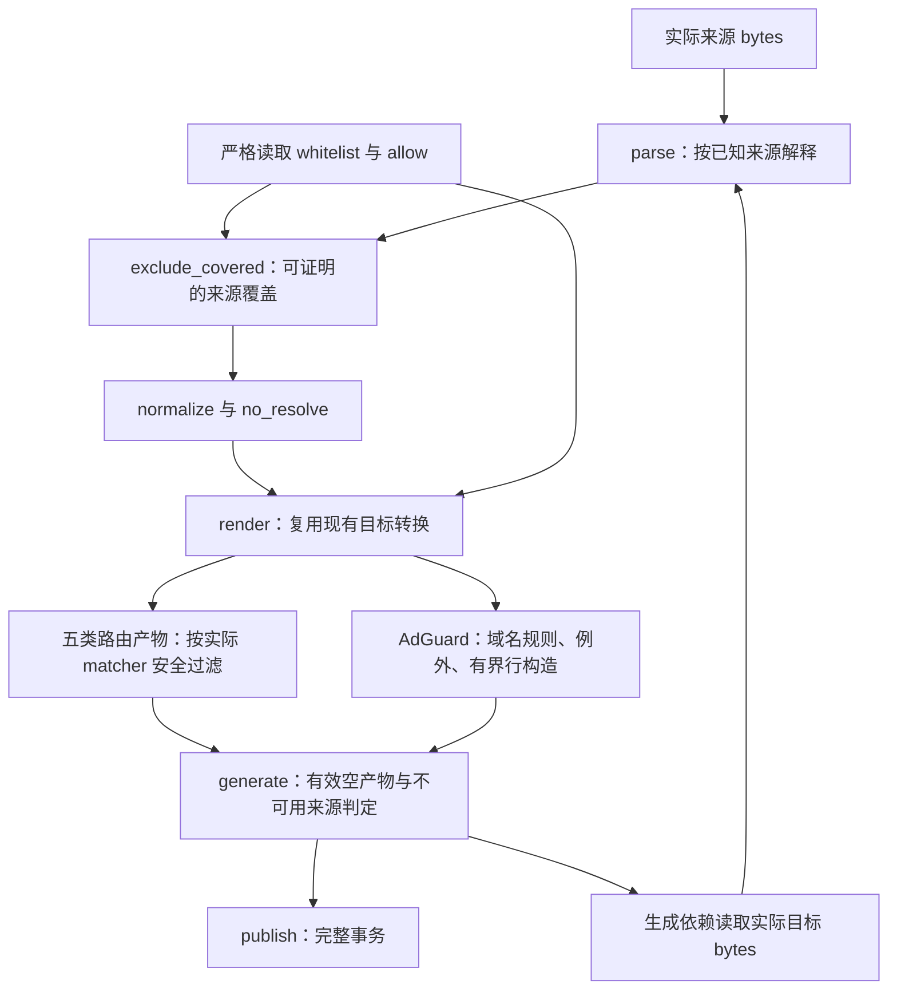

# 功能全面审查的修复设计

## 当前域名输出要求（2026-10-20）

普通来源和 Surge 的 `DOMAIN`／`DOMAIN-SUFFIX` 在 Mihomo classical 输出中使用同名原生规则，接受 Mihomo 原生 case／root 行为；按最终标量去重，保留其他目标和 DNS 使用的 Rule 来源身份。真实 raw regex 原文、必要 keyword／wildcard 转换、native 输入、IP／logical／no_resolve 和 DNS 结构证书及限制保持。

下文 U5D1 及相关 S1 的 ordinary paired-class／双 arm suffix 构造是历史实施记录，已由本节替代，不再要求普通域名生成 regex。U5D3／U5D4 对输入中真实严格 paired 模板的 DNS 证书及有限覆盖判断继续适用，模板再编码验证独立于普通域名输出。历史基准、验收记录和未属于本次修改的边界保留。

## 目标与完成边界

交付范围为基准 `32236187e11d4fbc1f01245989798e6246ac42c6` 上确认的 21 项缺陷修复及 C2 文件迁移，共 22 项任务：R1-R14、F1-F4、N1-N2、C1-C2，以及本规格 U5D1-U5D4 的后续域名投影修复。交付包含解析、白名单覆盖、目标转换、HTTPS 读取和生产工作流的完整修复、逐项 TDD、独立整体验证及远程 Ubuntu 验收。

当前实施基准为 `fe96a2b7946a530f29e055f531d6060326f0994b`，tree `916ce25ddc10fddcc2a7b4acfc5af01263fc032f`。U1-U4 及 V6 static canonical alias、V4 Surge wildcard 根点修复已经各自验证、审查和提交，不重开。当前待完成 U5D1-U5D4、新候选 U5 验收及 U6。旧候选 `bfae927795907006174f48d71d61431a983e998e` 的完整测试和 TLS 记录仅对应旧树，不能用于批准新候选发布；原 static 大运行只等待主动终态，不修改、取消或重复执行。两文档的当前修改属于待独立审查的草稿，不表示产品已修复或远程验收已完成。

保留七组 `cdn`、`a3`、`a4`、`big-data`、`tg`、`proxy`、`dirt`，每组六文件，共 42 文件：

| 文件 | 消费方式 |
|---|---|
| `fin.txt` | Surge 完整 RULE-SET |
| `fin-qx.txt` | Quantumult X 远程规则，策略占位保持 `LIST` |
| `fin.yaml` | Mihomo classical provider |
| `fin-adb.txt` | AdGuard DNS 域名规则与 `@@` 例外 |
| `fin-surge.txt` | Surge 非 DOMAIN-SET 规则 |
| `fin-surge-ds.txt` | Surge DOMAIN-SET |

继续使用 Python 3.11+ 标准库。公开入口 `Rule`、`parse`、`parse_whitelist`、`normalize`、`exclude_covered`、`render`、`generate`、`publish`、`fetch_https`、`load_config`、`resolve_source` 保持现有调用兼容。禁止在本机启动任何客户端，禁止下载执行客户端或其他外部代码；生产构建不增加客户端、依赖、来源集合、输出格式或平台适配，C2 仅同步现有本地白名单路径。

`static/` 可由用户合法编辑。生成器不得写入该目录；测试和 Actions 不得固定其内容、哈希、指定条目或 Git 工作区状态。输入语法、路径边界、本地白名单的严格校验、发布事务回滚继续保留。C2 仅将现有 `tg-sentinel.txt` 原样迁入 `static/`，不修改其他生产 `static/` 内容。

## 依据与核查范围

已完成的全面扫描覆盖解析、域名覆盖、IP/逻辑、Surge/QX、Mihomo/AdGuard、生成、配置/static、真实上游和 Ubuntu/Actions 九个范围。缺陷依据为本次确认登记、两个已完成反证 journal、generation 和 live-upstreams 完成报告。基线报告记录本地 860 项测试通过，相同源码的 Ubuntu run `38106246073` 通过；这些是前序执行记录，文档代理未重新运行测试。

前序真实来源审查读取全部 56 个唯一 HTTPS 来源、9 个本地来源及 42 个产物，记录远端 17,496,056 bytes、551,256 行，产物 2,499,556 条规则、Git blob 合计 77,011,711 bytes。此数据只作为修改前的规模与完整性参照，禁止作为更新后的固定数量断言。当前源码主链、修改函数的全部生产调用位置及相关测试范围已核查；最终 verification 仍须完成新的全量运行。

固定语义依据如下，引用仅支持对应事实：

- [regexp2 v1.12.0 parser](https://github.com/dlclark/regexp2/blob/3d5df45b703801b3fe51eb3f5c0dd302e8b0d676/syntax/parser.go) 的 `scanDecimal` 使用 MaxInt32，`scanOptions` 接受大小写及 `+`/`-`，`n` 控制显式捕获；本次已核对保存的原始代码对应范围。
- [Mihomo 固定版本 wildcard](https://github.com/MetaCubeX/mihomo/blob/88dcbf7f1614a67c3b36b848ee3592dfa92ada36/component/wildcard/wildcard.go) 按字符串 byte 索引匹配 `?`，方括号为字面字符。[端口构造](https://github.com/MetaCubeX/mihomo/blob/88dcbf7f1614a67c3b36b848ee3592dfa92ada36/rules/common/port.go) 与 `common/utils/range.go`、`ranges.go` 决定 uint16 转换、范围排序和原始分段上限。[ASN matcher](https://github.com/MetaCubeX/mihomo/blob/88dcbf7f1614a67c3b36b848ee3592dfa92ada36/rules/common/ipasn.go) 保留 payload 字符串并与数据库返回的 ASN 字符串直接比较。这些原始范围已核对。
- [现代 Go `ParsePrefix`](https://github.com/golang/go/blob/go1.26.8/src/net/netip/netip.go) 拒绝多位前导零 prefix；[Go 1.20 对应实现](https://github.com/golang/go/blob/go1.20/src/net/netip/netip.go) 没有该额外检查。两者均保留地址 host bits，拒绝 IPv6 zone。本次已核对保存的两个版本。
- [Surge 官方 IP 规则](https://manual.nssurge.com/rules/ip.html) 明确 `IP-ASN` 使用 decimal ASN，也接受 `AS` 前缀。已阅读该页；未运行真实 Surge 的前导零输入。
- [AdGuardHome 固定版本 rulelist parser](https://github.com/AdguardTeam/AdGuardHome/blob/8dedd3278542b45ea21994e24422f5cc53e14b8f/internal/filtering/rulelist/parser.go) 使用 `bufio.MaxScanTokenSize`；对应 Go scanner 上限为 64 KiB，缓冲需容纳换行。[urlfilter v0.23.4 的 regex 识别](https://github.com/AdguardTeam/urlfilter/blob/dba702354cd6a5a0eed03b41da0b22dd46a42af0/rules/network.go) 因 `replace=` 跳过无 modifier 的 regex 路径。已核对原始范围，前序报告提供加载和匹配反证。
- [RFC 9110 §5.6.3](https://www.rfc-editor.org/rfc/rfc9110.html#section-5.6.3) 的 OWS 仅含 SP/HTAB；[§8.4.1.3](https://www.rfc-editor.org/rfc/rfc9110.html#section-8.4.1.3) 要求接收方 SHOULD 将 `x-gzip` 视同 `gzip`。已直接阅读这些章节。
- N2 的 CPython 3.11/3.12/3.13 及 Ubuntu Python 3.12.3 redirect 行为来自已完成的真实 `HTTPResponse` 反证和固定源码报告，最终 transport 任务须在当前环境重新验证。

已收到完整 Surge 恢复反证，F4 依据其固定 VLESS 入站/metadata/tunnel/provider/logical 路径和公开接口复现；未启动 listener 或客户端。[Surge 官方域名语义](https://manual.nssurge.com/rules/domain.html) 明确忽略 hostname 尾根点，本次已通读该页。R14 的公开接口复现位于完成的 coveragecritic `.tmp/coverage-critic/scripts/probe.py`，语义依据已核对的 `scanHexUntilBrace` 原文；F2 的标题边界依据完成的 `title-probe.json`。稳定归档 `completed-report-2026-10-11.md` 已通读，逐项列明全部 92 个 tracked 文件的实际读取/全文程序核查范围及限制；`probe.py` 与 `public-probes.json`记录其文件分类和公开接口对照。已通读 `final-mapping-delta-wf_fc7b3a22-e49-2026-10-11.json`，正式完成映射保留全部 21 项确认缺陷，C2 为新增文件迁移要求。未完成或 API 失败的反证不得写为确认缺陷；后续新确认项须同步增补规格、实施依赖和验收。

## 主链、来源与目标职责

现有 `parse -> exclude_covered -> normalize -> render -> generate -> publish` 主链保留。`Rule.domain_source` 区分 `surge`、`qx`、`mihomo`；`native_fields` 仅表示 native logical 字段解释，不能用它推断全部 matcher 来源。`normalize` 保留 provenance、方向、options、allow 和 literal process 身份。

以下图表示职责和依赖，函数内部保持现有结构。

目标无法表达的 matcher 仅在该目标跳过并计数。确定被白名单覆盖的目标 matcher 属于合法删除，不计为 unsupported。任何逻辑子条件无法表达时仍跳过该目标的完整逻辑规则，不删除子条件来改变真假条件。

## R1-R3：regexp2 与深层正则

### R1：有界数值量词

- 复现输入为 `a{<5000位非零数字>}`、`a{<5000个0>1}`、`a{2147483648}` 及上下界包含该超限值的形式。前两类可触发 CPython 整数转换 `ValueError`；超出 2147483647 的数值不符合固定 regexp2 实现。
- 对 `DOMAIN-REGEX`、`PROCESS-NAME-REGEX`、`PROCESS-PATH-REGEX` 的数值量词按 MaxInt32 验证上下界及顺序，复用已有有界数字检查。给 Python probe 使用规范数字，公共 `Rule.value` 保留合法原文，5000 个前导零加 1 必须成功。禁止提高全局 digit limit，禁止只捕获异常后丢掉合法输入。
- `URL-REGEX` 仍按既有 Python 语义验证。其预期数值转换失败产生非法规则 warning，保留后续合法行；不得套用 regexp2 上限替代 URL 语义。普通/native 来源、quoted 字段、logical、普通来源、本地/远端 whitelist 和生成依赖均不得因本项意外终止。

### R2：inline options 与捕获状态

- `^(?n)ads\.example\.com$`、`^(?-n)ads\.example\.com$`、`^(?in:ads)\.example\.com$`、`^(?I)ads\.example\.com$`、`^(?x+i)ads\.example\.com$` 均须按固定 regexp2 接受并保留原文。
- `_delimiters` 与 `_valid_regex` 共用一致的 options 解释，覆盖 global/scoped、大小写、连续 `+`/`-` 切换。按 `scanOptions` 允许的 inline 集合处理 `i/m/n/s/x/d/u`，不接受 inline `r/e` 或未知字母；`d/u` 不可直接交给 Python options parser。仅实际影响当前验证的状态进入 probe。
- `n` 只关闭普通括号的自动捕获，named/显式编号仍分配捕获槽；退出 scoped group 恢复 `n` 与 `x` 状态。保留有效/无效数字、命名及条件引用，`x` comment 中的逗号、括号、`#` 不得损坏字段范围。options 之后没有量词对象时仍拒绝非法量词。

### R3：非递归深层验证

- 至少 600/1000 层普通捕获、`(?:...)`、`(?i:...)`、`(?n:...)`、`(?x:...)` 的合法来源须通过 `_valid_regex`，保持完整 matcher；全局 recursion limit 不变。
- 扩展既有 `_valid_deep_regex` 的非递归 group 处理，覆盖前置 scanner 实际输出的全部合法 probe header：普通/noncapture、scoped options、转换后的 named capture、lookaround、atomic 及 conditional 结构。来源 scanner 已完成捕获引用和 regexp2 特有转换，fallback 继续验证分组、分支、字符类、escape、量词及 header 结构。不得一律接受 `(?`，不得复制另一个完整 regexp2 parser。
- `formats._dns_pattern` 共用此 helper。DNS 仍单独验证 Go 可表达性、重复次数 1000 的组合限制及 backreference/lookaround 等限制；修复 parser 的深层接受不能扩大 DNS 可表达范围。

## R4-R7：域名字符与端口

### R4：真实 underscore 域名

共享域名校验保留下列七个实际后缀：`piano_log.kingsoft.jp`、`imp_track.zmaticoo.com`、`fb_servpub-a.akamaihd.net`、`at_w_atexxpressdata-c3a3188a23.exxpress.at`、`ad-cdn_core.cctv.com`、`ad_core.cctv.com`、`ad_m.cctv.com`。至少 Mihomo classical 须输出且可重导入。

普通、domainset、native、logical、whitelist、hosts 和裸域名入口共用修正后的字符校验。保留空 label、非法边缘 hyphen、非法字符和原有长度边界。`_wildcard_regex` 与 DNS 调用同步检查新合法字符。其他目标的字符接受须依据其消费语法核查；无法确认的目标局部跳过并计数，不删除公共规则。DNS exact underscore 使用已有 portable 精确锚定 regex 形式，禁止未经核实当作普通 hosts 行输出。

### R5：native wildcard pattern 边界

Mihomo native `*ads*`、`*`、单 label 含 `?` 的 pattern 均保留；不能套用 hostname 的必须含点等形状要求。保留非空、合法 scalar、行安全和实际 native matcher 字段边界，不增加 arbitrary hostname 长度限制。

`*`/`?` 分别保持 native byte matcher 的语义，`[]` 保持字面内容。Surge wildcard 的字符类和字符计数语义不改变，QX 的未知原始语义不合并。顶层、logical、whitelist、Mihomo 输出重导入及 DNS `_dns_pattern` 的调用都使用正确来源边界。DNS native `[]` 仍按现有未证明可表达的目标限制处理。

### R6：普通 logical quoted port

普通顶层和 logical 的 `DEST-PORT`/`DST-PORT`、`SRC-PORT`、`IN-PORT` 对 `"443"`、quoted range、多段及 comparison 使用同一个已解码值。`_normalize_condition` 已算出的 `checked` 必须供验证和规范化使用。`AND`、`OR`、`NOT` 保持顺序与完整结构；native matcher 内层引号仍为字面，不再按普通来源解码。

### R7：native unsigned port ranges

复用 `_valid_unsigned_ranges` 的成熟扫描及既有 port/OR 表示。如需要取得解析后的端点，将现有有界循环整理为共享内部结果，由原 validator 和 native port 共同使用，保持 UID/DSCP 全部行为；不得另写不同语义的 range parser。

| native payload | 规范后的 predicate |
|---|---|
| `443-80` | `80-443` |
| `[80-90]` | `80-90` |
| `/80//443/` | `80` 或 `443`，空段跳过 |
| `80/ /443` | `80`、`0` 或 `443`，非空空白段为 0 |
| `65536` | uint16 转换后的 `0` |
| `65537-65536` | 转换端点后排序为 `0-1` |

原始 uint64 解析上限 18446744073709551615，先做 uint16 转换，再排序端点。原始分隔后的 28 段合法、29 段非法，空段也计入上限；不能在删除空段后才检查。空串、`*`、纯 `/`、`>80`、内层 `"443"` 无效；普通 comparison 保持有效。native `80,443` 中 `443` 是 params，不能当作第二端口。顶层与任意 logical 叶子一致规范为已有端口或 OR，目的/来源方向保持。

## R8-R10：IP 与 ASN

### R8：拒绝 IPv6 scope

含 `%zone` 的裸 IP、CIDR、`SRC-IP`、`DST-IP` alias、source/destination CIDR、suffix 和 logical 叶子均在 `ipaddress` 可能去 zone 之前拒绝，给出准确行号 warning。严格本地 whitelist 仍报输入错误，不能用 scoped whitelist 删除无 scope 规则。

直接公共 `normalize([Rule(...)])` 的 IP/CIDR scope 输入须明确抛出 `ValueError`，在任何 collapse 前完成检查。两个不同 zone 的地址不得扩大成 `/63` 或 `/31`。不通过删除 `%` 后缀修复。正常 IPv4/IPv6 相邻网段、同 options 分组及 source/destination 隔离仍按现有规则 collapse。

### R9：规范 IP-SUFFIX prefix，保留 host bits

采用完整规范化：`192.0.2.7/024 -> 192.0.2.7/24`、`192.0.2.7/00 -> 192.0.2.7/0`、`2001:db8::7/064 -> 2001:db8::7/64`。复用 `ip_interface` 及其地址/prefix 属性，禁止用 `ip_network` 掩掉 suffix 地址 host bits。

普通/native、`IP-SUFFIX`/`SRC-IP-SUFFIX`、方向参数、logical、直接 `normalize` 和生成重导入使用同一规范表示；dotted mask、scope、越界 prefix 继续拒绝。正确说明现代 Go 1.26 与 Go 1.20 的输入差异；规范结果两个版本均可接受。

### R10：普通 decimal ASN 规范化

普通来源 `IP-ASN,0013335` 和 `IP-ASN,AS0013335` 均为 decimal `13335`，顶层、logical、确定的 `src` 参数和普通 `SRC-IP-ASN` 入口一致。验证 uint32 边界，沿用已有 `UNKNOWN` 支持范围。

native ASN `0`、`00`、`0013335` 原始字符串身份全部保留。顶层 native ASN 当前没有独立的来源标志，不能在 `Rule.__post_init__` 或无来源区分的 `normalize` 中无差别规范 ASN。规范化只在普通 parse/logical 已知来源入口执行；native 输出和磁盘重导入不误改。普通 decimal 依据官方说明，不宣称本次执行了 Surge 的前导零输入。

`tests/test_generate.py:1595-1637` 的 native ASN 身份 fixture 当前在 YAML 列表后追加普通 `IP-ASN,00`。U1 将用于 native 身份对照的 `00` 放入自建 native YAML 输入，保留同轮白名单、磁盘重导入、方向及 no_resolve 测试；另行测试普通 `00` 规范为 `0` 并被对应白名单覆盖。

## R11-R13：白名单完整覆盖

### R11：来源覆盖与实际目标覆盖

公共 `exclude_covered` 保留现有 provenance 分组和 ASCII exact/suffix 保护，补充已证明的 Surge white -> Mihomo 子集。覆盖判断必须证明 blocker 的全部匹配集合属于 white；仅命中一个示例不足以删除较宽 matcher。

必须删除的 native 正例：

| Surge whitelist | Mihomo blocker |
|---|---|
| `DOMAIN-KEYWORD,microsoft` | `DOMAIN-KEYWORD,microsoft`、`DOMAIN-KEYWORD,xmicrosofty` |
| 同上 | `DOMAIN,microsoft.com`、`DOMAIN,sub.microsoft.com` |
| 同上 | `DOMAIN-SUFFIX,microsoft.com`、`DOMAIN-SUFFIX,sub.microsoft.com` |
| 同上 | `DOMAIN-WILDCARD,microsoft-*.com` |
| `DOMAIN-WILDCARD,windows-*.net` | 同文的 native `DOMAIN-WILDCARD`、`DOMAIN,windows-abc.net` |

证明范围限定为已核查的 ASCII payload、完整 literal 关系和安全 wildcard 关系：keyword 出现在 constructor 规范后的固定 literal 中，且不依赖末尾根点；Surge wildcard 覆盖 native exact 时，仅在覆盖证明中对 constructor 规范后的固定 literal hostname 按 Surge 语义忽略单个尾根点，再作匹配；公共 native matcher 和 Mihomo 输出仍保留尾根点。同文的仅含 `*` 的 wildcard 还须证明 native 全部命中属于 Surge white：以非 `.` 的必要字面字符结尾时，native 不会额外命中带尾根点的 Host，`windows-*.net` 属于这一安全子集；以 `*` 结尾时只采用已证明可吸收根点的形状，如去掉末尾全部星号后为空或末尾为非 `.` 必要字面字符。`*.*` 和 `*.123.*` 的 native 命中可仅依赖 Host 根点，不能据同文删除。来源覆盖只要求单向子集，不能套用 F4 目标投影的双向等价条件而拒绝 `windows-*.net`。复用现有 literal/keyword/wildcard 处理和 `fnmatchcase`，不引入通用 glob/regex 等价引擎。

必须保留反例：

- native white 反向覆盖 Surge keyword/wildcard，大小写和根点范围不同。
- Surge `windows-??.net` 与 native 同文 wildcard；native `??` 可匹配 `é` 的两个 UTF-8 bytes，Surge 两个字符不等价。
- Surge `api-[0-9].example.com` 与 native 同文 wildcard，native `[]` 是字面。
- 依赖 `microsoft.` keyword 的末尾根点差异，或未证明的 Unicode/simple-fold 关系。
- Surge white 与 native blocker 同文为 `*.*` 或 `*.123.*`，分别在 `localhost.`、`cdn.123.` 上存在 native 命中而 white 不命中。
- Surge white `DOMAIN-WILDCARD,*.*` 与 native exact `DOMAIN,localhost.`：Host `localhost.` 命中 native；Surge 忽略 Host 尾根点后只见 `localhost`，white 不命中，不能删除 native blocker。当前基准公开 `exclude_covered` 正确保留它，此项为规划的新扩展分支永久回归。
- native `DOMAIN-SUFFIX,windows-abc.net` 不得被 `windows-*.net` 删除；其子域如 `x.windows-abc.net` 不匹配该 wildcard。
- QX 原始 matcher 的未知 Unicode、case、root-dot、byte 语义。公共 Rule 不因目标输出相同而丢 provenance。

`render` 接收的公共规则可能仍有 QX 来源，但输出已明确使用某个目标 matcher。五类路由文件须在现有转换点按实际目标解释检查覆盖：

1. 一次 materialize `rules` 和 `whitelist`，保留一次性 iterable 支持。路由白名单包含外部 white 和输入中的 allow；DNS allow/white 仍使用 `@@`。
2. 复用 `_domain_value`、`_mihomo_rule`、alias 和现有 payload 编码，取得真正要输出的 matcher，禁止从序列化字符串另写 parser。
3. 实际目标 kind/payload 完全相同的 matcher 可安全过滤。Surge white 投影到 Mihomo 可能为 `DOMAIN-REGEX`，必须比较转换后的 raw matcher；不能只比较转换前的 kind/value。
4. 对 Mihomo 实际 native keyword/suffix/wildcard/exact matcher，复用本项已证明的 Surge -> Mihomo 覆盖；例如 QX keyword 输出成 native `DOMAIN-KEYWORD,microsoft` 后，按该实际目标语义删除。Surge wildcard 覆盖 native exact 时同样只对覆盖证明专用的 constructor 规范后 literal hostname 忽略单个尾根点，不改写实际 matcher；`DOMAIN-WILDCARD,*.*` white 不覆盖 Mihomo `DOMAIN,localhost.`，须保留原文，不记该目标 whitelist-covered 或完整路由覆盖。来源单向覆盖与 native -> Surge 的完整保真分别验证，保留 `windows-*.net` 覆盖正例及已有 `*.*`、`*.123.*` wildcard 负例。Surge 实际 matcher 按已知 Surge 语义检查。QX 目标只使用已证明的相同 matcher/既有安全覆盖，不新增其未知语义推断。
5. 白名单投影保持原范围或属于原 white 是 white 可用性的必要检查；删除还必须独立证明本目标 blocker 的全部实际匹配集合属于本目标实际 white。原来源覆盖加上目标 white 是严格子集不能替代该证明。native white 不得借 Surge 的 case/root-dot 规范扩大原白名单。禁止把所有 white 改成目标来源后直接调用覆盖函数。
6. 为每条规则区分实际 emitted、合法 covered 和 unsupported。现有第二返回值仍为诊断 `dict[str, int]`：目标合法删除使用 `<file>:<kind>:whitelist-covered`，完整路由覆盖使用 `whitelist-covered:<kind>`，已有 `<file>:<kind>` 继续只表示 unsupported。完整覆盖计数仅在该规范规则至少有一个有效路由投影、且四个路由文件中所有有效投影均被覆盖时增加一次；完全不支持的规则不得计入。未保留的接口参数只对真正输出的 QX matcher 记录限制。Surge 完整文件及两个拆分文件保持一致。

`fin-adb.txt` 保留现有 block 和 `@@` 优先语义，应用 F1-F3；无需为路由目标过滤删除合法 DNS 例外。公共 `render(..., whitelist=...)` 必须具备上述路由保护，不能只在 `generate` 修复。

`generate` 在 `276-288` 的空结果判定作最小联动：将 `normalize` 后的同一列表用于一次 `render` 和数量判定。来源可用、全部四个路由文件为空时，只有每条非 allow 规范规则都取得一次完整路由覆盖计数，才发布合法空产物；零规则的既有合法清空和只剩 DNS `@@` 分支保留。部分规则被覆盖但另有完全不支持的规则时仍冻结，不可用来源仍冻结。完整覆盖判定必须逐条区分有效投影与完全不支持的规则。覆盖诊断与 unsupported 诊断分别输出，公开二元返回形状不变。

生成依赖继续读取本轮实际输出 bytes；磁盘重导入继续按文件来源重新解析。禁止新增 canonical Rule 缓存、provenance sidecar 或公共返回值变化。

### R12：Surge 字符类 whitelist

同来源 Surge `cdn-[ab].example.com` white 删除 `cdn-a.example.com`/`cdn-b.example.com`，保留 `cdn-z.example.com`。移除仅对已知 Surge 的 blanket `[` 排除，复用 `fnmatchcase`。QX 字符类仍不推断；Mihomo 方括号仍是字面，不改其 byte wildcard 判断。

### R13：相同 raw DOMAIN-REGEX

相同 raw `DOMAIN-REGEX` blocker 与 white 必须删除，覆盖普通/native parse、`parse_whitelist`、三种 purpose、logical 外部白名单入口和生成重导入。只比较 matcher 原文，保留大小写和不同表达式；不测试任意 regex 等价或执行 regexp2 匹配来推断覆盖。allow 规则继续保留，方向、options 和邻接规则不变。

更新 `tests/test_generate.py:592-828` 中将相同白名单遗漏写为保留的预期：被白名单覆盖的 regex 从 dependent/source 路由产物删除；block DNS 可只剩 `@@` 和未覆盖邻居；skip 应反映真正参与转换的规则。不可通过删除整组深层、磁盘重导入或九种 purpose/no_resolve 保护测试完成修复。

### R14：合法 braced hex 前导零

`\x{0000061}` 及任意更多前导零后数值为 `0x61` 的 braced hex 必须按固定 regexp2 的数值范围接受，保留公共 matcher 原文。`scanHexUntilBrace` 只要求非空 hex 及数值不超过 `0x10FFFF`，不限制原文为 1..6 位。

`rules._valid_regex` 与 `formats._dns_pattern` 使用相同的有界数值结果：先验证全部 hex 字符，去除前导零后按长度/数值界限检查，再供 Python probe 或 DNS 转换使用。禁止把长原文直接交给无界整数转换。覆盖三种 regexp2 类型、普通/native/quoted/logical、whitelist、generate/publish、同轮及磁盘 `fin.yaml` 依赖。DNS canonical hex 使用既有 escape 表示，遵守已有非 ASCII portability 限制；本项只移除错误的文本位数限制。空 hex、非 hex、超过 MaxRune 和缺失 brace 继续拒绝。

## F1-F3：AdGuard DNS 目标

### F1：DNS exact 的来源边界

DNS hosts 行只用于 U5D2 判定可表达的 exact matcher，使用已有 Go simple lowercase 构造和行预算。native `DOMAIN,ADS.EXAMPLE.COM` 的构造器仅规范 pattern，VLESS 可将原始 case 和单尾根点送入 matcher；DNS engine 已丢失这两个区别。因此 native exact/suffix 的 DNS block、public allow 和外部 white 一致目标局部 unsupported，不再输出该 hosts 行或 `@@|value|`。公共 Rule 和 Mihomo native payload 原文保持，普通 Surge exact、underscore 的现有正确 DNS 支持保留。

前序 F1 的 constructor-only 修复已经提交，其测试通过记录保留在审计历史。当前验收以 U5D2 的完整入口证据为依据，相关旧预期必须保留输入并更正，不能继续把 constructor lower 当作 Host lower。

### F2：单行限制与有界构造

前序原始构造对 17/18/20/32 个连续 native `?` 分别产生约 60,536/68,493/93,901/405,356 bytes 的 DNS 行，超限会使整份订阅更新失败。该历史规模记录保留；当前 byte 构造还须满足 U5D2 的 case/root 判定和 U5D3 的实际 wire presentation，不能继续把 raw Unicode Host 直接交给 DNS regex 当作验收。

复用 `_native_wildcard_regex`、`_dns_join` 和实际预算。U5D3 以一个有完整依据的 presentation token 表示一个来源 byte，可删除被其替代的递归 rune-width 展开；不得保留两套构造。构造、重复、literal 转义和最终包装均逐段扣预算，超预算返回目标局部 unsupported，禁止先分配完整巨量字符串；cache 只保存有界结果。native `?` 始终按来源 UTF-8 byte 数量匹配，不使用 rune `.{N}`。

原 17/18/20/32 个问号及原 8 秒测试保留。仅问号的 pattern 在 U5D2 因根点不保真而跳过后，必须另以 `?` 重复相应次数加 `123*` 等根点不变形状实际经过构造，独立给出 byte/token、正文和预算预期。新线性构造使某个原超限形状合法时，按实际最终长度保留；仍要构造恰好上限及再增加一个 byte 的安全形状，不能用提前全 skip 代替 F2 验收。

所有 DNS body 和 header 的最终 UTF-8 行连同 `/`、`@@`、`! Title: ` 和 LF 必须不超过 65,536 bytes，使用同一个固定界限。边界已核对：标题 `T` 重复 65,526 次和 `中` 重复 21,842 次，标题行含 LF 均为 65,536 bytes，可以扫描；分别再加一个字符后为 65,537/65,539 bytes，整份扫描失败。注释/header 也须先经过 scanner，不能豁免。

body 超限只增加 `fin-adb.txt:<kind>` skip，其他五类目标保留。formats 任务在 `_dns_pattern` 的共享返回边界保护全部 body，并同步三处 `render` 消费者；私有转换接收实际 block/allow/whitelist 上下文，预算只为例外预留两个 `@@` bytes，全部行预留 LF。不得因统一多预留两个 bytes 跳过本可输出的 block 边界行。普通 exact allow 沿用 `@@|value|`，新 underscore regex 例外使用其实际 pattern，长度检查依据最终行。

同一 formats 任务负责 `render` 最终 header/title 边界，标题超限抛出清楚的 `ValueError`，错误标明 group/title 和 byte 上限；`generate`/CLI 在 publish 前终止本轮，全部旧产物保持，不静默截断标题。保留 `sources.load_config` 既有语法校验，不为本项改动无关配置逻辑。直接 `render` 也执行该保护；全部固定 header 和 fallback group title 一并检查。预算包含 F3 转义后的实际长度，不新增用户配置、自动拆分规则或分段下载。

### F3：消除 regex 的 replace= sentinel

DNS 可表达规则中的 `replace=` 字面 sentinel 使用既有 Go regex 支持的 `\x{3D}` 编码。在现有 regex lexical 转换中处理 literal 上下文，不能对所有原文 `=` 作替换；group header、lookaround、class、已有 escape 的语义保持。U5D2/U5D3 的不可恢复 case/root 判断先执行，wire literal 编码与 sentinel 转义合用同一预算。

`^(?:replace=)?ads\.example\.com$` 保留原 source/Mihomo matcher。它的末尾 literal 和 end anchor 区分 raw Host 的单尾点，DNS 不能同时保留两种来源决定，按 U5D3 的有限根点敏感形状跳过 DNS。F3 的实际加载、block/allow/white 和预算回归同时使用不依赖末尾根点的 literal `replace=` 或已证明根点不变的相邻表达式，确保转义转换真实执行。最终可输出的 `/REGEX/` 不含使 urlfilter 误走 modifier 解析的 `replace=`；不得将可表达正例一并跳过。加载依据仍是固定 urlfilter 源码和已完成反证，Python `re` 可编译只作有限语法检查。

## F4：Surge 根点敏感的 native 投影

固定 Mihomo VLESS TCP 入站可将带尾根点的 FQDN 原样送到 Rule mode；sniffer 关闭、无 hosts domain alias、无提前截获规则时，`RuleHost()` 保留该点。正常 SOCKS 的裁剪路径不能反证这条已核查的 VLESS 路径。

| native matcher 与 Host | native 结果 | Surge 结果 |
|---|---|---|
| `DOMAIN-KEYWORD,123.`，`cdn.123.` | 命中 | 不命中 |
| `DOMAIN-WILDCARD,*.*`，`localhost.` | 命中 | 不命中 |
| `DOMAIN-WILDCARD,*.123`，`cdn.123.` | 不命中 | 命中 |
| `DOMAIN-WILDCARD,*.123.*`，`cdn.123.` | 命中 | 不命中 |
| `DOMAIN-WILDCARD,*.??*`，`a.b.` | 命中 | 不命中 |

在 `_domain_value` 的 Surge-target 分支实施共享安全判断，顶层与 `_logical_value` 同步消费。native keyword 末尾为 `.` 时不可投影；native wildcard 只有证明追加/去除 hostname 尾根点不改变 predicate 时才可投影。

对当前 native `*`/`?` 与字面 token，采用有依据的充分条件：以 `*` 结尾，去掉末尾全部 `*` 后为空，或最后必要 token 为非 `.` 的字面字符，可由末尾星号吸收尾根点，保留投影；其余不能保留根点区别的 pattern 跳过 Surge。最后必要 token 为 `?` 时不能按字面处理。此条件覆盖全部已复现反例，并保留 `*`、`*.*123*` 等已确认安全形状；含 `?` 的 pattern 还须满足已证明的 byte/字符等价，不能用根点条件代替该核查。`*?123*` 的星号与单个问号只要求非空前缀，可验证后保留，禁止因包含 `?` 一律跳过。其他 case、native `[]` 和 byte 语义保护继续独立执行。禁止只检查 `rstrip('*').endswith('.')`，它遗漏 `*.123` 和 `*.??*`。

保留已确认安全的 native keyword `123`、普通 Surge 相同 pattern、无关邻居和 Mihomo 原 matcher。受影响 Surge 两文件按原 kind 计 skip；任一不支持叶子使完整 `AND`/`OR`/`NOT` 或嵌套表达式跳过，按顶层 operator 各计一次，不能删除叶子。生成/publish 允许 Surge 为空而 Mihomo 有效，不冻结整个组。本项不改变 QX/DNS，不以未知 Unicode/IDNA 或 LAN 推断扩大 skip；可投影还须满足其他已证明语义保护。

## U5D1-U5D4：后续域名投影修复

### 证据、profile 与未证明边界

本节依据已封存的 ASCII case、exact/suffix、无字母 `*.*.*`、wire 反证及有限 regexp2 语义证明。对应工作目录为 `.claude/worktrees/` 下的 `wf_f14c50ef-084-1`、`wf_3c3e1217-2a5-3`、`wf_b933fa82-65d-1`、`wf_18f8a21d-99b-1`、`wf_b9b9cf48-117-1`。索引为主集成 worktree 的 `.tmp/u5-domain-followup-status-20261015-7e62c1a9.md`。新 proof SHA 为 `e48dc5ef612f0ab3e319c776bd8f172c0216d1fc021d2ab729b4a100be14742f`，seal SHA 为 `15da095b740f8f731b06adf3b643baeb70da15ab3bfdf932f66551b3c4178ecd`，wire 结论 SHA 为 `87ac9335b03889a01be878cbd419f53bab00fed15cbc3c5fe773069dc45d4f4e`。原正式语义 workflow 的 blocked 返回与后续四组 canonical DNS 反例、24 文件封存分别保留，不混称一次执行或批准。

来源 profile 是固定 Mihomo Rule mode 的正常 VLESS TCP raw FQDN：关闭 sniffer、无相关 hosts alias、无提前改写/截获，classical provider 原样传递 RuleHost。SOCKS 仅作不带根点的 case 控制。DNS profile 是固定 AGH 普通 UDP、单 A/IN question、正常过滤链；wire decoder 产生 presentation，AGH 去除该 presentation 的末尾点并 lowercase 后传给 engine。它没有原应用 Host 的 case/root 标记。客户端真值来自完整固定源码推导，Python 公开转换和磁盘发布是另一类实际执行证据；禁止运行客户端、Go、decoder 或 listener。

令 `L` 为固定 Go Unicode 15.0.0 的逐 rune ToLower，`N` 为删除至多一个 ASCII 尾点。regexp2 literal/Multi/runner/prefix 的默认 IgnoreCase 与显式 `(?i:)` 均使用 `L`。`k/K` 命中 `K`，`i/I` 命中 `İ`，`s/S` 不命中 `ſ`，`i/I` 不命中 `ı`。Surge 官方已明确普通 ASCII hostname 的 case-insensitive、单尾点及 exact/suffix 关系，没有给出完整 Unicode case、IDNA 或 raw Unicode 入口算法。不得把 ASCII pattern、paired class 或回编码相同当作闭源全域等价证明。

本次修复覆盖下列明确 profile，不新增闭源全域等价承诺。公共 Rule、其他目标和未知 Unicode/IDNA 的来源边界保持；DNS rawregex 只有通过 U5D3 的完整结构证书及编码才能输出，未知结构统一局部 unsupported，不能继承旧 scanner 的成功正文。所有新增分支必须明确触发条件。缺证只阻止依赖该证据的转换或删除，不能使其余已确认修复等待一般等价证明。

### U5D1：routing exact/suffix 与 logical、Surge 拆分

在 `_domain_value` 的 exact/suffix 提前返回前处理实际 source/target，所有 scalar、`_logical_value`、`_mihomo_rule`、white 调用共用该结果。`native_fields` 不作为来源判定：native scalar exact/suffix 实际是 `domain_source=mihomo, native_fields=False`。

- native exact/suffix -> Mihomo 保留 kind、payload 和 flags。native -> Surge 因单尾根点已不可恢复，目标局部 unsupported，包括数字/underscore literal；Surge full、DOMAIN-SET 及 logical 不得另按原 value 直出。
- 普通 Surge 的 ASCII exact/suffix -> Mihomo 只修复已知 ASCII Host profile，使用当前 `DOMAIN-REGEX` 和现有字段/YAML 编码。设 `d` 为已有 validator 接受的不带尾点 ASCII literal，`C(d)` 将每个 ASCII 字母写成显式大小写 paired class，其他字符用 `re.escape`。外层必须 `(?-i:...)`，禁止默认 IgnoreCase 引入 `K/İ`。
- exact 的目标为 `(?-i:\A<C(d)>\.?\z)`。来源在合法 ASCII、无尾点或一个尾点的 Host 上为 `lower(N(h)) == d`，目标在此 profile 完全相同。原 native exact 仅命中 `h == d`，新目标对所有非 ASCII Host 仍为 false，多尾点仍为 false。
- suffix 的目标为旧 native 后缀谓词与 ASCII 修复分支的并集。旧分支 `(?:\A|\.)<escaped d>\z` 完整保留；新分支为 `\A(?=[A-Za-z0-9_.-]{1,253}\.?\z)(?:<label>\.)*<C(d)>\.?\z`，两者同在一个 `(?-i:...)` 内。`<label>` 是当前 validator 的 `[A-Za-z0-9_](?:[A-Za-z0-9_-]{0,61}[A-Za-z0-9_])?` 形状，保留字符、边缘 hyphen、63 字符及完整 hostname 去根点后 253 字符界限。新分支外严格保留旧谓词，包括非 ASCII prefix、空 label、多尾点和超长 Host；不能只给整个旧 suffix 无条件增加忽略大小写/可选点。
- 对普通 Surge 非 ASCII payload、QX 原来源和其他 matcher，不进入这两个新增构造。新 suffix 对非 ASCII prefix 的旧决定保持，不能把它宣称为完整 Surge suffix 等价。新 exact/suffix 任意 logical 叶子按相同有限 profile 替换，profile 外叶子决定保持旧值，因此 AND/OR/NOT 及嵌套整体也保持旧决定；叶子不可表达时仍按目标 whole-skip。

新目标 regex 的 actual predicate 是完整可核查的 native 谓词。它们不反向转换成 Surge DOMAIN/DOMAIN-SUFFIX，也不恢复旧来源。fin.yaml 重导入后的 raw regex 在 Surge/QX 仍按实际不支持范围计数。普通 Surge 源的 Surge/DNS literal 输出保持；不能为保持上游与重导入的数量相同而补造规则。

Surge full、非 DOMAIN-SET split、DOMAIN-SET 均只消费同一次成功的 Surge kind/payload 投影，按实际 kind 分流；诊断保留输入 kind。full 等于 split 与 DOMAIN-SET 对应规则集合的无交集并集。native `DOMAIN,localhost.` 与其他不可表达 exact 不得绕过 guard 写入 DOMAIN-SET；原 `fin-surge.txt` 对 scalar DOMAIN-SET 不适用的诊断豁免保持。

### U5D2：DNS case/root 可表达性

`_dns_pattern` 在 exact exception 快路径之前执行同一判断，block、public `Rule(allow=True)` 和真实外部 white 均调用它。`@@` native YAML 输入仍拒绝，不能以人工 allow 代替真实外部 white 验收。

| 实际 source matcher | 必须保留或跳过的条件 | 来源和目标依据 |
|---|---|---|
| native DOMAIN/DOMAIN-SUFFIX | DNS 局部 unsupported，普通 Surge literal 支持保留 | `a.test/A.test` 或 `a.test/a.test.` 来源决定不同，engine 相同；exact `@@|value|` 也受同一限制 |
| native keyword | 先使用 constructor 的 `L(value)`；含必要 ASCII 字母或以 `.` 结尾则 skip；其余进入 U5D3 wire 编码 | ASCII case 已丢失；末尾根点可构成 keyword 的最后点；数字和非 ASCII literal 不因类别一并删除 |
| native wildcard | 必要 ASCII 字母、既有 literal `[]` 限制保持；另复用 F4 根点不变的充分条件，之后按 U5D3 byte 语义构造 | `*.*.*` 对 `x.test/x.test.` 为 false/true，字母 guard 无法处理；`*`、`*.*123*`、`*?123*` 是保留正例，DNS 不套用 Surge 的 byte/字符限制 |
| raw DOMAIN-REGEX | 依 U5D3 的严格有限实际 matcher 判断，不能只检查 provenance | native YAML raw regex 实际仍可为 `domain_source=surge, native_fields=False` |

native wildcard 复用的根点充分条件为尾部有 `*`，去除所有尾星号后为空或最后必要 token 是非点字面；最后 token 是 `?` 不算字面。DNS 另保留仅由星号和一个问号组成、至少有一个星号的既有 universal 正例，如 `*?*`：在本节合法非空 FQDN profile 上，来源始终命中，engine 字符串也非空，可保持既有非空匹配；不据此新增 Surge 能力。native `*` 的原正确输出保留，其他 native byte `?` 和非 ASCII literal 的可表达正例仍须实际构造。不能全禁 native wildcard、Unicode 或 regex。

### U5D3：完整 raw matcher 的闭合 DNS 安全编码

`é.example` 的普通 UTF-8 wire 使 engine 收到字面 `\195\169.example`。已完成的两节点反证 `U5D3-UNSAFE-NONMEMBER-FALLBACK` 还确认 `195|zz`、`(?:é)`、`(?:^a[.]test$)` 分别保留相同的数字误匹配、Unicode 漏匹配及根点误匹配；finder/verifier 回执 SHA 为 `1327d3acab4094caeb22706d984aa4e33af3abda438048206a5a906edeaf95f3`、`aa90a6cf40635641ad3cefde177af8d5080496735d0d0ea14a44d1421be76312`。它们的 parse/render 和最小真实 generate/publish 已执行，source 真值来自固定源码有限推导，没有运行客户端。这项反证没有批准一个完整新方案。

#### 同一个入口、实际谓词及失败结果

所有 DNS matcher 在 `_dns_pattern` 的 exact exception 快路径之前取得证书。普通 Surge literal/class 继续使用 U5D2 已有来源证明和 builder；native exact/suffix、keyword/wildcard 使用 U5D2；任何 `kind == DOMAIN-REGEX` 都进入本节，不能用 `domain_source == mihomo`、native_fields、来源文件名或是否由生成器产生来绕过。block、public allow、真实 external white 只在最后包装和 @@ 预算上不同。原文未识别、任一子结构无证书、case/root 不可恢复、source 或最终目标预算失败，均返回现有 `None` 并增加现有 `fin-adb.txt:<原kind>`，不回退原正文，不增加诊断键或 unittest skip。其他目标、Rule 原文和来源身份保持。

令 `P` 为已核固定 miekg presentation 编码，`A` 仅把 presentation 内的 ASCII A-Z 转为 a-z，`D(h)=A(P(N(h)))` 是本 profile 的 engine hostname。非 ASCII 已转成 decimal bytes，不能把这里写成 `P(L(h))`，`É` 与 `é` 仍有不同 presentation。对完整 raw matcher `R`，输出必须满足 `Target(D(h)) == R(h)`，并先证明 raw ASCII case 和单根点这两个被 D 丢失的区别不改变 R。来源默认 IgnoreCase 的 rune predicate 使用 Go `L`；目标统一 `(?-i:...)`，不能让 Go SimpleFold 改变该谓词。

#### presentation byte 与 rune 集合编码

复用 `_dns_literal`、`_dns_join`、`_native_wildcard_regex`、现有 scanner 的 class ranges 和 `_PROCESS_CASE_VARIANTS/_go_lower`。固定 P 对普通 printable byte 原样输出，对 label 内 `. 空格 ' @ ; ( ) " \` 加一个反斜杠，其余 byte 用反斜杠加三位 decimal；hostname 的分隔点保持单个点。literal 按 UTF-8 bytes 编码后再作 regex 转义；所有 literal `=` 共用 F3 的 `\x{3D}`。这是写目标格式的 encoder，不读取 wire、不解码 presentation，也不实现客户端 matcher。

`T=(?:[^\\]|\\[. '@;()"\\]|\\[0-9]{3})` 消费一个完整 presentation byte token。特殊字符集合不含数字，合法输入的三类 token 唯一分段，禁止 `\\.` 一类可只消费 decimal 第一位的分支。native wildcard `?` 用一个 T、`*` 用 T*，native keyword 用 `\A T* <encoded literal> T* \z`，纯 `*` 保留既有 universal 表示。它们仍按 byte 匹配，不共用 rawregex 的 rune 量词。

rawregex 的一个 rune 原子用 `E(C)` 表示，其中 C 是该来源原子实际接受的 scalar 集合。默认 literal 的 C 为 `{c: L(c)==L(literal)}`；class 的 C 按下一节计算。先得到 C 的有序、不交叠 scalar intervals，再把每个 interval 限定在 UTF-8 的 1/2/3/4-byte 区段并排除 surrogate。区段端点用标准 `str.encode('utf-8')`；同宽 UTF-8 的字典序保持码点顺序，按最长共同 byte 前缀及中间完整 byte 区间分解。每层只分首边界、中间区间、尾边界，深度最多 4；合并相邻且剩余 interval 完全相同的 byte 分支。一个 byte 区间用有限三位 decimal 前缀分解，深度最多 3，ASCII printable/special/分隔点分别使用上段编码。不得逐 scalar 扫描到输入最大码点、列举全部字符串或构造任意 regex 的等价自动机。

E(C) 每次恰好消费一个完整合法 UTF-8 rune 的 presentation，量词作用在整个非捕获 E(C) 上。raw search 的前缀 T* 从 \A 开始，不能在 decimal token 内开始；即使 T* 停在 UTF-8 continuation byte 前，非空 E(C) 的合法首 byte 也不能从 continuation 开始，因此不能新增跨 rune 的命中。ASCII lowercase 的重复编码去重。固定 L 的 preimage 复用现有 case-variable 集合：集合外 L 为 identity，只对该固定有限集合补删并合并 intervals，不改用 Python re.I/casefold/SimpleFold，不新增 Rule cache、sidecar、公共类型、依赖或配置。`i` 的 preimage 包含 `İ`，`k` 包含 `K`，`s` 不加入 `ſ`，`i` 不加入 `ı`。

#### 固定 Unicode 数据与 Python 版本

本规格的 source 为固定 Mihomo `88dcbf7f1614a67c3b36b848ee3592dfa92ada36`、regexp2 v1.12.0 `3d5df45b703801b3fe51eb3f5c0dd302e8b0d676` 及其已核 Go Unicode 15.0.0 的 `L/Categories/IsSpace`。这不推出旧 Go17 或其他客户端版本的行为。README 要求 Python 3.11+，Actions 只检查 >=3.11，当前固定执行器 3.13.13 使用 UCD 15.1.0；因此不能把当前 Python 的 category/lower 结果当固定 Go source 数据。

可直接复用的是 `rules._REGEXP2_WORD_BOUNDARIES` 的固定 word 并集、`unicode_ranges('s')` 的显式 IsSpace intervals、现有 ranges 合并/补集/二分查找算法、`_PROCESS_CASE_VARIANTS` 的固定候选范围。现有 `unicode_ranges('L'/'d')` 用 Python `isalpha/isdecimal` 再加 Go15 补段，`_go_lower` 在固定范围内仍调用 Python lower；它们的当前字面 probe 不能单独证明全部支持 Python 版本上的 fixed-source 等价。

S3 必须把这两处实际需要的数据固定为同一 Go15 的私有不可变内容：`Nd` 的左闭右开 intervals；word 集中非 L 的 `Mn ∪ Nd ∪ Pc ∪ {U+200C,U+200D}` intervals，使 `L-category = word - nonletter-word`；以及 Go15 非 identity simple-lower 的紧凑 range/单点映射，供既有 `_go_lower` 使用。此处的 L-category 是 General_Category 字母集合，与 ToLower 函数 L 分别命名和核查。仅保存所需分界/映射，复用既有 helper，不增加完整 Unicode 数据库、另一套 matcher、cache、运行时版本探测、配置或网络来源。数据从已绑定 Go15 Unicode tables 及同版本 UCD 纯数据获得，读取用成熟 parser、标准库有界字段处理，不运行 Go、下载代码或从当前 Python property 反推后冒称已固定。

每份固定数据须绑定源版本/原件 SHA/提取方式，核全部 intervals、Go CaseRanges 的 UpperLower 交替区段与单点（包括 İ/K），检查所有非 identity 映射 key 均落在 `_PROCESS_CASE_VARIANTS` 候选域，候选域内未列项及域外均为 identity。IsSpace、word、Nd、L-category 的补集和 union 在 source scalar 域上独立核对；不能只核几个 ASCII/Unicode 字面值。`_go_lower` 的既有 process/native callers 应保持其已声明 Go15 输出，必要相关回归保留。未列出的 property/无法给出 source-set 的 non-ASCII range 局部 unsupported；必保留的 word/L/Nd/simple-lower 数据未核完整时该 slice 以具体数据和 missing basis 返回 blocked，禁止换回 Python property、静默采用目标默认 i 或全禁这些必保留类别。数据核验是本 slice 的一项有限集合检查，不重复已经结束的客户端/wire 大矩阵。

#### 允许的完整语法与原子集合

只扩展现有 `_dns_body` 的 lexical/group/alternate/class/repeat 扫描及有界摘要，不新增一般 regex parser 或 AST。`rules._valid_regex`、`_valid_deep_regex`、`_hex_codepoint`、`_capture_number` 仍负责各自已有验证；公共 Rule seam 也不能绕过完整结构校验。下表以已经成功验证来源语法的值为前提，任何未列出的 token/header 都不获 DNS 证书。

| 结构 | 允许范围及实际处理 |
|---|---|
| literal | 除保留 operator 外原 scanner 接受的 scalar、明确 literal escape `\\.*+?{}()[]\|^$-`、`[.]`、数值合法的 ASCII `\x{...}`；非 ASCII braced hex 的原 unsupported 保持。不是合法量词的 `{` 仍为 literal，长前导零用现有有界 helper。原文含 `/` 的既有 DNS 拒绝保持 |
| dot | 类外 `.` 是一个非 LF rune，使用 E(U 去除 LF)，不能用一个 T 或目标 `.` 替代；未启用 source s/m。Host 非空且无 LF 时可作下述 universal-single 证书 |
| class | 保留普通/否定 class、literal/range、class 内现有 `\p{L}`。先按来源 CharSet 的顺序合并相邻 literal/range，再处理 lowercase 和整类否定；不把 SimpleFold 的 `class_runes/folded_range` 当来源集合。ASCII intervals 的 lowercase 加集可直接精确求得，singleton 用 L；另允许完整 `[0,b]` 且 b 至少覆盖现有 case-variable 集合最大 scalar 的区间，其 source lowercase 加集均在区间内。其他非 ASCII 非 singleton interval 无现成 source range-lower 证明时局部 unsupported，不能把多枚相邻 Unicode singleton 当互不相交处理 |
| Unicode atom | class 外已有 `\d/\D/\w/\W/\s/\S`、`\p{L}`、`\p{Nd}`；复用按上述 Go15 数据固定后的 `unicode_ranges`、原 `_REGEXP2_WORD_BOUNDARIES` 和 range 合并/补集。\w 是固定 L/Mn/Nd/Pc 加 U+200C/U+200D，\s 是既有固定 IsSpace 集，\d 是 Nd。未列出的 property、class 内其他 shorthand/property、subtraction/POSIX 边界仍 unsupported |
| class 的源码依据 | 固定 regexp2 `scanCharSet` 先 canonicalize，再 `addLowercase`；singleton 被 L(singleton) 替换，非 singleton range 保留原 range 再加旧 lcTable 的映射，runner 对输入用 L 后执行 CharIn。仅上述可精确处理的 intervals 进入 C=`{c: L(c) in source-set}`；category 与 literal ranges 先并集，最后整类取反。不得把一般 Unicode range 的映射假定为当前 Go L 的完整像 |
| 组合 | concatenation、任意多分支 alternation（包括空分支）、普通 capture、`(?:...)`、原 scanner 接受的 ASCII named capture。没有引用/conditional 时 capture 改为 noncapture；中性 group 逐层继承子证书，分组深度不是新的家族名单 |
| flags | source 默认 i；原 scanner 已接受且完整原文为 ASCII 的 `(?i:...)` 继承同一集合。其余原 global/scoped options、显式 -i 仍按旧 DNS unsupported，只有下面 U5D1 exact 的严格完整模板允许 -i。不因来源 parser 接受 m/n/s/x/d/u 就扩 DNS 支持 |
| repeat | `* + ? {m} {m,n} {m,}` 及已有 lazy `?`，绑定前一个完整 body 原子/无 anchor 的 group。normalize 数值不改语言；bool 匹配不依赖贪婪顺序。possessive、无原子量词、反序、source MaxInt32、Go 单次/组合 1000、height 1000 和现有 compiled-size 上限全部保留 |
| anchor | `^/\A` 只作完整分支的开头，`$/\z` 只作结尾；此 profile 无 LF，不启用 multiline。内部 anchor、量化完整 anchored matcher、lookaround/backreference/conditional/atomic/\G/word-boundary 等不获证书。完整 canonical suffix 的 `(?:\A|\.)` 初始边界由现有有限模板识别，不扩为任意 anchor 组合 |

来源 class 的补查依据为[固定 regexp2 charclass.go](https://github.com/dlclark/regexp2/blob/3d5df45b703801b3fe51eb3f5c0dd302e8b0d676/syntax/charclass.go) 的 `canonicalize/addLowercase/addLowercaseRange/CharIn`，及已核 parser `scanCharSet`、runner `forwardcharnext`。singleton 与相邻合并后 range 的 lowercase 行为确实不同，因此本节不复制旧 lcTable 来扩大 range 支持。

现有 group 摘要只附带实际需要的 `nullable`、末尾是否可能为点、case 证书、有限 anchor 位置及有界目标片段。无 anchor 的 body B：literal/class 的末尾集合为 C；alternation 对 nullable 作或、末尾集合取并集；concat 从右向左合并可空后缀的末尾集合、nullable 作且；max=0 的 repeat 为空，其余 repeat 的末尾集合继承子项，min=0 或子项可空时 nullable。neutral group 继承摘要，任何未知项向外传播失败，不能只取一个安全分支。不得为 A/B/C 添加文本名单或无限枚举 wrapper。

#### case/root 证书与最终编码

完整 matcher 仅取以下闭合形式；无 anchor 的 B 不能混入内部完整 matcher。unquantified neutral/capture group 可包任一形式；完整形式之间的 alternation 逐分支验证后取 OR，任一分支失败则整条 DNS unsupported。这些组合仍复用同一个 scanner 摘要，不建立第二棵树。

1. source 默认 i 的 B 已逐 atom 证明 ASCII A/a 决定一致。无 end anchor 的 search `B` 或 beginning search `\A B`，在 B 可空，或其所有可能末尾 rune 均不是 `.` 时 root 不变。可空且无 end anchor 的完整 matcher 始终为 true，可用已有 universal 表示；另保留 dot/全 scalar class 本身或经 nullable concat、alternation、min<=1<=max（含无上界）repeat 可证明接受任一单 rune 的 universal 正例，依赖仅为 Host 非空。其他 search 编码为 `(?-i:\A T* E(B))`，beginning search 去掉 T*；E 保持 concat/alt/repeat 的完整结构。无末尾 anchor，不能凭空添加 \z 缩小 substring 范围。
2. 具有显式单个可选尾点的 `B \.? End`、`Start B \.? End`，要求 B 的所有非空末尾均不是点。source 对 h/N(h) 决定相同；target 删除此尾点节点，分别用 `(?-i:\A T* E(B)\z)` 或 `(?-i:\A E(B)\z)`。另允许同一位置为无上界 `S*` 且其实际 rune 集合包含点、B 的非空末尾非点：追加/删除根点仅在 S* 内发生，target 保留 `E(S)*`，可选 Start 决定有无 T*。这保留 `^ads.*$`、`^.*$`、`ads[.]*$` 等已可证形状；有限上界的尾部 repeat 不据此放行。Start/End 可为上表等价 anchor，包在任意中性 group 中仍按同一结构处理。其余仅有 `B End` 的值不满足此项；即使旧输出能 compile 也不能放行。
3. 已封存 `(?i:\A<literal>\.?\z)` 和 `(?i:(?:\A|\.)<literal>\.?\z)` 的 actual exact/suffix，按共同 L/N 以及上述 E 的完整 preimage 编码。suffix 使用开始或 separator 的完整边界，不能在 decimal 内寻找点。exact/suffix 的 k/K、i/İ 四例继续命中，s/ſ、i/ı 不命中；没有 canonical -> Surge/DSET/logical 逆投影。
4. U5D1 的严格完整 `(?-i:\A<C(d)>\.?\z)` exact 是唯一新增 -i 模板。paired ASCII class 的 A/a 两项在 D 上合并，target 按 ASCII-only actual predicate 编码，不加入 Unicode alias。U5D1 suffix 包含保留的 root-sensitive non-ASCII legacy arm，`é.test/é.test.` 来源决定不同，完整 actual regex 回读后 DNS unsupported，不能恢复为普通 suffix。

对所有获证书的完整 matcher，再核现有 source/Go portability、最终目标的 repeat/height/compiled-size 和实际行预算。source class 的 Go SimpleFold 预算摘要与来源 L 集合职责分开；新增 `(?-i:)` 下的最终目标必须按实际 FoldCase=false 核算。复用原有非递归扫描、prefix factoring/marker 和 group 归约，编码生成的 group/alt/repeat 也计入真实目标成本，不提高 1000/compiled-size/行限。输出片段在组合前扣预算，失败不保留半条或旧正文；移除被 byte-token 替代的 rune-width 实现，不新增另一套备用构造。原 4300/1000 和 8 秒约束保留，安全结构必须实际进入 builder，不能靠所有输入提前 skip 通过。

#### 现有正例、实际来源与逐项处理

以下清单是改旧 DNS 断言的依据，不把原测试通过当 Source/Target 保真证明。ordinary typed/quoted 与 native YAML 的 raw DOMAIN-REGEX 都是实际 native regexp2 matcher，常见 provenance 均为 surge/native_fields=False；Rule(allow=True) 仅表示 public seam，真实 white 另经 parse_whitelist/config/generate/publish。

| 现有真实输入及位置（fe96） | 本次结果与依据 |
|---|---|
| `195`、`195\|zz`、`é`、`(?:é)`、`replace=`，原 F3 相邻 literal | 保留并编码，search 末尾非点；195 只在 token 边界开始，é/É 用完整 L preimage，sentinel 用 \x{3D}。三个消费者同一证书；A false->true、B true->false 的旧错误必须消失 |
| `^a[.]test$`、`(?:^a[.]test$)`、`^api[0-9]\.example\.com$`、`^(?:ads\|track)\.example\.com$`、原 F3 `^(?:replace=)?ads\.example\.com$`；`test_formats.py:2021-2078`、`test_functional_audit_dns.py:461-558` | 原输入/原 native 输出保留，DNS skip。a.test、api7.example.com、ads.example.com 等可达无点 Host 与加根点 Host 的 source 决定不同，D 相同；分组、capture、ASCII class、\z 替换不改变此反例。F3 另加未锚定同构安全输入实际经过 codec |
| `^\d+\.example\.com$`、`^\w+\.example\.com$`、`^\p{L}+\.example\.com$`、\D/\W/\s/\S、quoted/hex/backslash/零填充量词的同类严格 end-anchor 输入；`test_formats.py:2097-2248`、DNS `2322-2537` | 保留来源接受和五类目标断言；严格末尾缺可选根点的 DNS 旧预期不能保留为安全正例。每个具体可达 Host 记录自己的根点见证；没有可达见证的超长/控制字符输入标明未证完整转换，不能虚构已确认语义错误。另增相同 atom/operator 的 root-stable search 或明确 \.? End 正例，实际验 E、limits 和预算 |
| `a{0001}`、`a{1000}`、`(?:a{20}){50}`、`(?:a{500}){0}`，DNS `2289-2320`；无 anchor 的深层 `(?:...)?`、空分支 | search 的末尾为非点，或完整 matcher 可空，保留支持并 canonicalize 数值；原 source/Go 1000 组合拒绝仍须真实检查，不能因 nullable 直接绕过原限额 |
| `(?:[K]x Z\|[K]y Z)`、`replace=中(?:[σ]x Z\|[Σ]y Z)`、`(?:a[bc]\|a[de])`、`[^ab]x`、`\dx`、`[ab]{3}x` 及其实际深层 Z；DNS `966-1880` | Z 是原测试的嵌套可选 z。末尾 x/y/z 不含点，保留闭合 class/concat/alt/repeat 编码和真实同轮/磁盘 source/white。σ/Σ 不把 final-sigma 当 SimpleFold alias，K/K 用来源 L；非空高层分支不能退回原 Unicode 正文 |
| `\p{L}`、`[\p{L}]x Z`、`[\p{L}\p{L}中]y Z`、`(?:a\|.)x`、`(?:a\|[^a])x`、`(?:[1]\|[2])x`、`[--0]x`；DNS `1102-1133,1503-1566,2540-2842` | 已有固定 category/ASCII interval/singleton 分解进入 E，末尾非点；Unicode、否定 class、constructed class 与 union 均不整类禁用。若原实例还带严格 end anchor，独立按完整 root 证书判定，不只看内层 class |
| high rune U+10FFFD singleton、同端点 range、`[\x{0}-U+10FFFD]`，DNS `2647-2690` | 原 parser/native/8 秒输入保留。前两者可编码，完整前缀 range 的 lowercase 加集在范围内；原 `^atom{64}$` 没有 root 证书，不继承其旧正文。增加相同 scalar/range 的 root-stable search 控制进入 encoder，不能扫描到 high rune 逐枚枚举 |
| source 600/1000 层普通/noncapture/scoped i、R14 长零 hex、named capture/duplicate name、原 Go factoring/marker/compiled-size fixtures | 仍由现有 scanner/validator 完整处理，neutral 包装不改变归属；锚点、预算逐完整值分类。保留原输入及无关目标，新增安全同结构输入触达原边界；target 字节增长和 FoldCase 改变据真实计算改断言，不机械替换 fixture 或提高限制 |
| canonical k/i exact/suffix 四例、U5D1 paired exact、partial suffix 回读 | 分别按上面第 3/4 项，完整 canonical 与部分 white 不混用。相同 raw 用户输入和 fin.yaml 回读作相同判定，不隐藏恢复旧来源 |
| 普通 Surge literal/domainset/underscore、Surge `api-[0-9].example.com` wildcard | 按真实普通来源保留已有可证 ASCII profile，不能误归 raw regex；生成后的 raw DOMAIN-REGEX 回读必须重新按其完整 actual predicate 判断。原 QX unknown、native literal[]、byte? 边界不变 |
| 原不支持的 non-ASCII braced hex、global/-i flags、lookaround/backreference/conditional/atomic/\G/word boundary、class subtraction/POSIX、反序/超限/未闭合结构 | 保留原来源/native 能力和 DNS 原拒绝；其他未知结构也必须安全失败，不继承旧 scanner 的成功输出 |

以上表中参数族按其明确构造和真实输入逐项建立测试清单，不能把整段上下文的所有 value 归成同一个 verdict。旧 class/cost 测试只证明原词法或 Go 编译边界时，记录该范围；只有新 codec 的独立字面目标检查和固定 source 推导共同支持转换结论。小型设计 probe 已实际验证 A/B 的目标边界、é/É、k/K、i/İ、s/ſ、i/ı，及固定 word intervals 的目标编码可在行预算内表示；它未运行 source matcher，未验证未来 scanner 集成或客户端性能，不能替代 S3 的 red/green、全部真实限额与独立复审。

### U5D4：actual-target 覆盖、bytes 依赖与诊断

复用 `_route_whitelist`、`pending`、`_mihomo_rule` 和 `exclude_covered`，不改已确认正确的 `rules.py` 覆盖算法。新增有限比较只消费实际目标 Rule 的 U5D1 严格模板，不解析输出文件重造 Rule，不建立全等价 Surge 视图。相同 actual raw regex 的既有 identity 路径保持。U5D1 exact 的全匹配均为 ASCII；它被 U5D1 suffix 覆盖时必须证明实际 ASCII 分支包含整个 exact。U5D1 suffix -> suffix 的比较分别证明旧 native 分支和新增 ASCII 分支的包含，不能只比较 literal 后宣称一般 regex 等价。

U5D1 改变 kind 后，public render 原 exact -> suffix/keyword/已证 wildcard 的覆盖须保持，不能只靠 generate 的来源预过滤。新 exact 可在完整 ASCII Host profile 上复用已有必要 literal/keyword 和已证 wildcard 关系；新 suffix 的 keyword 覆盖须由 d 内不依赖末点的必要 literal 证明，不能把只覆盖 ASCII Host 的 wildcard 推广到其整个非 ASCII legacy 分支。实际关系在每目标批次内建立，保留输入的普通/native quoted 字段、options 和 provenance。

旧 canonical `E_a.test` 包含于完整 actual canonical `S_test` 的直接 native 定理成立，因为共同 `L/N` 保留点边界；本任务不为未使用的覆盖能力额外新增分支。该定理不能用于部分 white：旧 canonical `(?i:\Ak\.test\.?\z)` 在 `K.TEST`、`K.test.` 上均命中，U5D1 部分 suffix white `test` 在两者上均不命中，必须保留 blocker。这个反例须分别经过 public render、真实 source/white 及同轮/磁盘回读。

每个 white 仍须通过本目标/options 的原可用性检查。使用普通 Surge white 时，只复用已完成 R11 对旧 native 分支的已证子集，加上新 ASCII 分支的独立证明；超出该证明范围时不启用新增删除。原 white 覆盖原 blocker，以及 target white 属于原 white 的子集，均不能替代实际 target blocker 全部属于 target white 的证明。未知 QX、任意 raw regex、未证 Unicode 和 logical 叶子局部覆盖不得进入新批次；宽 suffix 被窄 exact white 覆盖的反例继续保留。有限关系在每目标批次内使用，不逐规则重建全部 white 索引。

保留每文件 unsupported、`<file>:<原kind>:whitelist-covered` 和 global `whitelist-covered:<原kind>`。每条规范规则只有至少一个有效 route 且所有有效 route 全部 covered 才全局计一次，完全 unsupported 不计 covered；同 kind 不同 value/options/interface、目标去重和重复 effective 均逐条核查。`render` 返回仍为 `tuple[dict[str,str], dict[str,int]]`。generate 继续使用一次 normalized 列表作一次 render 与判空，合法 all-route-covered 空发布、混入 unsupported 冻结、部分来源和 DNS-only `@@` 保持。

本轮与磁盘 source/white 都重新读取实际 bytes，覆盖 fin.yaml、fin.txt 和 DOMAIN-SET；相同 bytes 在六目标各自取得相同合法支持子集、计数和诊断。fin.yaml 重新解析的 raw regex 不承诺恢复原普通 literal 在所有客户端的输出。当前生产 `big-data` 依赖 `cdn/fin.txt`，禁止改为 fin.yaml 掩盖差异；native 父组 fin.yaml 可非空而 fin.txt 合法为空，下游仍按所声明的 fin.txt bytes 处理，不能从隐藏 Rule 缓存补回。

永久保护 R11 的 native `localhost.`/Surge `*.*`、native `*.*` 对 `localhost.`、`*.123.*` 对 `cdn.123.`、suffix `windows-abc.net` 不被 `windows-*.net` 删除，以及已证单向 `windows-*.net` exact/wildcard 正例。两文档、最终 README 和差异归因须区分本来未知的行为、已确认缺陷及本次有限修复承诺。

## N1-N2：HTTP 读取边界

### N1：gzip OWS 与别名

`Content-Encoding` 按 `strip(' \t').lower()` 后识别单一 `gzip` 和 `x-gzip`，复用现有有界 gzip 解码。真实 `HTTPResponse` 的 SP/HTAB 边缘和混合大小写均返回解压后的原始规则 bytes，普通 source 和 remote whitelist 均正确使用。

保留最终状态 200、原始/解压 `MAX_BYTES`、Content-Length 短读、gzip CRC/截断、空输入和 source URL 错误信息。只移除 ASCII OWS；不新增其他编码、组合编码或未证明 fallback。

### N2：redirect 响应体不读取

现有 urllib 在返回最终 response 前无界读取 redirect body。已复现 Content-Length/chunked 的 67,108,865-byte redirect 后仍返回 22-byte 规则；持续 chunk 也可超过 30 秒，因为 socket timeout 只约束单次等待。

在 `_HttpsOnlyRedirect.redirect_request` 中保留 HTTPS 检查，调用标准库成功取得新的 Request 后关闭旧 `fp`，再返回 Request。关闭后的真实 `HTTPResponse.read()` 为空，使标准库后续 drain 不消费 body。沿用标准库的 Location、相对 URL、301/302/303/307/308 和 loop 规则；失败前不启动不安全请求，不自行写 redirect parser。

验证旧 response body 未被读取、连接关闭、最终 response 仍执行大小/状态/截断/gzip 检查。保留普通 generate 行为，不添加整次下载截止时间或改动 socket timeout 规格。

## C1：static 合法维护

移除 `.github/workflows/main.yml:27-30,49-52` 的 static diff/untracked 状态限制，移除 `tests/test_sources.py:145-155` 的 NoDirect 完整五行断言、`tests/test_workflow.py:31-43` 的状态/指定域名断言。`tests/test_generate.py:4054-4078` 使用自己构造的五条规则 fixture，禁止复制生产 NoDirect 当作固定预期。

合法编辑包括新增/删除条目、重排、注释、UTF-8 BOM、CRLF 和新增本地文件。用隔离副本验证本轮实际内容决定产物，同时记录编辑完成后 static bytes；生成、发布及完整 suite 不再更改这些 bytes。不得把合法编辑写进生产 static 或固定其他永久条目替代原断言。

保留 `publish` 禁止输出 static、root/symlink/path 边界、本地白名单无效/缺失/空输入处理、依赖冻结与发布回滚。Actions 仍先测试同一 `github.sha`，随后生成、更新 README 数量，只 stage 配置决定的 42 个产物和 `README.md`。不得改为全目录 stage 或强推。

## C2：迁移 tg-sentinel 本地白名单

将根目录 `tg-sentinel.txt` 原样迁至 `static/tg-sentinel.txt`，保留文件名及迁移开始时的全部 bytes。`rulesets.json` 的 `tg.whitelist` 将对应条目改为 `static/tg-sentinel.txt`，保持顺序、其余来源、purpose 和 no_resolve 不变。目标已有不同内容时停止迁移并报告，禁止覆盖。

同步 `README.md:71` 的位置说明和相对链接、`tests/test_sources.py:126,217-232` 的路径引用，以及 `tests/test_readme.py:66-73` 的链接检查。移除迁入 static 后的生产 sentinel 固定内容断言，使用自建 fixture 证明本地 white 在远端 LAN 不可用时仍排除对应规则；公开读取保留有效、缺失、无效和空白名单的既有处理。

迁移后根目录旧文件不存在，新路径可由 `resolve_source` 严格解析和读取。用同一份来源快照及同一生成时刻比较仅路径迁移前后的六种 tg 产物、header/body 数量和 README 数量，结果不变。迁移时的 bytes 比较仅验证同一 worktree 的本次原样移动，不固定 CRLF 或跨平台 Git blob，也不作为以后 static 内容或哈希限制。生成和 publish 始终不得改写迁入的文件。C1 的隔离合法编辑矩阵须包含新的 `static/tg-sentinel.txt`，覆盖有效替换、增删、重排、注释、BOM/CRLF 后完整 suite 和实际输入决定的产物；不保留原生产正文断言。其他生产 static 及无关历史文档不修改。

C1 与 C2 归同一 U4 worktree，连续完成必要调用/测试/配置更新、TDD、规格审查、完整验证、复审和提交。Actions 的生产产物 staging 范围不包含本地输入；C2 的源码提交单独包含原样迁移、JSON 路径、README 说明及必要测试。

## 实施归属

下列 U1-U4 归属是已经完成交付的任务记录，按 fe96 保留，不重开。当前 U5D1-U5D4 由一个独立 worktree 编码 workflow 按 slice 连续修改 formats、必要调用方/旧 fixtures 和 README，逐项 red -> minimal green、相关回归、独立规格/正确性审查、修正简化、复审和正常提交；`rules.py` 覆盖算法、generate 现有空判定、transport、配置和 static 仅验收，除非出现具体公开失败及独立审查批准的必要联动。相同 formats 位置不并行写。U5D1-U5D4 全部交付后重新建立新候选 U5 的证据，再执行 U6。

四个原编码任务均由独立 worktree 的代理连续完成。U1 仅修改 `rules.py` 的公共 parser/来源覆盖、对应测试、`tests/test_generate.py:592-828` 的旧 regex 预期及 `1595-1637` 的 ASN 身份 fixture，不修改 `formats.py` 或 `generate.py`。U2 独占全部 `formats.py`、三处 DNS 消费者、header/title、F4、R11 实际目标覆盖，以及 `generate.py:276-288` 的空判定；先完成独立 F1-F3，再在自己的 worktree 合入完整 U1 提交，完成 R4/R5/R14 消费和全部联动。

U3 仅修改 `generate.py:26-62` 的 transport；U4 完成 C1 的 workflow/指定测试及 `tests/test_generate.py:4054-4078` fixture，并完成 C2 的原样迁移、JSON 路径、README 位置说明和必要测试。U1/U4 不改写对方的测试 hunk，各任务新测试模块独立命名。README 的 C2 路径和 R13/R11 相邻说明全部归 U4；U1/U2 不修改 README。U4 先独立完成 C1/C2 的编码、路径说明、测试、审查、复审和各项提交，再于同一 worktree 接收并合入完整 U1/R13 和 U2/R11 交付，核对实际行为，完成 README 支持范围与诊断说明、完整回归、复审和提交。四任务完整提交后，独立 U5 完成全量集成、真实来源、static 合法编辑与九范围复审；合并/push 后独立 U6 验收真实 Ubuntu 和全部 42 产物。

## 验证条件

每项先保存行为复现的失败测试，再完成最小实现和相应调用方/fixtures/旧预期，随后回归、规格审查、修正、简化、复审和提交。禁止先批量写全部缺陷测试，再批量修改生产代码。每个编码任务及最终 verification 由独立 worktree 的代理连续完成，主会话只合并已完整交付的提交。

| 验证层 | 完成条件 |
|---|---|
| 单项行为 | 原 22 项及 U5D1-U5D4 正反例、实际谓词/profile、warning/exception、原文/来源、调用方与旧 fixture 均符合条款；未知闭源语义不写为新承诺 |
| 转换矩阵 | `block/direct/proxy` 与 `add/strip/keep`，普通/native/QX、顶层/logical、six outputs、whitelist/allow 均覆盖适用分支 |
| 生成依赖 | 同轮生成 bytes 与磁盘重导入一致；合法过滤发布空产物，不可用来源仍冻结 |
| HTTP | 真实 HTTPResponse、redirect handler 调用链、source/white 集成和限制回归完成；mock 的范围明确 |
| static | 隔离副本合法编辑下完整 suite 通过，生成/发布无输入字节改动，无内容或状态锁定 |
| 真实来源 | 全部配置来源/white 实际下载并保存本地输入快照，七组六格式 42 文件全量检查，无抽样替代 |
| 同快照差异 | 新候选复用封存的 56 HTTPS/8 个非生成 local bytes、Python `C:/Users/user/.local/bin/python.exe` 3.13.13、固定 T=`2026-10-15T12:34:56+08:00`，经公开 generate 重生成全部 42，与 322、aa 和旧 bfae 全部正文增删/数量/诊断差异逐项归因；旧基准异常如实保留。随后按实际时钟生成 42 并更新 README，43 个允许路径和实际 changed 分别以 Git 核实，不固定数量/hash。C2 仅按各版本路径读取相同 bytes |
| 产物 | fixed T 与 actual clock 两轮新 42 逐文件记录最终 UTF-8/LF bytes、对应 Git blob bytes/身份、总量及最终 kind 数量；实际完成受影响 a3/a4 大组的全量生成和适用的同轮/磁盘 source/white 回读。头部/body 数量、去重、格式、方向/no-resolve、Surge 拆分、DNS 行限与例外、真实 underscore、dirt 已证 white 全核；结构检查不能替代差异归因 |
| 新表示与发布限制 | 提交前核所有待提交 blob：超过 50 MiB 仅记录 warning，大于 100 MiB 不得提交该候选并报告具体路径/bytes/限制；不得删正确规则、降低语义或提高限额控体积。U6 正常 push 核实际 2 GiB 单次 push 边界和最终身份，未压缩文件总量不等于 push pack 大小，不建议 amend/force/重写历史 |
| coveragecritic | 保留已完成九范围审计及两个 fix 的记录；按新树和实际变化重新绑定必要 full/static9/TLS、完整路径定义、22+U5D1-U5D4 和全部 42/V8 的覆盖证据，独立并行补审受影响范围及所有遗漏。原 wf375-6 inheritance 目录不可访问的范围须重做并留可访问证据，不为此重复无关旧 full |
| 远程 | 合并/push 后真实 Ubuntu `test`、`update`、生成提交和最终 42 文件均核对 commit/run 身份及结果 |

规模与发布验收关闭 `U5-NEW-REPRESENTATION-SCALE`，只在新产物实际记录和检查完成后通过。当前 fe96 的 42 Git blob 合计 77,011,711 bytes、CRLF 工作区 79,511,363 bytes、旧 snapshot 实际生成 78,071,439 bytes 是不同对象，均不得继承为新候选大小。[GitHub 单文件限制](https://docs.github.com/en/repositories/working-with-files/managing-large-files/about-large-files-on-github)和[单次 push 限制](https://docs.github.com/en/get-started/using-git/troubleshooting-the-2-gb-push-limit)只作为上述界限依据，不采用其历史重写操作。固定 Mihomo classical 路径逐条对 DOMAIN-REGEX 执行 regexp2.Compile，匹配阶段顺序调用各条 Match；该源码行为已核，实际客户端加载耗时、内存和匹配性能未测，不新增客户端 benchmark 或把估算作为缺陷。

最终检查发现的新确认且可安全修复问题，在独立 verification worktree 内按 TDD 修复、审查、复审及提交，并重跑受影响检查和完整 suite。不得把尚未验证的结果交给主会话补做。详细修改归属、依赖和逐项执行见 `docs/superpowers/plans/2026-10-11-functional-audit.md`。
