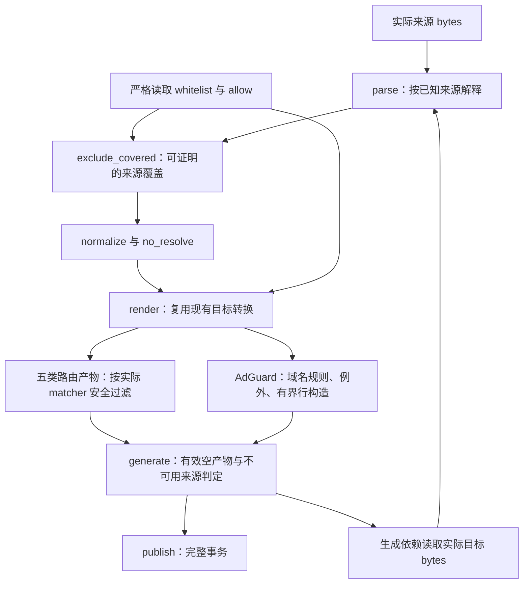

# 功能全面审查的修复设计

## 目标与完成边界

完成基准 `32236187e11d4fbc1f01245989798e6246ac42c6` 上确认的 21 项缺陷修复及 C2 文件迁移，共 22 项任务：R1-R14、F1-F4、N1-N2、C1-C2。交付包含解析、白名单覆盖、目标转换、HTTPS 读取和生产工作流的完整修复、逐项 TDD、独立整体验证及远程 Ubuntu 验收。本规格是编码依据，当前文档提交不表示修复或验收已经完成。

保留七组 `cdn`、`a3`、`a4`、`big-data`、`tg`、`proxy`、`dirt`，每组六文件，共 42 文件：

| 文件 | 消费方式 |
|---|---|
| `fin.txt` | Surge 完整 RULE-SET |
| `fin-qx.txt` | Quantumult X 远程规则，策略占位保持 `LIST` |
| `fin.yaml` | Mihomo classical provider |
| `fin-adb.txt` | AdGuard DNS 域名规则与 `@@` 例外 |
| `fin-surge.txt` | Surge 非 DOMAIN-SET 规则 |
| `fin-surge-ds.txt` | Surge DOMAIN-SET |

继续使用 Python 3.11+ 标准库。公开入口 `Rule`、`parse`、`parse_whitelist`、`normalize`、`exclude_covered`、`render`、`generate`、`publish`、`fetch_https`、`load_config`、`resolve_source` 保持现有调用兼容。禁止在本机启动任何客户端，禁止下载执行客户端或其他外部代码；生产构建不增加客户端、依赖、来源集合、输出格式或平台适配，C2 仅同步现有本地白名单路径。

`static/` 可由用户合法编辑。生成器不得写入该目录；测试和 Actions 不得固定其内容、哈希、指定条目或 Git 工作区状态。输入语法、路径边界、本地白名单的严格校验、发布事务回滚继续保留。C2 仅将现有 `tg-sentinel.txt` 原样迁入 `static/`，不修改其他生产 `static/` 内容。

## 依据与核查范围

已完成的全面扫描覆盖解析、域名覆盖、IP/逻辑、Surge/QX、Mihomo/AdGuard、生成、配置/static、真实上游和 Ubuntu/Actions 九个范围。缺陷依据为本次确认登记、两个已完成反证 journal、generation 和 live-upstreams 完成报告。基线报告记录本地 860 项测试通过，相同源码的 Ubuntu run `38106246073` 通过；这些是前序执行记录，文档代理未重新运行测试。

前序真实来源审查读取全部 56 个唯一 HTTPS 来源、9 个本地来源及 42 个产物，记录远端 17,496,056 bytes、551,256 行，产物 2,499,556 条规则、Git blob 合计 77,011,711 bytes。此数据只作为修改前的规模与完整性参照，禁止作为更新后的固定数量断言。当前源码主链、修改函数的全部生产调用位置及相关测试范围已核查；最终 verification 仍须完成新的全量运行。

固定语义依据如下，引用仅支持对应事实：

- [regexp2 v1.12.0 parser](https://github.com/dlclark/regexp2/blob/3d5df45b703801b3fe51eb3f5c0dd302e8b0d676/syntax/parser.go) 的 `scanDecimal` 使用 MaxInt32，`scanOptions` 接受大小写及 `+`/`-`，`n` 控制显式捕获；本次已核对保存的原始代码对应范围。
- [Mihomo 固定版本 wildcard](https://github.com/MetaCubeX/mihomo/blob/88dcbf7f1614a67c3b36b848ee3592dfa92ada36/component/wildcard/wildcard.go) 按字符串 byte 索引匹配 `?`，方括号为字面字符。[端口构造](https://github.com/MetaCubeX/mihomo/blob/88dcbf7f1614a67c3b36b848ee3592dfa92ada36/rules/common/port.go) 与 `common/utils/range.go`、`ranges.go` 决定 uint16 转换、范围排序和原始分段上限。[ASN matcher](https://github.com/MetaCubeX/mihomo/blob/88dcbf7f1614a67c3b36b848ee3592dfa92ada36/rules/common/ipasn.go) 保留 payload 字符串并与数据库返回的 ASN 字符串直接比较。这些原始范围已核对。
- [现代 Go `ParsePrefix`](https://github.com/golang/go/blob/go1.26.8/src/net/netip/netip.go) 拒绝多位前导零 prefix；[Go 1.20 对应实现](https://github.com/golang/go/blob/go1.20/src/net/netip/netip.go) 没有该额外检查。两者均保留地址 host bits，拒绝 IPv6 zone。本次已核对保存的两个版本。
- [Surge 官方 IP 规则](https://manual.nssurge.com/rules/ip.html) 明确 `IP-ASN` 使用 decimal ASN，也接受 `AS` 前缀。已阅读该页；未运行真实 Surge 的前导零输入。
- [AdGuardHome 固定版本 rulelist parser](https://github.com/AdguardTeam/AdGuardHome/blob/8dedd3278542b45ea21994e24422f5cc53e14b8f/internal/filtering/rulelist/parser.go) 使用 `bufio.MaxScanTokenSize`；对应 Go scanner 上限为 64 KiB，缓冲需容纳换行。[urlfilter v0.23.4 的 regex 识别](https://github.com/AdguardTeam/urlfilter/blob/dba702354cd6a5a0eed03b41da0b22dd46a42af0/rules/network.go) 因 `replace=` 跳过无 modifier 的 regex 路径。已核对原始范围，前序报告提供加载和匹配反证。
- [RFC 9110 §5.6.3](https://www.rfc-editor.org/rfc/rfc9110.html#section-5.6.3) 的 OWS 仅含 SP/HTAB；[§8.4.1.3](https://www.rfc-editor.org/rfc/rfc9110.html#section-8.4.1.3) 要求接收方 SHOULD 将 `x-gzip` 视同 `gzip`。已直接阅读这些章节。
- N2 的 CPython 3.11/3.12/3.13 及 Ubuntu Python 3.12.3 redirect 行为来自已完成的真实 `HTTPResponse` 反证和固定源码报告，最终 transport 任务须在当前环境重新验证。

已收到完整 Surge 恢复反证，F4 依据其固定 VLESS 入站/metadata/tunnel/provider/logical 路径和公开接口复现；未启动 listener 或客户端。[Surge 官方域名语义](https://manual.nssurge.com/rules/domain.html) 明确忽略 hostname 尾根点，本次已通读该页。R14 的公开接口复现位于完成的 coveragecritic `.tmp/coverage-critic/scripts/probe.py`，语义依据已核对的 `scanHexUntilBrace` 原文；F2 的标题边界依据完成的 `title-probe.json`。稳定归档 `completed-report-2026-10-11.md` 已通读，逐项列明全部 92 个 tracked 文件的实际读取/全文程序核查范围及限制；`probe.py` 与 `public-probes.json`记录其文件分类和公开接口对照。已通读 `final-mapping-delta-wf_fc7b3a22-e49-2026-10-11.json`，正式完成映射保留全部 21 项确认缺陷，C2 为新增文件迁移要求。未完成或 API 失败的反证不得写为确认缺陷；后续新确认项须同步增补规格、实施依赖和验收。

## 主链、来源与目标职责

现有 `parse -> exclude_covered -> normalize -> render -> generate -> publish` 主链保留。`Rule.domain_source` 区分 `surge`、`qx`、`mihomo`；`native_fields` 仅表示 native logical 字段解释，不能用它推断全部 matcher 来源。`normalize` 保留 provenance、方向、options、allow 和 literal process 身份。

以下图表示职责和依赖，函数内部保持现有结构。

目标无法表达的 matcher 仅在该目标跳过并计数。确定被白名单覆盖的目标 matcher 属于合法删除，不计为 unsupported。任何逻辑子条件无法表达时仍跳过该目标的完整逻辑规则，不删除子条件来改变真假条件。

## R1-R3：regexp2 与深层正则

### R1：有界数值量词

- 复现输入为 `a{<5000位非零数字>}`、`a{<5000个0>1}`、`a{2147483648}` 及上下界包含该超限值的形式。前两类可触发 CPython 整数转换 `ValueError`；超出 2147483647 的数值不符合固定 regexp2 实现。
- 对 `DOMAIN-REGEX`、`PROCESS-NAME-REGEX`、`PROCESS-PATH-REGEX` 的数值量词按 MaxInt32 验证上下界及顺序，复用已有有界数字检查。给 Python probe 使用规范数字，公共 `Rule.value` 保留合法原文，5000 个前导零加 1 必须成功。禁止提高全局 digit limit，禁止只捕获异常后丢掉合法输入。
- `URL-REGEX` 仍按既有 Python 语义验证。其预期数值转换失败产生非法规则 warning，保留后续合法行；不得套用 regexp2 上限替代 URL 语义。普通/native 来源、quoted 字段、logical、普通来源、本地/远端 whitelist 和生成依赖均不得因本项意外终止。

### R2：inline options 与捕获状态

- `^(?n)ads\.example\.com$`、`^(?-n)ads\.example\.com$`、`^(?in:ads)\.example\.com$`、`^(?I)ads\.example\.com$`、`^(?x+i)ads\.example\.com$` 均须按固定 regexp2 接受并保留原文。
- `_delimiters` 与 `_valid_regex` 共用一致的 options 解释，覆盖 global/scoped、大小写、连续 `+`/`-` 切换。按 `scanOptions` 允许的 inline 集合处理 `i/m/n/s/x/d/u`，不接受 inline `r/e` 或未知字母；`d/u` 不可直接交给 Python options parser。仅实际影响当前验证的状态进入 probe。
- `n` 只关闭普通括号的自动捕获，named/显式编号仍分配捕获槽；退出 scoped group 恢复 `n` 与 `x` 状态。保留有效/无效数字、命名及条件引用，`x` comment 中的逗号、括号、`#` 不得损坏字段范围。options 之后没有量词对象时仍拒绝非法量词。

### R3：非递归深层验证

- 至少 600/1000 层普通捕获、`(?:...)`、`(?i:...)`、`(?n:...)`、`(?x:...)` 的合法来源须通过 `_valid_regex`，保持完整 matcher；全局 recursion limit 不变。
- 扩展既有 `_valid_deep_regex` 的非递归 group 处理，覆盖前置 scanner 实际输出的全部合法 probe header：普通/noncapture、scoped options、转换后的 named capture、lookaround、atomic 及 conditional 结构。来源 scanner 已完成捕获引用和 regexp2 特有转换，fallback 继续验证分组、分支、字符类、escape、量词及 header 结构。不得一律接受 `(?`，不得复制另一个完整 regexp2 parser。
- `formats._dns_pattern` 共用此 helper。DNS 仍单独验证 Go 可表达性、重复次数 1000 的组合限制及 backreference/lookaround 等限制；修复 parser 的深层接受不能扩大 DNS 可表达范围。

## R4-R7：域名字符与端口

### R4：真实 underscore 域名

共享域名校验保留下列七个实际后缀：`piano_log.kingsoft.jp`、`imp_track.zmaticoo.com`、`fb_servpub-a.akamaihd.net`、`at_w_atexxpressdata-c3a3188a23.exxpress.at`、`ad-cdn_core.cctv.com`、`ad_core.cctv.com`、`ad_m.cctv.com`。至少 Mihomo classical 须输出且可重导入。

普通、domainset、native、logical、whitelist、hosts 和裸域名入口共用修正后的字符校验。保留空 label、非法边缘 hyphen、非法字符和原有长度边界。`_wildcard_regex` 与 DNS 调用同步检查新合法字符。其他目标的字符接受须依据其消费语法核查；无法确认的目标局部跳过并计数，不删除公共规则。DNS exact underscore 使用已有 portable 精确锚定 regex 形式，禁止未经核实当作普通 hosts 行输出。

### R5：native wildcard pattern 边界

Mihomo native `*ads*`、`*`、单 label 含 `?` 的 pattern 均保留；不能套用 hostname 的必须含点等形状要求。保留非空、合法 scalar、行安全和实际 native matcher 字段边界，不增加 arbitrary hostname 长度限制。

`*`/`?` 分别保持 native byte matcher 的语义，`[]` 保持字面内容。Surge wildcard 的字符类和字符计数语义不改变，QX 的未知原始语义不合并。顶层、logical、whitelist、Mihomo 输出重导入及 DNS `_dns_pattern` 的调用都使用正确来源边界。DNS native `[]` 仍按现有未证明可表达的目标限制处理。

### R6：普通 logical quoted port

普通顶层和 logical 的 `DEST-PORT`/`DST-PORT`、`SRC-PORT`、`IN-PORT` 对 `"443"`、quoted range、多段及 comparison 使用同一个已解码值。`_normalize_condition` 已算出的 `checked` 必须供验证和规范化使用。`AND`、`OR`、`NOT` 保持顺序与完整结构；native matcher 内层引号仍为字面，不再按普通来源解码。

### R7：native unsigned port ranges

复用 `_valid_unsigned_ranges` 的成熟扫描及既有 port/OR 表示。如需要取得解析后的端点，将现有有界循环整理为共享内部结果，由原 validator 和 native port 共同使用，保持 UID/DSCP 全部行为；不得另写不同语义的 range parser。

| native payload | 规范后的 predicate |
|---|---|
| `443-80` | `80-443` |
| `[80-90]` | `80-90` |
| `/80//443/` | `80` 或 `443`，空段跳过 |
| `80/ /443` | `80`、`0` 或 `443`，非空空白段为 0 |
| `65536` | uint16 转换后的 `0` |
| `65537-65536` | 转换端点后排序为 `0-1` |

原始 uint64 解析上限 18446744073709551615，先做 uint16 转换，再排序端点。原始分隔后的 28 段合法、29 段非法，空段也计入上限；不能在删除空段后才检查。空串、`*`、纯 `/`、`>80`、内层 `"443"` 无效；普通 comparison 保持有效。native `80,443` 中 `443` 是 params，不能当作第二端口。顶层与任意 logical 叶子一致规范为已有端口或 OR，目的/来源方向保持。

## R8-R10：IP 与 ASN

### R8：拒绝 IPv6 scope

含 `%zone` 的裸 IP、CIDR、`SRC-IP`、`DST-IP` alias、source/destination CIDR、suffix 和 logical 叶子均在 `ipaddress` 可能去 zone 之前拒绝，给出准确行号 warning。严格本地 whitelist 仍报输入错误，不能用 scoped whitelist 删除无 scope 规则。

直接公共 `normalize([Rule(...)])` 的 IP/CIDR scope 输入须明确抛出 `ValueError`，在任何 collapse 前完成检查。两个不同 zone 的地址不得扩大成 `/63` 或 `/31`。不通过删除 `%` 后缀修复。正常 IPv4/IPv6 相邻网段、同 options 分组及 source/destination 隔离仍按现有规则 collapse。

### R9：规范 IP-SUFFIX prefix，保留 host bits

采用完整规范化：`192.0.2.7/024 -> 192.0.2.7/24`、`192.0.2.7/00 -> 192.0.2.7/0`、`2001:db8::7/064 -> 2001:db8::7/64`。复用 `ip_interface` 及其地址/prefix 属性，禁止用 `ip_network` 掩掉 suffix 地址 host bits。

普通/native、`IP-SUFFIX`/`SRC-IP-SUFFIX`、方向参数、logical、直接 `normalize` 和生成重导入使用同一规范表示；dotted mask、scope、越界 prefix 继续拒绝。正确说明现代 Go 1.26 与 Go 1.20 的输入差异；规范结果两个版本均可接受。

### R10：普通 decimal ASN 规范化

普通来源 `IP-ASN,0013335` 和 `IP-ASN,AS0013335` 均为 decimal `13335`，顶层、logical、确定的 `src` 参数和普通 `SRC-IP-ASN` 入口一致。验证 uint32 边界，沿用已有 `UNKNOWN` 支持范围。

native ASN `0`、`00`、`0013335` 原始字符串身份全部保留。顶层 native ASN 当前没有独立的来源标志，不能在 `Rule.__post_init__` 或无来源区分的 `normalize` 中无差别规范 ASN。规范化只在普通 parse/logical 已知来源入口执行；native 输出和磁盘重导入不误改。普通 decimal 依据官方说明，不宣称本次执行了 Surge 的前导零输入。

`tests/test_generate.py:1595-1637` 的 native ASN 身份 fixture 当前在 YAML 列表后追加普通 `IP-ASN,00`。U1 将用于 native 身份对照的 `00` 放入自建 native YAML 输入，保留同轮白名单、磁盘重导入、方向及 no_resolve 测试；另行测试普通 `00` 规范为 `0` 并被对应白名单覆盖。

## R11-R13：白名单完整覆盖

### R11：来源覆盖与实际目标覆盖

公共 `exclude_covered` 保留现有 provenance 分组和 ASCII exact/suffix 保护，补充已证明的 Surge white -> Mihomo 子集。覆盖判断必须证明 blocker 的全部匹配集合属于 white；仅命中一个示例不足以删除较宽 matcher。

必须删除的 native 正例：

| Surge whitelist | Mihomo blocker |
|---|---|
| `DOMAIN-KEYWORD,microsoft` | `DOMAIN-KEYWORD,microsoft`、`DOMAIN-KEYWORD,xmicrosofty` |
| 同上 | `DOMAIN,microsoft.com`、`DOMAIN,sub.microsoft.com` |
| 同上 | `DOMAIN-SUFFIX,microsoft.com`、`DOMAIN-SUFFIX,sub.microsoft.com` |
| 同上 | `DOMAIN-WILDCARD,microsoft-*.com` |
| `DOMAIN-WILDCARD,windows-*.net` | 同文的 native `DOMAIN-WILDCARD`、`DOMAIN,windows-abc.net` |

证明范围限定为已核查的 ASCII payload、完整 literal 关系和安全 wildcard 关系：keyword 出现在 constructor 规范后的固定 literal 中，且不依赖末尾根点；Surge wildcard 可匹配固定 native exact literal。同文的仅含 `*` 的 wildcard 还须证明 native 全部命中属于 Surge white：以非 `.` 的必要字面字符结尾时，native 不会额外命中带尾根点的 Host，`windows-*.net` 属于这一安全子集；以 `*` 结尾时只采用已证明可吸收根点的形状，如去掉末尾全部星号后为空或末尾为非 `.` 必要字面字符。`*.*` 和 `*.123.*` 的 native 命中可仅依赖 Host 根点，不能据同文删除。来源覆盖只要求单向子集，不能套用 F4 目标投影的双向等价条件而拒绝 `windows-*.net`。复用现有 literal/keyword/wildcard 处理和 `fnmatchcase`，不引入通用 glob/regex 等价引擎。

必须保留反例：

- native white 反向覆盖 Surge keyword/wildcard，大小写和根点范围不同。
- Surge `windows-??.net` 与 native 同文 wildcard；native `??` 可匹配 `é` 的两个 UTF-8 bytes，Surge 两个字符不等价。
- Surge `api-[0-9].example.com` 与 native 同文 wildcard，native `[]` 是字面。
- 依赖 `microsoft.` keyword 的末尾根点差异，或未证明的 Unicode/simple-fold 关系。
- Surge white 与 native blocker 同文为 `*.*` 或 `*.123.*`，分别在 `localhost.`、`cdn.123.` 上存在 native 命中而 white 不命中。
- native `DOMAIN-SUFFIX,windows-abc.net` 被 `windows-*.net` 覆盖；其子域如 `x.windows-abc.net` 不匹配该 wildcard。
- QX 原始 matcher 的未知 Unicode、case、root-dot、byte 语义。公共 Rule 不因目标输出相同而丢 provenance。

`render` 接收的公共规则可能仍有 QX 来源，但输出已明确使用某个目标 matcher。五类路由文件须在现有转换点按实际目标解释检查覆盖：

1. 一次 materialize `rules` 和 `whitelist`，保留一次性 iterable 支持。路由白名单包含外部 white 和输入中的 allow；DNS allow/white 仍使用 `@@`。
2. 复用 `_domain_value`、`_mihomo_rule`、alias 和现有 payload 编码，取得真正要输出的 matcher，禁止从序列化字符串另写 parser。
3. 实际目标 kind/payload 完全相同的 matcher 可安全过滤。Surge white 投影到 Mihomo 可能为 `DOMAIN-REGEX`，必须比较转换后的 raw matcher；不能只比较转换前的 kind/value。
4. 对 Mihomo 实际 native keyword/suffix/wildcard/exact matcher，复用本项已证明的 Surge -> Mihomo 覆盖；例如 QX keyword 输出成 native `DOMAIN-KEYWORD,microsoft` 后，按该实际目标语义删除。Surge 实际 matcher 按已知 Surge 语义检查。QX 目标只使用已证明的相同 matcher/既有安全覆盖，不新增其未知语义推断。
5. 只有白名单投影保持原范围，或已证明投影范围属于原 white，才可用于跨来源的删除。native white 不得借 Surge 的 case/root-dot 规范扩大原白名单。禁止把所有 white 改成目标来源后直接调用覆盖函数。
6. 为每条规则区分实际 emitted、合法 covered 和 unsupported。现有第二返回值仍为诊断 `dict[str, int]`：目标合法删除使用 `<file>:<kind>:whitelist-covered`，完整路由覆盖使用 `whitelist-covered:<kind>`，已有 `<file>:<kind>` 继续只表示 unsupported。完整覆盖计数仅在该规范规则至少有一个有效路由投影、且四个路由文件中所有有效投影均被覆盖时增加一次；完全不支持的规则不得计入。未保留的接口参数只对真正输出的 QX matcher 记录限制。Surge 完整文件及两个拆分文件保持一致。

`fin-adb.txt` 保留现有 block 和 `@@` 优先语义，应用 F1-F3；无需为路由目标过滤删除合法 DNS 例外。公共 `render(..., whitelist=...)` 必须具备上述路由保护，不能只在 `generate` 修复。

`generate` 在 `276-288` 的空结果判定作最小联动：将 `normalize` 后的同一列表用于一次 `render` 和数量判定。来源可用、全部四个路由文件为空时，只有每条非 allow 规范规则都取得一次完整路由覆盖计数，才发布合法空产物；零规则的既有合法清空和只剩 DNS `@@` 分支保留。部分规则被覆盖但另有完全不支持的规则时仍冻结，不可用来源仍冻结。完整覆盖判定必须逐条区分有效投影与完全不支持的规则。覆盖诊断与 unsupported 诊断分别输出，公开二元返回形状不变。

生成依赖继续读取本轮实际输出 bytes；磁盘重导入继续按文件来源重新解析。禁止新增 canonical Rule 缓存、provenance sidecar 或公共返回值变化。

### R12：Surge 字符类 whitelist

同来源 Surge `cdn-[ab].example.com` white 删除 `cdn-a.example.com`/`cdn-b.example.com`，保留 `cdn-z.example.com`。移除仅对已知 Surge 的 blanket `[` 排除，复用 `fnmatchcase`。QX 字符类仍不推断；Mihomo 方括号仍是字面，不改其 byte wildcard 判断。

### R13：相同 raw DOMAIN-REGEX

相同 raw `DOMAIN-REGEX` blocker 与 white 必须删除，覆盖普通/native parse、`parse_whitelist`、三种 purpose、logical 外部白名单入口和生成重导入。只比较 matcher 原文，保留大小写和不同表达式；不测试任意 regex 等价或执行 regexp2 匹配来推断覆盖。allow 规则继续保留，方向、options 和邻接规则不变。

更新 `tests/test_generate.py:592-828` 中将相同白名单遗漏写为保留的预期：被白名单覆盖的 regex 从 dependent/source 路由产物删除；block DNS 可只剩 `@@` 和未覆盖邻居；skip 应反映真正参与转换的规则。不可通过删除整组深层、磁盘重导入或九种 purpose/no_resolve 保护测试完成修复。

### R14：合法 braced hex 前导零

`\x{0000061}` 及任意更多前导零后数值为 `0x61` 的 braced hex 必须按固定 regexp2 的数值范围接受，保留公共 matcher 原文。`scanHexUntilBrace` 只要求非空 hex 及数值不超过 `0x10FFFF`，不限制原文为 1..6 位。

`rules._valid_regex` 与 `formats._dns_pattern` 使用相同的有界数值结果：先验证全部 hex 字符，去除前导零后按长度/数值界限检查，再供 Python probe 或 DNS 转换使用。禁止把长原文直接交给无界整数转换。覆盖三种 regexp2 类型、普通/native/quoted/logical、whitelist、generate/publish、同轮及磁盘 `fin.yaml` 依赖。DNS canonical hex 使用既有 escape 表示，遵守已有非 ASCII portability 限制；本项只移除错误的文本位数限制。空 hex、非 hex、超过 MaxRune 和缺失 brace 继续拒绝。

## F1-F3：AdGuard DNS 目标

### F1：native uppercase exact hosts

native `DOMAIN,ADS.EXAMPLE.COM` 的 DNS block hosts 输出为 `0.0.0.0 ads.example.com`。仅 DNS 目标作 constructor 等价的 Go simple lowercase；复用 `_PROCESS_CASE_VARIANTS` 的固定范围和现有逐字符映射，覆盖 `İ`、Sigma、Kelvin 等非 ASCII 边界，不用可能改变长度或上下文的整串 Python lowercase。公共 Rule 和 Mihomo native payload 原文保持。network `@@` 例外不因 hosts 结论改变。

### F2：单行限制与有界构造

当前 18 个连续 native `?` 产生约 68,493 bytes 的 DNS 行，超过 AdGuardHome 65,536-byte scanner 缓冲；17/20/32 个分别约 60,536/93,901/405,356 bytes。超限会使整份订阅更新失败。

采用目标局部安全 skip：在现有 `_native_wildcard_regex` 的 `span` 和最终拼接中带入 DNS byte 预算，任何子表达式/拼接确定超出预算便返回不可表达，禁止先生成完整巨量表达式再过滤。可复用已有 cache，但不得缓存或合成超预算字符串。保留现有 UTF-8 byte-span 表达式，不使用 rune `.{N}` 替换 native `?`。

所有 DNS body 和 header 的最终 UTF-8 行连同 `/`、`@@`、`! Title: ` 和 LF 必须不超过 65,536 bytes，使用同一个固定界限。边界已核对：标题 `T` 重复 65,526 次和 `中` 重复 21,842 次，标题行含 LF 均为 65,536 bytes，可以扫描；分别再加一个字符后为 65,537/65,539 bytes，整份扫描失败。注释/header 也须先经过 scanner，不能豁免。

body 超限只增加 `fin-adb.txt:<kind>` skip，其他五类目标保留。formats 任务在 `_dns_pattern` 的共享返回边界保护全部 body，并同步三处 `render` 消费者；私有转换接收实际 block/allow/whitelist 上下文，预算只为例外预留两个 `@@` bytes，全部行预留 LF。不得因统一多预留两个 bytes 跳过本可输出的 block 边界行。普通 exact allow 沿用 `@@|value|`，新 underscore regex 例外使用其实际 pattern，长度检查依据最终行。

同一 formats 任务负责 `render` 最终 header/title 边界，标题超限抛出清楚的 `ValueError`，错误标明 group/title 和 byte 上限；`generate`/CLI 在 publish 前终止本轮，全部旧产物保持，不静默截断标题。保留 `sources.load_config` 既有语法校验，不为本项改动无关配置逻辑。直接 `render` 也执行该保护；全部固定 header 和 fallback group title 一并检查。预算包含 F3 转义后的实际长度，不新增用户配置、自动拆分规则或分段下载。

### F3：消除 regex 的 replace= sentinel

`^(?:replace=)?ads\.example\.com$` 的 DNS 转换保留等价 matcher，将构成 sentinel 的字面 `=` 编码为既有 Go regex 支持的 `\x{3D}`。在现有 regex lexical 转换中处理 literal 上下文，不能对所有原文 `=` 作替换；group header、lookaround、class、已有 escape 的语义保持。

最终 `/REGEX/` 不含使 urlfilter 误走 modifier 解析的 `replace=`，block/allow/whitelist 均能表达，Mihomo 原文保持。保留 `$`/`\z` 锚点、量词和邻接有效 matcher，禁止将本可表达的规则报为 unsupported。验证实际固定 urlfilter 解析结果或前序固定源码对应语义，不能仅以 Python `re` 可编译作为 AdGuard 接受证明。

## F4：Surge 根点敏感的 native 投影

固定 Mihomo VLESS TCP 入站可将带尾根点的 FQDN 原样送到 Rule mode；sniffer 关闭、无 hosts domain alias、无提前截获规则时，`RuleHost()` 保留该点。正常 SOCKS 的裁剪路径不能反证这条已核查的 VLESS 路径。

| native matcher 与 Host | native 结果 | Surge 结果 |
|---|---|---|
| `DOMAIN-KEYWORD,123.`，`cdn.123.` | 命中 | 不命中 |
| `DOMAIN-WILDCARD,*.*`，`localhost.` | 命中 | 不命中 |
| `DOMAIN-WILDCARD,*.123`，`cdn.123.` | 不命中 | 命中 |
| `DOMAIN-WILDCARD,*.123.*`，`cdn.123.` | 命中 | 不命中 |
| `DOMAIN-WILDCARD,*.??*`，`a.b.` | 命中 | 不命中 |

在 `_domain_value` 的 Surge-target 分支实施共享安全判断，顶层与 `_logical_value` 同步消费。native keyword 末尾为 `.` 时不可投影；native wildcard 只有证明追加/去除 hostname 尾根点不改变 predicate 时才可投影。

对当前 native `*`/`?` 与字面 token，采用有依据的充分条件：以 `*` 结尾，去掉末尾全部 `*` 后为空，或最后必要 token 为非 `.` 的字面字符，可由末尾星号吸收尾根点，保留投影；其余不能保留根点区别的 pattern 跳过 Surge。最后必要 token 为 `?` 时不能按字面处理。此条件覆盖全部已复现反例，并保留 `*`、`*.*123*` 等已确认安全形状；含 `?` 的 pattern 还须满足已证明的 byte/字符等价，不能用根点条件代替该核查。`*?123*` 的星号与单个问号只要求非空前缀，可验证后保留，禁止因包含 `?` 一律跳过。其他 case、native `[]` 和 byte 语义保护继续独立执行。禁止只检查 `rstrip('*').endswith('.')`，它遗漏 `*.123` 和 `*.??*`。

保留已确认安全的 native keyword `123`、普通 Surge 相同 pattern、无关邻居和 Mihomo 原 matcher。受影响 Surge 两文件按原 kind 计 skip；任一不支持叶子使完整 `AND`/`OR`/`NOT` 或嵌套表达式跳过，按顶层 operator 各计一次，不能删除叶子。生成/publish 允许 Surge 为空而 Mihomo 有效，不冻结整个组。本项不改变 QX/DNS，不以未知 Unicode/IDNA 或 LAN 推断扩大 skip；可投影还须满足其他已证明语义保护。

## N1-N2：HTTP 读取边界

### N1：gzip OWS 与别名

`Content-Encoding` 按 `strip(' \t').lower()` 后识别单一 `gzip` 和 `x-gzip`，复用现有有界 gzip 解码。真实 `HTTPResponse` 的 SP/HTAB 边缘和混合大小写均返回解压后的原始规则 bytes，普通 source 和 remote whitelist 均正确使用。

保留最终状态 200、原始/解压 `MAX_BYTES`、Content-Length 短读、gzip CRC/截断、空输入和 source URL 错误信息。只移除 ASCII OWS；不新增其他编码、组合编码或未证明 fallback。

### N2：redirect 响应体不读取

现有 urllib 在返回最终 response 前无界读取 redirect body。已复现 Content-Length/chunked 的 67,108,865-byte redirect 后仍返回 22-byte 规则；持续 chunk 也可超过 30 秒，因为 socket timeout 只约束单次等待。

在 `_HttpsOnlyRedirect.redirect_request` 中保留 HTTPS 检查，调用标准库成功取得新的 Request 后关闭旧 `fp`，再返回 Request。关闭后的真实 `HTTPResponse.read()` 为空，使标准库后续 drain 不消费 body。沿用标准库的 Location、相对 URL、301/302/303/307/308 和 loop 规则；失败前不启动不安全请求，不自行写 redirect parser。

验证旧 response body 未被读取、连接关闭、最终 response 仍执行大小/状态/截断/gzip 检查。保留普通 generate 行为，不添加整次下载截止时间或改动 socket timeout 规格。

## C1：static 合法维护

移除 `.github/workflows/main.yml:27-30,49-52` 的 static diff/untracked 状态限制，移除 `tests/test_sources.py:145-155` 的 NoDirect 完整五行断言、`tests/test_workflow.py:31-43` 的状态/指定域名断言。`tests/test_generate.py:4054-4078` 使用自己构造的五条规则 fixture，禁止复制生产 NoDirect 当作固定预期。

合法编辑包括新增/删除条目、重排、注释、UTF-8 BOM、CRLF 和新增本地文件。用隔离副本验证本轮实际内容决定产物，同时记录编辑完成后 static bytes；生成、发布及完整 suite 不再更改这些 bytes。不得把合法编辑写进生产 static 或固定其他永久条目替代原断言。

保留 `publish` 禁止输出 static、root/symlink/path 边界、本地白名单无效/缺失/空输入处理、依赖冻结与发布回滚。Actions 仍先测试同一 `github.sha`，随后生成、更新 README 数量，只 stage 配置决定的 42 个产物和 `README.md`。不得改为全目录 stage 或强推。

## C2：迁移 tg-sentinel 本地白名单

将根目录 `tg-sentinel.txt` 原样迁至 `static/tg-sentinel.txt`，保留文件名及迁移开始时的全部 bytes。`rulesets.json` 的 `tg.whitelist` 将对应条目改为 `static/tg-sentinel.txt`，保持顺序、其余来源、purpose 和 no_resolve 不变。目标已有不同内容时停止迁移并报告，禁止覆盖。

同步 `README.md:71` 的位置说明和相对链接、`tests/test_sources.py:126,217-232` 的路径引用，以及 `tests/test_readme.py:66-73` 的链接检查。移除迁入 static 后的生产 sentinel 固定内容断言，使用自建 fixture 证明本地 white 在远端 LAN 不可用时仍排除对应规则；公开读取保留有效、缺失、无效和空白名单的既有处理。

迁移后根目录旧文件不存在，新路径可由 `resolve_source` 严格解析和读取。用同一份来源快照及同一生成时刻比较仅路径迁移前后的六种 tg 产物、header/body 数量和 README 数量，结果不变。迁移时的 bytes 比较仅验证同一 worktree 的本次原样移动，不固定 CRLF 或跨平台 Git blob，也不作为以后 static 内容或哈希限制。生成和 publish 始终不得改写迁入的文件。C1 的隔离合法编辑矩阵须包含新的 `static/tg-sentinel.txt`，覆盖有效替换、增删、重排、注释、BOM/CRLF 后完整 suite 和实际输入决定的产物；不保留原生产正文断言。其他生产 static 及无关历史文档不修改。

C1 与 C2 归同一 U4 worktree，连续完成必要调用/测试/配置更新、TDD、规格审查、完整验证、复审和提交。Actions 的生产产物 staging 范围不包含本地输入；C2 的源码提交单独包含原样迁移、JSON 路径、README 说明及必要测试。

## 实施归属

四个编码任务均由独立 worktree 的代理连续完成。U1 仅修改 `rules.py` 的公共 parser/来源覆盖、对应测试、`tests/test_generate.py:592-828` 的旧 regex 预期及 `1595-1637` 的 ASN 身份 fixture，不修改 `formats.py` 或 `generate.py`。U2 独占全部 `formats.py`、三处 DNS 消费者、header/title、F4、R11 实际目标覆盖，以及 `generate.py:276-288` 的空判定；先完成独立 F1-F3，再在自己的 worktree 合入完整 U1 提交，完成 R4/R5/R14 消费和全部联动。

U3 仅修改 `generate.py:26-62` 的 transport；U4 完成 C1 的 workflow/指定测试及 `tests/test_generate.py:4054-4078` fixture，并完成 C2 的原样迁移、JSON 路径、README 位置说明和必要测试。U1/U4 不改写对方的测试 hunk，各任务新测试模块独立命名。README 的 C2 路径和 R13/R11 相邻说明全部归 U4；U1/U2 不修改 README。U4 先独立完成 C1/C2 的编码、路径说明、测试、审查、复审和各项提交，再于同一 worktree 接收并合入完整 U1/R13 和 U2/R11 交付，核对实际行为，完成 README 支持范围与诊断说明、完整回归、复审和提交。四任务完整提交后，独立 U5 完成全量集成、真实来源、static 合法编辑与九范围复审；合并/push 后独立 U6 验收真实 Ubuntu 和全部 42 产物。

## 验证条件

每项先保存行为复现的失败测试，再完成最小实现和相应调用方/fixtures/旧预期，随后回归、规格审查、修正、简化、复审和提交。禁止先批量写全部缺陷测试，再批量修改生产代码。每个编码任务及最终 verification 由独立 worktree 的代理连续完成，主会话只合并已完整交付的提交。

| 验证层 | 完成条件 |
|---|---|
| 单项行为 | 正例、反例、warning/exception、原文与来源保护、调用方均符合各 R/F/N/C 条款 |
| 转换矩阵 | `block/direct/proxy` 与 `add/strip/keep`，普通/native/QX、顶层/logical、six outputs、whitelist/allow 均覆盖适用分支 |
| 生成依赖 | 同轮生成 bytes 与磁盘重导入一致；合法过滤发布空产物，不可用来源仍冻结 |
| HTTP | 真实 HTTPResponse、redirect handler 调用链、source/white 集成和限制回归完成；mock 的范围明确 |
| static | 隔离副本合法编辑下完整 suite 通过，生成/发布无输入字节改动，无内容或状态锁定 |
| 真实来源 | 全部配置来源/white 实际下载并保存本地输入快照，七组六格式 42 文件全量检查，无抽样替代 |
| 同快照差异 | 基准和修复提交使用同一真实 source/white/local bytes、解释器和生成时刻，经公开 generate 产生各版本实际依赖；全部 42 文件正文增删、数量及诊断变化逐项解释，未解释变化不得完成。C2 仅按各版本路径读取同一 bytes，不固定生产数量或哈希 |
| 产物 | 头部数量、实际 body 数量、UTF-8/LF、去重、大小、格式、方向/no-resolve、Surge 拆分、DNS 行限与例外、真实 underscore、dirt 已证明 white 全部核对；修复版结构检查不能替代同快照差异比较 |
| coveragecritic | 九个范围独立并行重审，逐项核对读取覆盖、证据、边界和本计划完成情况；补查全部遗漏 |
| 远程 | 合并/push 后真实 Ubuntu `test`、`update`、生成提交和最终 42 文件均核对 commit/run 身份及结果 |

最终检查发现的新确认且可安全修复问题，在独立 verification worktree 内按 TDD 修复、审查、复审及提交，并重跑受影响检查和完整 suite。不得把尚未验证的结果交给主会话补做。详细修改归属、依赖和逐项执行见 `docs/superpowers/plans/2026-10-11-functional-audit.md`。
